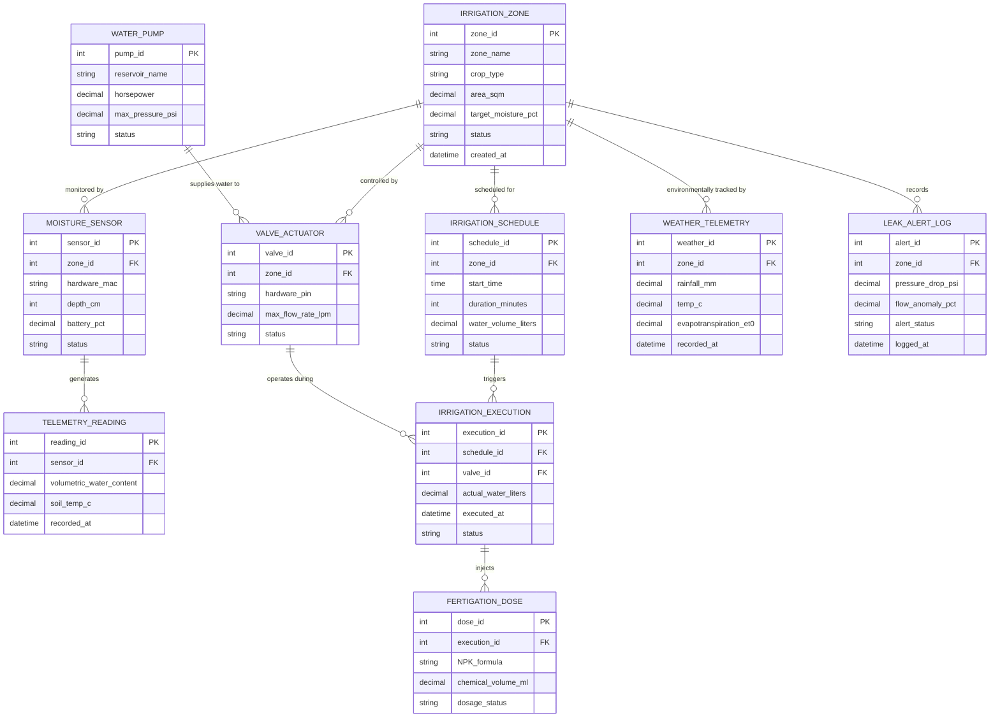

# Conceptual ERD — Smart Irrigation Management System

## Mermaid Code

## Entity Description Table | Bang mo ta Entity

| # | Entity Name | Vietnamese Name | Description | Key Attributes | Main Relationships |
|---|-------------|-----------------|-------------|----------------|-------------------|
| 1 | IRRIGATION_ZONE | Khu Vực Tưới Tái | Specific hydraulic field zone mapped with distinct soil properties and crop water targets | zone_id, zone_name, crop_type, area_sqm, target_moisture_pct, status | Has many MOISTURE_SENSOR, VALVE_ACTUATOR, IRRIGATION_SCHEDULE, WEATHER_TELEMETRY, LEAK_ALERT_LOG |
| 2 | MOISTURE_SENSOR | Cảm Biến Độ Ẩm Đất | Wireless multi-depth soil sensor node measuring volumetric water content and temperature | sensor_id, zone_id, hardware_mac, depth_cm, battery_pct, status | Belongs to IRRIGATION_ZONE; has many TELEMETRY_READING |
| 3 | TELEMETRY_READING | Dữ Liệu Đo Độ Ẩm | Time-series volumetric water content (%) and soil temperature telemetry data point | reading_id, sensor_id, volumetric_water_content, soil_temp_c, recorded_at | Belongs to MOISTURE_SENSOR |
| 4 | VALVE_ACTUATOR | Van Điện Từ Solenoid | Solenoid valve relay actuator controlling hydraulic water flow into a specific field zone | valve_id, zone_id, hardware_pin, max_flow_rate_lpm, status | Belongs to IRRIGATION_ZONE; operates in IRRIGATION_EXECUTION, supplied by WATER_PUMP |
| 5 | WATER_PUMP | Máy Bơm Nước Chính | Hydraulic water pump and variable-frequency drive motor supplying pressurized water from reservoirs | pump_id, reservoir_name, horsepower, max_pressure_psi, status | Supplies water to VALVE_ACTUATOR |
| 6 | IRRIGATION_SCHEDULE | Lịch Tưới Tự Động | Programmed or automated irrigation event schedule specifying target duration and water volume | schedule_id, zone_id, start_time, duration_minutes, water_volume_liters | Belongs to IRRIGATION_ZONE; triggers IRRIGATION_EXECUTION |
| 7 | IRRIGATION_EXECUTION | Nhật Ký Vận Hành Tưới | Log of executed irrigation cycles recording actual water volume consumed and valve operation time | execution_id, schedule_id, valve_id, actual_water_liters, executed_at | Belongs to IRRIGATION_SCHEDULE, VALVE_ACTUATOR; has FERTIGATION_DOSE |
| 8 | FERTIGATION_DOSE | Nhật Ký Bón Phân Lỏng | Log of injected liquid NPK fertilizer and acid chemical dosing during an active irrigation cycle | dose_id, execution_id, NPK_formula, chemical_volume_ml, dosage_status | Belongs to IRRIGATION_EXECUTION |
| 9 | WEATHER_TELEMETRY | Dữ Liệu Thời Tiết & ET0 | Hourly weather observation record detailing rainfall, solar radiation, and calculated ET0 evapotranspiration | weather_id, zone_id, rainfall_mm, temp_c, evapotranspiration_et0, recorded_at | Belongs to IRRIGATION_ZONE |
| 10 | LEAK_ALERT_LOG | Nhật Ký Cảnh Báo Rò Rỉ | Incident log recording differential pressure drops and flow rate anomalies indicating pipe breaks | alert_id, zone_id, pressure_drop_psi, flow_anomaly_pct, alert_status, logged_at | Belongs to IRRIGATION_ZONE |

## Relationship Description | Mo ta Quan he

| # | From Entity | Cardinality | To Entity | Relationship Label | Business Explanation |
|---|-------------|-------------|-----------|-------------------|----------------------|
| 1 | IRRIGATION_ZONE | one-to-many | MOISTURE_SENSOR | monitored by | Một khu vực tưới được lắp đặt nhiều nút cảm biến đo độ ẩm đất ở các độ sâu. |
| 2 | IRRIGATION_ZONE | one-to-many | VALVE_ACTUATOR | controlled by | Một khu vực tưới được điều khiển lưu lượng bởi một hoặc nhiều van điện từ. |
| 3 | IRRIGATION_ZONE | one-to-many | IRRIGATION_SCHEDULE | scheduled for | Một khu vực tưới nhận nhiều lịch tưới tự động được tính toán theo ngày/tuần. |
| 4 | IRRIGATION_ZONE | one-to-many | WEATHER_TELEMETRY | environmentally tracked by | Một khu vực tưới liên tục cập nhật các bản ghi dữ liệu thời tiết và bốc thoát hơi nước ET0. |
| 5 | IRRIGATION_ZONE | one-to-many | LEAK_ALERT_LOG | records | Một khu vực tưới có thể phát sinh các bản ghi cảnh báo sự cố rò rỉ hoặc vỡ đường ống. |
| 6 | MOISTURE_SENSOR | one-to-many | TELEMETRY_READING | generates | Một nút cảm biến gửi về chuỗi nhiều bản ghi dữ liệu đo độ ẩm đất theo thời gian. |
| 7 | IRRIGATION_SCHEDULE | one-to-many | IRRIGATION_EXECUTION | triggers | Một lịch tưới kích hoạt một hoặc nhiều lượt vận hành tưới thực tế trên đồng ruộng. |
| 8 | VALVE_ACTUATOR | one-to-many | IRRIGATION_EXECUTION | operates during | Một van điện từ thực hiện mở/đóng trong nhiều lượt vận hành tưới nước. |
| 9 | WATER_PUMP | one-to-many | VALVE_ACTUATOR | supplies water to | Bơm nước chính cấp áp lực nước cho nhiều van điện từ khu vực hoạt động. |
| 10 | IRRIGATION_EXECUTION | one-to-many | FERTIGATION_DOSE | injects | Một lượt vận hành tưới có thể kết hợp bơm tiêm nhiều liều lượng phân bón lỏng. |
