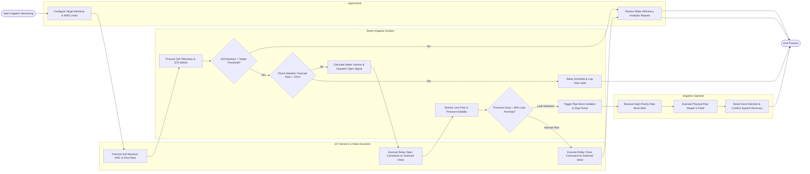

# Swimlane Diagram — Smart Irrigation Management System

## Mermaid Code

## Flow Description | Mo ta luong

| Lane | Actor / Subsystem | Role in Flow |
|------|-------------------|--------------|
| IoT Sensors & Valve Actuators | Field Hardware Array | Measures soil volumetric water content (VWC) at multi-depth root zones, transmits wireless telemetry, and actuates physical solenoid valves. |
| Smart Irrigation System | Automated Core Platform | Processes soil moisture telemetry, computes water deficits, checks weather rain delays, commands valve switching, monitors hydraulic pressure stability, and isolates line leaks. |
| Agronomist | Technical Specialist | Establishes target soil moisture limits, defines crop management allowable depletion (MAD) thresholds, and reviews water utilization reports. |
| Irrigation Operator | Maintenance Technician | Receives automated pipe rupture alerts, performs physical field pipe repairs, and resets system safety interlocks to restore normal operations. |
