# Action Tree — Smart Irrigation Management System

## Mermaid Code

```mermaid
graph TD
    Root["Smart Irrigation Management System"]

    Root --> M1["Zone & Spatial Infrastructure Management"]
    Root --> M2["IoT Sensor Telemetry & Soil Monitoring"]
    Root --> M3["Evapotranspiration & Weather Analytics"]
    Root --> M4["Automated Schedule & Valve Control Engine"]
    Root --> M5["Fertigation & Chemical Dosing Management"]
    Root --> M6["Water Conservation & Regulatory Compliance"]

    M1 --> A11["Map Hydraulic Irrigation Zone Polygons"]
    M1 --> A12["Configure Emitter Types & Flow Rates"]
    M1 --> A13["Register Solenoid Valves & Pump Hardware"]

    M2 --> A21["Ingest Multi-Depth Soil VWC % Telemetry"]
    M2 --> A22["Calibrate Soil TypePermittivity Curves"]
    M2 --> A23["Monitor Sensor Battery & Signal Quality"]

    M3 --> A31["Fetch 7-Day Weather Forecast & Rain Data"]
    M3 --> A32["Compute Penman-Monteith ET0 Evapotranspiration"]
    M3 --> A33["Calculate Net Soil Water Deficit Volume"]

    M4 --> A41["Execute Automated Irrigation Schedules"]
    M4 --> A42["Send Relay Signals to Solenoid Valves"]
    M4 --> A43["Detect Pipe Burst & Line Pressure Drops"]
    M4 --> A44["Execute Emergency Manual Valve Overrides"]

    M5 --> A51["Program NPK Chemical Injection Ratios"]
    M5 --> A52["Monitor Fertigation EC & pH Stream Sensors"]
    M5 --> A53["Execute Post-Fertigation Clean Water Flush"]

    M6 --> A61["Enforce Daily Groundwater Extraction Quotas"]
    M6 --> A62["Track Solar Battery & Power Load Shedding"]
    M6 --> A63["Generate Water Efficiency Crop-Per-Drop Reports"]
    M6 --> A64["Export Water Utility Audit Compliance Files"]
```

## Module Description | Mo ta Module

| # | Module | Description | Actions |
|---|--------|-------------|---------|
| 1 | Zone & Spatial Infrastructure Management | Maps field hydraulic zones, defines emitter discharge rates, and registers physical solenoid valve and pump hardware | Map Hydraulic Irrigation Zone Polygons, Configure Emitter Types & Flow Rates, Register Solenoid Valves & Pump Hardware |
| 2 | IoT Sensor Telemetry & Soil Monitoring | Collects wireless soil moisture readings across 15/30/60cm depths, applies soil texture calibration curves, and monitors sensor node health | Ingest Multi-Depth Soil VWC % Telemetry, Calibrate Soil Type Permittivity Curves, Monitor Sensor Battery & Signal Quality |
| 3 | Evapotranspiration & Weather Analytics | Integrates 7-day weather forecasts, computes Penman-Monteith ET0 evapotranspiration rates, and calculates net soil moisture deficits | Fetch 7-Day Weather Forecast & Rain Data, Compute Penman-Monteith ET0 Evapotranspiration, Calculate Net Soil Water Deficit Volume |
| 4 | Automated Schedule & Valve Control Engine | Dispatches automated valve switching triggers, manages pressure booster pumps, detects pipe leaks, and provides manual hardware bypass | Execute Automated Irrigation Schedules, Send Relay Signals to Solenoid Valves, Detect Pipe Burst & Line Pressure Drops, Execute Emergency Manual Valve Overrides |
| 5 | Fertigation & Chemical Dosing Management | Controls Venturi dosing pumps to inject liquid NPK fertilizers and acid conditioners into irrigation lines while monitoring EC/pH levels | Program NPK Chemical Injection Ratios, Monitor Fertigation EC & pH Stream Sensors, Execute Post-Fertigation Clean Water Flush |
| 6 | Water Conservation & Regulatory Compliance | Enforces groundwater extraction caps, manages off-grid solar power loads, compiles water efficiency analytics, and exports government compliance logs | Enforce Daily Groundwater Extraction Quotas, Track Solar Battery & Power Load Shedding, Generate Water Efficiency Crop-Per-Drop Reports, Export Water Utility Audit Compliance Files |
