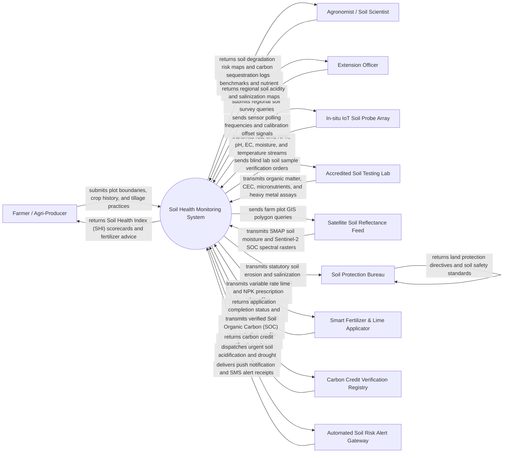

# Context Diagram — Soil Health Monitoring System

## Mermaid Code

## Actor & Interaction Table | Bang Actor & Tuong tac

| # | Actor | Actor Type | Data Sent TO System | Data Received FROM System | Notes |
|---|-------|------------|---------------------|---------------------------|-------|
| 1 | Farmer / Agri-Producer | Primary | Plot GIS boundaries, crop varieties, planting dates, tillage methods, organic amendments | Overall Soil Health Index (SHI) ratings, custom fertilizer schedules, liming advice, yield risk warnings | Agricultural producer managing field fertility and soil health for optimal crop yield |
| 2 | Agronomist / Soil Scientist | Primary | Soil target nutrient benchmarks, crop removal rates, fertilizer reaction models, lime requirements | Spatial NPK deficiency heatmaps, soil organic carbon (SOC) growth models, salinization vectors | Technical expert analyzing physical, chemical, and biological soil health parameters |
| 3 | Extension Officer | Primary | Regional soil survey queries, land degradation reports | Regional soil acidification maps, salt intrusion boundaries, erosion risk advisories | Public advisor assisting farming communities in soil conservation and sustainable land management |
| 4 | In-situ IoT Soil Probe Array | Supporting System | Real-time soil nitrogen ($N$), phosphorus ($P$), potassium ($K$), pH, electrical conductivity ($EC$), moisture ($\%$), temp ($^\circ C$) | Sensor polling intervals, sensor calibration offset parameters, battery health queries | Submersible multi-depth IoT soil sondes measuring root-zone chemical and physical metrics |
| 5 | Accredited Soil Testing Lab | Supporting System | Certified lab analysis for Soil Organic Matter (SOM $\%$), Cation Exchange Capacity (CEC), micronutrients ($Zn, Fe, B, Mn$), heavy metals ($Cd, Pb$) | Blind sample tracking codes, chain of custody logs, laboratory test order requests | ISO/IEC 17025 accredited laboratory processing wet-chemistry soil extractions |
| 6 | Satellite Soil Reflectance Feed | Supporting System | NASA SMAP surface soil moisture, Sentinel-2 MSI topsoil reflectance, bare-soil spectral indices | Plot polygon shapefiles, spectral band query parameters, acquisition timestamps | Remote sensing satellites estimating topsoil moisture, clay content, and organic carbon |
| 7 | Soil Protection Bureau | Regulatory System | Statutory land conservation guidelines, maximum soil loss tolerances, agricultural soil standards | Regional soil degradation audit logs, erosion risk maps, land conservation reports | Government body overseeing agricultural land protection, erosion prevention, and soil health policy |
| 8 | Smart Fertilizer & Lime Applicator | Supporting System | Variable-rate application completion logs, total fertilizer/lime mass applied ($kg$) | Georeferenced VRA prescription shapefiles ($kg/ha$ or $tons/ha$ per management zone) | Tractor-mounted smart fertilizer spreaders and lime applicators executing precision dosage |
| 9 | Carbon Credit Verification Registry | Supporting System | Carbon credit issuance guidelines, baseline measurement protocols | Verified Soil Organic Carbon (SOC) stock changes ($t CO_2e/ha/year$), carbon audit logs | Environmental registry issuing carbon offset credits for verified soil carbon accumulation |
| 10 | Automated Soil Risk Alert Gateway | Supporting System | SMS delivery logs, alert dispatch status | Urgent soil acidification alerts, root-zone drought warnings, high salinization alerts | Communication gateway dispatching immediate warnings to farmers when soil health thresholds fail |

## System Boundary Description | Mo ta Pham vi He thong

The **Soil Health Monitoring System** is an advanced agricultural software platform designed to integrate in-situ IoT soil probe telemetry, laboratory chemical assays, satellite remote sensing, and agronomic modeling to assess soil health, predict degradation, optimize variable-rate fertilization, and track Soil Organic Carbon (SOC) sequestration.

The **system boundary** encompasses soil plot GIS mapping, IoT telemetry ingestion, Soil Health Index (SHI) computation algorithms, salinization and acidification modeling, variable-rate lime/NPK recommendation generation, soil organic carbon stock accounting, and carbon credit verification integration.

**External to the system boundary** are physical soil microbial metabolic processes, physical tractor mechanical lime spreading, laboratory chemical digestion hardware, civil land title legal registration, and satellite orbital constellations. System interfaces connect via MQTT IoT protocols, RESTful web APIs, ISO-XML precision farming formats, and OGC geospatial standards.
