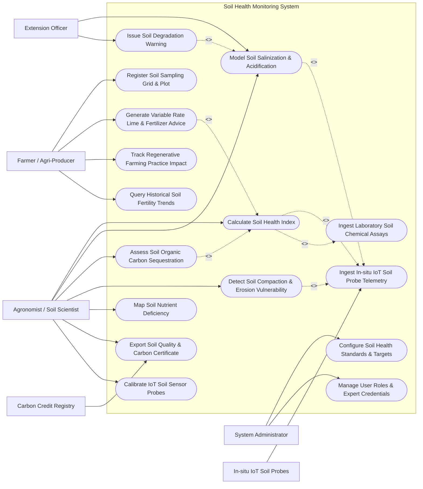

# Use Case Diagram — Soil Health Monitoring System

## Mermaid Code

## Actor Table | Bang Actor

| # | Actor | Actor Type | Role Description | Related Use Cases |
|---|-------|------------|------------------|-------------------|
| 1 | Farmer / Agri-Producer | Primary | Agricultural producer defining field plots, inputting tillage practices, and receiving VRA fertilizer advice | UC01, UC06, UC11, UC12 |
| 2 | Agronomist / Soil Scientist | Primary | Domain specialist modeling soil chemistry, calculating Soil Health Index (SHI), and evaluating carbon stocks | UC03, UC05, UC07, UC08, UC09, UC13, UC15 |
| 3 | Extension Officer | Primary | Public field advisor monitoring regional soil degradation, salinization intrusion, and erosion risks | UC05, UC10 |
| 4 | System Administrator | Primary | Technical administrator configuring soil standards (USDA/FAO), calibration rules, and user roles | UC14, UC16 |
| 5 | In-situ IoT Soil Probes | Secondary / System | Multi-depth soil sondes measuring real-time nitrogen, phosphorus, potassium, pH, EC, and moisture | UC02 |
| 6 | Carbon Credit Registry | Secondary / System | External environmental registry verifying soil organic carbon accumulation for carbon offset credits | UC13 |

## Use Case Table | Bang Use Case

| # | UC ID | Use Case Name | Primary Actor | Secondary Actor | Description | Priority |
|---|-------|---------------|---------------|-----------------|-------------|----------|
| 1 | UC01 | Register Soil Sampling Grid & Plot | Farmer / Agri-Producer | None | Defines farm plot boundaries, soil textural classification, elevation, and sampling grid nodes | High |
| 2 | UC02 | Ingest In-situ IoT Soil Probe Telemetry | System | IoT Soil Probes | Ingests real-time multi-depth soil NPK, pH, electrical conductivity ($EC$), and moisture streams | High |
| 3 | UC03 | Calculate Soil Health Index | Agronomist | System | Computes physical, chemical, and biological sub-indices to output overall Soil Health Index ($0-100$) | High |
| 4 | UC04 | Ingest Laboratory Soil Chemical Assays | Agronomist | Testing Lab | Ingests certified lab test results for Organic Matter (SOM %), Cation Exchange Capacity (CEC), and heavy metals | High |
| 5 | UC05 | Model Soil Salinization & Acidification | Agronomist | Extension Officer | Simulates electrical conductivity ($EC$) accumulation, sodium adsorption ratio ($SAR$), and pH drops | High |
| 6 | UC06 | Generate Variable Rate Lime & Fertilizer Advice | Farmer / Agri-Producer | Agronomist | Computes precise VRA lime ($tons/ha$) and N-P-K ($kg/ha$) prescription maps for smart machinery | High |
| 7 | UC07 | Assess Soil Organic Carbon Sequestration | Agronomist | Carbon Registry | Quantifies Soil Organic Carbon (SOC) stock changes ($t CO_2e/ha/yr$) using RothC / DAYCENT models | High |
| 8 | UC08 | Detect Soil Compaction & Erosion Vulnerability | Agronomist | System | Evaluates bulk density ($g/cm^3$), penetration resistance ($kPa$), and RUSLE water/wind erosion risks | Medium |
| 9 | UC09 | Map Soil Nutrient Deficiency | Agronomist | System | Renders spatial raster heatmaps highlighting nitrogen, phosphorus, potassium, and zinc deficiency zones | High |
| 10 | UC10 | Issue Soil Degradation Warning | Extension Officer | System | Dispatches emergency alerts when soil pH drops $<4.5$ or EC exceeds salinization limit ($>4.0\text{ dS/m}$) | High |
| 11 | UC11 | Track Regenerative Farming Practice Impact | Farmer / Agri-Producer | None | Monitors changes in soil organic matter and microbial activity following cover cropping or no-till | Medium |
| 12 | UC12 | Query Historical Soil Fertility Trends | Farmer / Agri-Producer | None | Provides searchable historical database of multi-year NPK levels, pH trends, and crop yields | Low |
| 13 | UC13 | Export Soil Quality & Carbon Certificate | Agronomist | Carbon Registry | Exports certified soil health scorecards and verified soil carbon credit compliance packages | High |
| 14 | UC14 | Configure Soil Health Standards & Targets | System Administrator | None | Configures optimal target NPK, pH, and organic matter ranges per crop species and soil type | Medium |
| 15 | UC15 | Calibrate IoT Soil Sensor Probes | Agronomist | IoT Soil Probes | Adjusts probe calibration slopes, temperature compensation factors, and moisture dielectric curves | Medium |
| 16 | UC16 | Manage User Roles & Expert Credentials | System Administrator | None | Manages user accounts, agronomist certified soil scientist credentials, and system permissions | Low |

## Use Case Specification | Dac ta Use Case

---

### UC02 — Ingest In-situ IoT Soil Probe Telemetry

| Field | Detail |
|-------|--------|
| **UC ID** | UC02 |
| **Use Case Name** | Ingest In-situ IoT Soil Probe Telemetry |
| **Actor(s)** | Primary: System   Secondary: In-situ IoT Soil Probes |
| **Description** | Ingests real-time, multi-depth soil sensor probe telemetry (Nitrogen, Phosphorus, Potassium, pH, Electrical Conductivity, Volumetric Water Content, Temperature) via MQTT/LoRaWAN protocols. |
| **Precondition** | 1. Soil sensor probes are installed in sampling grid nodes and registered in system (UC01).   2. Sensor IoT gateway wireless communication link is active. |
| **Main Flow** | 1. Soil probe sensors take readings at multi-depth root zones (e.g., $15\text{ cm}, 30\text{ cm}, 60\text{ cm}$) every 15 minutes.   2. Probe IoT gateway packages telemetry payload: Station ID, Probe Serial Number, Sampling Depth, Timestamp, Available Nitrogen ($mg/kg$), Available Phosphorus ($mg/kg$), Available Potassium ($mg/kg$), Soil pH, Electrical Conductivity ($dS/m$), Volumetric Water Content ($\%$ VWC), and Soil Temperature ($^\circ C$).   3. Gateway transmits payload to System MQTT broker over TLS-encrypted connection.   4. System ingests packet, parses sensor depth layers, and validates data payload integrity.   5. System checks values against physical boundaries (e.g., checks if $pH < 2.0$ or $> 12.0$, or VWC $> 100\%$ indicating sensor failure).   6. System applies soil-specific calibration dielectric curves (e.g., clay vs sand calibration offset) based on active calibration log (UC15).   7. System stores validated telemetry records in time-series database.   8. System updates real-time soil plot dashboard and triggers Soil Health Index (SHI) calculations (UC03). |
| **Alternative Flow** | **AF1** — LoRaWAN Low-Power Batching: Probe gateway batches 6-hour sensor logs into a single compressed LoRaWAN payload to conserve solar battery life. |
| **Exception Flow** | **EX1** — Probe Desiccation / Air Pocket Alert: Sensor VWC drops to $0\%$ while EC reads zero, indicating soil cracking or air pocket separation from probe; system flags `SENSOR_AIR_GAP_FAULT` and alerts agronomist.   **EX2** — Unauthorized Gateway API Key: Gateway payload fails authentication, system drops packet and logs security alert. |
| **Postcondition** | Calibrated multi-depth soil telemetry stored in database and available for soil health calculations. |
| **Business Rule** | **BR1**: Raw sensor voltage/frequency values must be archived alongside converted chemical concentration metrics for audit integrity. |

---

### UC03 — Calculate Soil Health Index (SHI)

| Field | Detail |
|-------|--------|
| **UC ID** | UC03 |
| **Use Case Name** | Calculate Soil Health Index (SHI) |
| **Actor(s)** | Primary: Agronomist / Soil Scientist   Secondary: System |
| **Description** | Integrates physical (bulk density, moisture retention), chemical (pH, EC, NPK, CEC), and biological (soil organic matter, microbial biomass) indicators using non-linear scoring functions (SMAF / Cornell CASH framework) to output an overall Soil Health Index (SHI $0-100$). |
| **Precondition** | 1. Ingested IoT soil telemetry (UC02) or lab soil assays (UC04) are recorded for target plot.   2. Optimal soil indicator scoring functions are configured for target soil textural class (e.g., Sandy Loam, Clay). |
| **Main Flow** | 1. System retrieves latest soil indicator values for target plot: pH, Electrical Conductivity ($EC$), Available N, P, K, Soil Organic Matter ($\text{SOM}\%$), Cation Exchange Capacity ($\text{CEC}$), Bulk Density ($g/cm^3$), and Aggregate Stability ($\%$).   2. System calculates **Physical Sub-Index ($S_{phys}$)** using non-linear scoring curves for bulk density and water retention.   3. System calculates **Chemical Sub-Index ($S_{chem}$)** using "More is Better" (SOM, NPK) and "Optimum Range" (pH $6.0-7.0$, EC $< 2.0\text{ dS/m}$) scoring functions:   &nbsp;&nbsp;&nbsp;&nbsp;$$S_i = \frac{1}{1 + \left( \frac{x_0}{x} \right)^b}$$   4. System calculates **Biological Sub-Index ($S_{biol}$)** based on Soil Organic Matter ($\%$) and respiration rates.   5. System computes overall weighted **Soil Health Index (SHI)** ($0 - 100$):   &nbsp;&nbsp;&nbsp;&nbsp;$$\text{SHI} = w_1 S_{phys} + w_2 S_{chem} + w_3 S_{biol}$$   6. System maps SHI score to standardized soil health tier categories:   &nbsp;&nbsp;&nbsp;&nbsp;a. **85 - 100** (Green): `Very Healthy / Optimal`   &nbsp;&nbsp;&nbsp;&nbsp;b. **70 - 84** (Light Green): `Good / Mild Deficiency`   &nbsp;&nbsp;&nbsp;&nbsp;c. **55 - 69** (Yellow): `Moderate / Action Recommended`   &nbsp;&nbsp;&nbsp;&nbsp;d. **40 - 54** (Orange): `Poor / High Degradation Risk`   &nbsp;&nbsp;&nbsp;&nbsp;e. **< 40** (Red): `Severely Degraded / Immediate Remediation Required`   7. System displays SHI scorecard, highlighting limiting soil constraint parameters (e.g., "Low organic matter limiting nutrient retention"). |
| **Alternative Flow** | **AF1** — Simplified IoT-Only SHI: If lab biological assays are pending, system computes preliminary "Real-Time Chemical-Physical SHI" using IoT probe data alone. |
| **Exception Flow** | **EX1** — Extreme Acidification Override: Soil pH $< 4.2$ (aluminum toxicity threshold); overall SHI score is automatically capped at maximum 35 regardless of high NPK levels. |
| **Postcondition** | Calculated SHI score, sub-index breakdowns, and limiting soil constraint factors stored in database. |
| **Business Rule** | **BR1**: SHI scoring functions must be calibrated against specific regional soil series (USDA Soil Taxonomy). |

---

### UC05 — Model Soil Salinization & Acidification Risk

| Field | Detail |
|-------|--------|
| **UC ID** | UC05 |
| **Use Case Name** | Model Soil Salinization & Acidification Risk |
| **Actor(s)** | Primary: Agronomist / Soil Scientist   Secondary: Extension Officer |
| **Description** | Simulates long-term accumulation of soluble salts (Electrical Conductivity $EC$, Sodium Adsorption Ratio $SAR$) and soil pH drop caused by saline irrigation water, chemical fertilizer overuse, or coastal salt wedge intrusion. |
| **Precondition** | 1. Soil telemetry ($EC$, pH, Sodium $Na^+$, Calcium $Ca^{2+}$, Magnesium $Mg^{2+}$) is available.   2. Irrigation water salinity and fertilizer application history are logged. |
| **Main Flow** | 1. Agronomist selects target farm plot and opens "Soil Salinity & Acidification Model".   2. System retrieves historical soil $EC$ ($dS/m$), pH readings, irrigation water EC ($EC_{iw}$), and leaching fraction ($LF$).   3. System calculates **Sodium Adsorption Ratio (SAR)**:   &nbsp;&nbsp;&nbsp;&nbsp;$$\text{SAR} = \frac{[Na^+]}{\sqrt{\frac{1}{2} ([Ca^{2+}] + [Mg^{2+}])}}$$   4. System executes solute transport model to project root-zone electrical conductivity ($EC_e$) accumulation over the next 12 months.   5. System evaluates crop salt tolerance threshold ($EC_e$ threshold for target crop, e.g., $1.7\text{ dS/m}$ for corn, $3.0\text{ dS/m}$ for wheat).   6. System projects soil pH acidification rate ($\Delta pH / year$) based on ammonium-based fertilizer nitrogen loading rates.   7. System rates salinization/acidification risk: `LOW`, `MODERATE`, `HIGH`, or `CRITICAL`.   8. System generates spatial risk maps and recommends leaching fraction requirements ($LF\%$) or lime buffering applications. |
| **Alternative Flow** | **AF1** — Coastal Salt Wedge Intrusion Event: System integrates tidal river salinity telemetry to predict rapid soil salinization during dry-season estuarine salt wedge intrusion. |
| **Exception Flow** | **EX1** — Sodic Soil Hazard Detected: $SAR > 13$ and $EC > 4.0\text{ dS/m}$ (Sodic/Saline-Sodic condition); system flags severe soil structure collapse risk and recommends immediate gypsum ($CaSO_4$) treatment. |
| **Postcondition** | Salinization growth curves, SAR values, and leaching/liming mitigation requirements logged in database. |
| **Business Rule** | **BR1**: Leaching requirement calculation must follow FAO Irrigation and Drainage Paper 29 standards. |

---

### UC06 — Generate Variable Rate Lime & Fertilizer Recommendation

| Field | Detail |
|-------|--------|
| **UC ID** | UC06 |
| **Use Case Name** | Generate Variable Rate Lime & Fertilizer Advice |
| **Actor(s)** | Primary: Farmer / Agri-Producer   Secondary: Agronomist / Soil Scientist |
| **Description** | Combines Soil Health Index scores, target crop yield goals, soil buffer pH, and NPK deficiency maps to generate georeferenced Variable Rate Application (VRA) lime ($tons/ha$) and fertilizer ($kg/ha$) prescription shapefiles for smart agricultural machinery. |
| **Precondition** | 1. Soil Health Index (UC03) and Nutrient Deficiency Maps (UC09) are complete.   2. Farmer inputs target crop species and target yield goal (e.g., $10\text{ tons/ha}$ corn). |
| **Main Flow** | 1. Farmer opens "Fertilizer & Lime Prescription Engine".   2. Farmer selects target crop species, target yield goal, and preferred fertilizer commercial products (e.g., NPK 16-16-8, Urea 46%, Agricultural Lime $CaCO_3$).   3. System retrieves spatial soil test layers: available N, P, K ($mg/kg$), soil pH, and cation exchange capacity ($\text{CEC}$).   4. System calculates net nutrient requirements:   &nbsp;&nbsp;&nbsp;&nbsp;$$\text{Nutrient Requirement} = (\text{Crop Removal Rate} \times \text{Yield Goal}) - \text{Soil Available Nutrient} \times \text{Efficiency Factor}$$   5. System calculates lime requirement ($tons/ha$) based on Shoemaker-McLean-Pratt (SMP) buffer pH method to raise pH to target $6.5$.   6. System divides field parcel into $10\text{m} \times 10\text{m}$ spatial management zones based on soil variation.   7. System computes exact prescription dosage ($kg/ha$ of NPK / Lime) for each spatial zone.   8. System generates VRA prescription file package formatted as ISO-XML (ISO 11783) and Shapefile (.shp/.dbf).   9. Farmer downloads prescription package to USB drive or transfers directly to smart tractor terminal. |
| **Alternative Flow** | **AF1** — Organic Farming Mode: System restricts fertilizer recommendations strictly to approved organic amendments (compost, rock phosphate, poultry manure, biochar). |
| **Exception Flow** | **EX1** — Excessive Fertilizer Limit Warning: Calculated nitrogen application rate exceeds maximum legal environmental limit ($>200\text{ kg N/ha}$); system caps prescription rate and displays environmental leaching warning. |
| **Postcondition** | Georeferenced VRA lime and fertilizer prescription shapefile package created, saved, and ready for tractor application. |
| **Business Rule** | **BR1**: Lime application recommendations must not exceed $5\text{ tons/ha}$ in a single application to prevent micronutrient lockup. |

---

### UC07 — Assess Soil Organic Carbon Sequestration

| Field | Detail |
|-------|--------|
| **UC ID** | UC07 |
| **Use Case Name** | Assess Soil Organic Carbon Sequestration |
| **Actor(s)** | Primary: Agronomist / Soil Scientist   Secondary: Carbon Credit Verification Registry |
| **Description** | Models and quantifies Soil Organic Carbon (SOC) stock changes ($t CO_2e/ha/year$) over time by combining baseline soil organic matter testing, cover crop adoption, tillage reduction, and biogeochemical carbon models (RothC / DAYCENT). |
| **Precondition** | 1. Baseline Soil Organic Carbon (SOC) stock ($t C/ha$ at $0-30\text{ cm}$ depth) is established (UC04).   2. Regenerative farming practices (no-till, cover cropping, manure application) are logged (UC11). |
| **Main Flow** | 1. Agronomist selects target farm plot and opens "Soil Carbon Accounting" module.   2. System retrieves baseline SOC stock ($t C/ha$), soil clay content ($\%$), bulk density ($g/cm^3$), and historical climate data.   3. System retrieves logged management practice changes: Tillage Reduction (Conventional to No-Till), Cover Crop species & biomass, Residue Retention ($\%$), and Organic Amendment inputs.   4. System executes RothC (Rothamsted Carbon Model) biogeochemical simulation to partition carbon into pool fractions: Decomposable Plant Material (DPM), Resistant Plant Material (RPM), Microbial Biomass (BIO), and Humified Organic Matter (HUM).   5. System projects SOC stock changes over a 10-year horizon ($t C/ha$).   6. System calculates net carbon sequestration rate and converts to equivalent carbon dioxide equivalent:   &nbsp;&nbsp;&nbsp;&nbsp;$$\text{Sequestration Rate } (t CO_2e/ha/yr) = \Delta \text{SOC } (t C/ha/yr) \times 3.667$$   7. System compiles Soil Carbon Audit Dossier including model inputs, satellite baseline verification, and uncertainty bounds ($\pm 15\%$).   8. System submits carbon sequestration dossier to Carbon Credit Verification Registry (UC13). |
| **Alternative Flow** | **AF1** — Direct Core Sampling Validation: Agronomist uploads physical deep core lab carbon combustion test results ($0-30\text{ cm}, 30-60\text{ cm}$) to validate and recalibrate RothC model predictions. |
| **Exception Flow** | **EX1** — Reversal Event Detected: Farmer re-plows no-till field (deep tillage), releasing stored carbon; system models carbon loss reversal event and adjusts cumulative carbon credit balance downward. |
| **Postcondition** | Soil Organic Carbon (SOC) sequestration rate quantified, uncertainty bounds established, and carbon credit audit dossier generated. |
| **Business Rule** | **BR1**: SOC stock calculations must cover a minimum topsoil depth of $0 - 30\text{ cm}$ using bulk density correction to account for soil compaction. |
