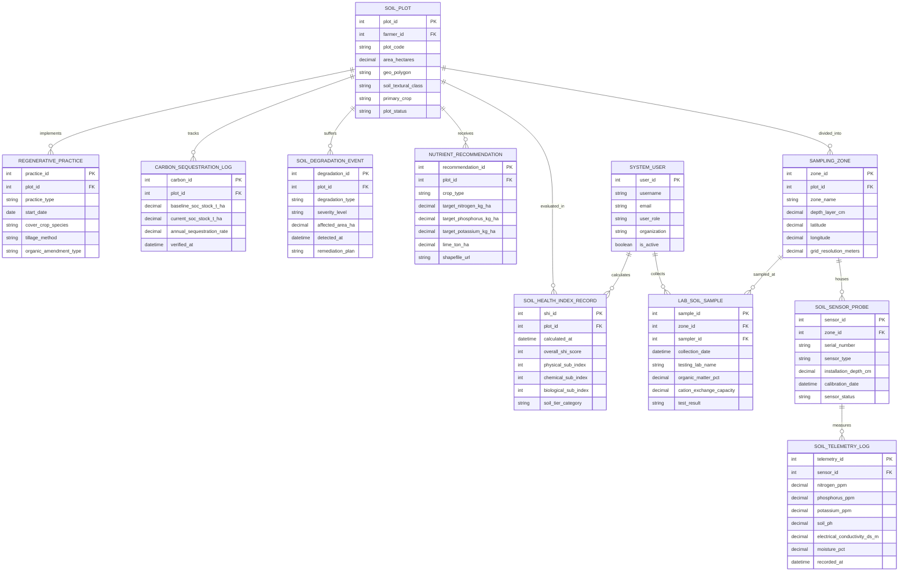

# Conceptual ERD — Soil Health Monitoring System

## Mermaid Code

## Entity Description Table | Bang mo ta Entity

| # | Entity Name | Vietnamese Name | Description | Key Attributes | Main Relationships |
|---|-------------|-----------------|-------------|----------------|-------------------|
| 1 | SOIL_PLOT | Thửa Đất Nông Nghiệp | Stores farm plot master records, GIS boundary polygons, soil texture (clay, loam, sand), primary crop, and area | plot_id, farmer_id, plot_code, area_hectares, geo_polygon, soil_textural_class, plot_status | Divided into SAMPLING_ZONE, receives RECOMMENDATION, tracks CARBON |
| 2 | SAMPLING_ZONE | Vùng / Lưới Lấy Mẫu Đất | Represents grid sampling nodes, depth layers ($0-15\text{ cm}, 15-30\text{ cm}$), GIS point coordinates, and grid resolution | zone_id, plot_id, zone_name, depth_layer_cm, latitude, longitude, grid_resolution_meters | Belongs to SOIL_PLOT, houses SENSOR_PROBE, sampled at LAB_SAMPLE |
| 3 | SOIL_SENSOR_PROBE | Cảm Biến Đất Trong Đất | Stores submersible soil sensor sonde profiles, installation depth, sensor types (NPK, pH, EC, VWC), and calibration dates | sensor_id, zone_id, serial_number, sensor_type, installation_depth_cm, sensor_status | Housed in SAMPLING_ZONE, measures TELEMETRY_LOG |
| 4 | SOIL_TELEMETRY_LOG | Nhật Ký Dữ Liệu Cảm Biến Đất | High-frequency telemetry storing soil NPK ($mg/kg$), pH, electrical conductivity ($dS/m$), moisture ($\%$), and temperature | telemetry_id, sensor_id, nitrogen_ppm, soil_ph, electrical_conductivity_ds_m, moisture_pct, recorded_at | Measured by SOIL_SENSOR_PROBE |
| 5 | LAB_SOIL_SAMPLE | Mẫu Đất Kiểm Nghiệm Lab | Captures certified laboratory test results for Soil Organic Matter (SOM %), CEC, micronutrients, and heavy metal assays | sample_id, zone_id, sampler_id, collection_date, organic_matter_pct, test_result | Sampled at SAMPLING_ZONE, collected by SYSTEM_USER |
| 6 | SOIL_HEALTH_INDEX_RECORD | Kết Quả Chỉ Số Sức Khỏe Đất | Stores computed Soil Health Index (SHI $0-100$) scores, physical/chemical/biological sub-indices, and soil tier categories | shi_id, plot_id, calculated_at, overall_shi_score, physical_sub_index, chemical_sub_index, soil_tier_category | Evaluated for SOIL_PLOT, calculated by SYSTEM_USER |
| 7 | NUTRIENT_RECOMMENDATION | Khuyến Cáo Phân Bón Biến Thiên | Formulates variable-rate N-P-K ($kg/ha$) and lime ($tons/ha$) application prescriptions, target crop goals, and shapefile URLs | recommendation_id, plot_id, crop_type, target_nitrogen_kg_ha, lime_ton_ha, shapefile_url | Received by SOIL_PLOT |
| 8 | SOIL_DEGRADATION_EVENT | Biến Cố Suy Thoái Đất | Records soil degradation incidents (acidification, salinization, compaction, erosion), severity levels, and remediation plans | degradation_id, plot_id, degradation_type, severity_level, affected_area_ha, remediation_plan | Suffered by SOIL_PLOT |
| 9 | CARBON_SEQUESTRATION_LOG | Nhật Ký Tích Lũy Carbon Đất | Tracks baseline and current Soil Organic Carbon (SOC) stocks ($t C/ha$) and annual carbon sequestration rates ($t CO_2e/ha/yr$) | carbon_id, plot_id, baseline_soc_stock_t_ha, current_soc_stock_t_ha, annual_sequestration_rate, verified_at | Tracked for SOIL_PLOT |
| 10 | REGENERATIVE_PRACTICE | Thực Hành Nông Nghiệp Tái Sinh | Logs adoption of regenerative practices (no-till, cover crops, green manure, biochar, reduced chemical inputs) | practice_id, plot_id, practice_type, start_date, cover_crop_species, tillage_method | Implemented on SOIL_PLOT |
| 11 | SYSTEM_USER | Người Dùng Hệ Thống | Stores user accounts, roles (Farmer, Agronomist, Extension Officer, Admin), organizations, and expert qualifications | user_id, username, user_role, organization, is_active | Collects LAB_SOIL_SAMPLE, calculates SOIL_HEALTH_INDEX_RECORD |

## Relationship Description | Mo ta Quan he

| # | From Entity | Cardinality | To Entity | Relationship Label | Business Explanation |
|---|-------------|-------------|-----------|-------------------|----------------------|
| 1 | SOIL_PLOT | one-to-many | SAMPLING_ZONE | divided_into | A farm soil plot is divided into multiple spatial grid sampling zones and depth layers |
| 2 | SAMPLING_ZONE | one-to-many | SOIL_SENSOR_PROBE | houses | A sampling zone houses multi-depth in-situ IoT soil sensor sondes (15cm, 30cm, 60cm) |
| 3 | SOIL_SENSOR_PROBE | one-to-many | SOIL_TELEMETRY_LOG | measures | A soil sensor probe measures high-frequency NPK, pH, EC, and moisture telemetry over time |
| 4 | SAMPLING_ZONE | one-to-many | LAB_SOIL_SAMPLE | sampled_at | Physical soil core samples are collected at specific registered sampling zones for lab analysis |
| 5 | SOIL_PLOT | one-to-many | SOIL_HEALTH_INDEX_RECORD | evaluated_in | A soil plot undergoes periodic Soil Health Index (SHI) evaluations over crop seasons |
| 6 | SOIL_PLOT | one-to-many | NUTRIENT_RECOMMENDATION | receives | A soil plot receives variable-rate lime and N-P-K fertilizer recommendations per crop cycle |
| 7 | SOIL_PLOT | one-to-many | SOIL_DEGRADATION_EVENT | suffers | A soil plot can suffer from degradation events such as salinization, acidification, or erosion |
| 8 | SOIL_PLOT | one-to-many | CARBON_SEQUESTRATION_LOG | tracks | A soil plot tracks Soil Organic Carbon (SOC) stock changes over multi-year horizons |
| 9 | SOIL_PLOT | one-to-many | REGENERATIVE_PRACTICE | implements | A soil plot implements regenerative farming practices (cover crops, no-till, biochar) |
| 10 | SYSTEM_USER | one-to-many | LAB_SOIL_SAMPLE | collects | A sampling technician user collects field soil core samples for laboratory analysis |
| 11 | SYSTEM_USER | one-to-many | SOIL_HEALTH_INDEX_RECORD | calculates | An agronomist user calculates and validates Soil Health Index (SHI) scorecards |
