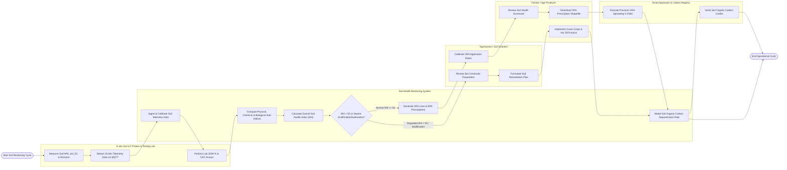

# Swimlane Diagram — Soil Health Monitoring System

## Mermaid Code

## Flow Description | Mo ta luong

| Lane | Actor | Role in Flow |
|------|-------|-------------|
| 1 | In-situ Soil IoT Probes & Testing Lab | Multi-depth submersible soil sondes measure root-zone chemical/physical metrics (NPK, pH, EC, VWC) and stream 15-minute telemetry over TLS MQTT, while wet-chemistry labs process Soil Organic Matter (SOM %) and CEC assays |
| 2 | Soil Health Monitoring System | Ingests and calibrates soil telemetry data, calculates physical, chemical, and biological sub-indices, computes overall Soil Health Index (SHI $0-100$), evaluates acidification/salinization risks, generates VRA prescription shapefiles, and models Soil Organic Carbon (SOC) accumulation |
| 3 | Agronomist / Soil Scientist | Reviews limiting soil constraint parameters, calibrates variable-rate lime and NPK application rates against target yield goals, formulates soil remediation plans, and validates carbon accounting models |
| 4 | Farmer / Agri-Producer | Views digital soil health scorecards, downloads georeferenced VRA fertilizer/lime prescription shapefiles, adopts regenerative practices (no-till, cover crops, biochar), and tracks long-term plot fertility |
| 5 | Smart Applicator & Carbon Registry | Tractor-mounted smart spreaders execute variable-rate lime/NPK application according to prescription shapefiles, while the carbon registry verifies soil organic carbon accumulation for carbon offset credits |
