# Action Tree — Soil Health Monitoring System

## Mermaid Code

```mermaid
graph TD
    Root["Soil Health Monitoring System"]

    Root --> M1["Soil Plot & Sampling Grid Management"]
    Root --> M2["IoT Telemetry & Lab Chemical Ingestion"]
    Root --> M3["Soil Health Index & Nutrient Mapping"]
    Root --> M4["Salinization, Acidification & Degradation"]
    Root --> M5["Variable Rate Lime & Fertilizer Advice"]
    Root --> M6["Soil Carbon & Regenerative Practices"]
    Root --> M7["Sensor Calibration & System Admin"]

    M1 --> A11["Register Farm Soil Plot GIS Polygon"]
    M1 --> A12["Define Grid Sampling Nodes & Depth Layers"]
    M1 --> A13["Set Soil Textural Classification"]
    M1 --> A14["Link Plot to Nearest Weather & IoT Probes"]

    M2 --> A21["Ingest 15-Minute IoT Soil NPK & pH Streams"]
    M2 --> A22["Ingest Lab Organic Matter SOM & CEC Assays"]
    M2 --> A23["Ingest Satellite SMAP Soil Moisture Rasters"]
    M2 --> A24["Filter Probe Air Gap & Desiccation Signals"]

    M3 --> A31["Calculate Physical, Chemical & Biological Sub-Indices"]
    M3 --> A32["Compute Overall Soil Health Index SHI Score"]
    M3 --> A33["Generate Spatial NPK & pH Deficiency Heatmaps"]
    M3 --> A34["Identify Liming & Organic Matter Constraints"]

    M4 --> A41["Model Soil Salinization & Sodium Ratio SAR"]
    M4 --> A42["Project Soil pH Acidification Rates"]
    M4 --> A43["Evaluate RUSLE Soil Erosion & Compaction Risk"]
    M4 --> A44["Issue Soil Degradation & Salt Intrusion Alerts"]

    M5 --> A51["Calculate Net Crop NPK Nutrient Requirements"]
    M5 --> A52["Compute SMP Buffer pH Lime Dosage Requirements"]
    M5 --> A53["Formulate Spatial Management Application Zones"]
    M5 --> A54["Export ISO-XML & Shapefile VRA Packages"]

    M6 --> A61["Quantify Baseline Soil Organic Carbon SOC Stock"]
    M6 --> A62["Execute RothC Biogeochemical Carbon Simulation"]
    M6 --> A63["Track Regenerative No-Till & Cover Crop Adoption"]
    M6 --> A64["Export Verified Soil Carbon Credit Audit Dossier"]

    M7 --> A71["Record IoT Probe Zero-Span Calibration Offsets"]
    M7 --> A72["Configure Soil Taxonomy SHI Scoring Functions"]
    M7 --> A73["Dispatch Probe Hardware Repair Work Orders"]
    M7 --> A74["Manage User Roles & Agronomist Credentials"]
```

## Module Description | Mo ta Module

| # | Module | Description | Actions |
|---|--------|-------------|---------|
| 1 | Soil Plot & Sampling Grid Management | Manages farm plot registrations, GIS boundary polygons, soil texture classifications (clay, loam, sand), grid sampling node configurations, and weather station links | Register Farm Soil Plot GIS Polygon, Define Grid Sampling Nodes & Depth Layers, Set Soil Textural Classification, Link Plot to Nearest Weather & IoT Probes |
| 2 | IoT Telemetry & Lab Chemical Ingestion | Ingests 15-minute IoT soil probe telemetry (NPK, pH, EC, VWC), certified lab soil assays (SOM %, CEC, heavy metals), satellite SMAP soil moisture, and filters sensor air-gap noise | Ingest 15-Minute IoT Soil NPK & pH Streams, Ingest Lab Organic Matter SOM & CEC Assays, Ingest Satellite SMAP Soil Moisture Rasters, Filter Probe Air Gap & Desiccation Signals |
| 3 | Soil Health Index & Nutrient Mapping | Calculates physical, chemical, and biological sub-indices, outputs overall Soil Health Index (SHI $0-100$) scores, and renders spatial NPK/pH deficiency heatmaps | Calculate Physical, Chemical & Biological Sub-Indices, Compute Overall Soil Health Index SHI Score, Generate Spatial NPK & pH Deficiency Heatmaps, Identify Liming & Organic Matter Constraints |
| 4 | Salinization, Acidification & Degradation | Models electrical conductivity ($EC$) accumulation, Sodium Adsorption Ratio (SAR), soil pH acidification rates, RUSLE erosion risks, and issues emergency degradation alerts | Model Soil Salinization & Sodium Ratio SAR, Project Soil pH Acidification Rates, Evaluate RUSLE Soil Erosion & Compaction Risk, Issue Soil Degradation & Salt Intrusion Alerts |
| 5 | Variable Rate Lime & Fertilizer Advice | Computes net crop NPK requirements, calculates SMP buffer pH lime requirements ($tons/ha$), formulates spatial management zones, and exports ISO-XML/Shapefile VRA packages | Calculate Net Crop NPK Nutrient Requirements, Compute SMP Buffer pH Lime Dosage Requirements, Formulate Spatial Management Application Zones, Export ISO-XML & Shapefile VRA Packages |
| 6 | Soil Carbon & Regenerative Practices | Quantifies Soil Organic Carbon (SOC) baseline stocks ($t C/ha$), executes RothC biogeochemical carbon simulations, tracks cover crop/no-till adoption, and exports carbon credit dossiers | Quantify Baseline Soil Organic Carbon SOC Stock, Execute RothC Biogeochemical Carbon Simulation, Track Regenerative No-Till & Cover Crop Adoption, Export Verified Soil Carbon Credit Audit Dossier |
| 7 | Sensor Calibration & System Admin | Tracks IoT soil probe zero-span calibration offsets, updates soil taxonomy SHI scoring curves, dispatches hardware maintenance work orders, and manages agronomist credentials | Record IoT Probe Zero-Span Calibration Offsets, Configure Soil Taxonomy SHI Scoring Functions, Dispatch Probe Hardware Repair Work Orders, Manage User Roles & Agronomist Credentials |
