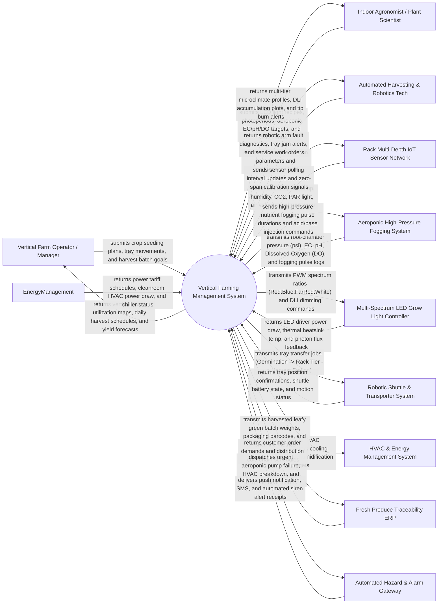

# Context Diagram — Vertical Farming Management System

## Mermaid Code

## Actor & Interaction Table | Bang Actor & Tuong tac

| # | Actor | Actor Type | Data Sent TO System | Data Received FROM System | Notes |
|---|-------|------------|---------------------|---------------------------|-------|
| 1 | Vertical Farm Operator / Manager | Primary | Seeding batch schedules, tray movement commands, harvest targets, packaging specs | Real-time vertical tower status, daily operational task lists, harvest yield reports | Facility manager overseeing daily plant factory production, seeding, and packaging |
| 2 | Indoor Agronomist / Plant Scientist | Primary | LED spectrum recipes (Red/Blue/Far-Red ratios), photoperiods, aeroponic EC/pH setpoints, VPD targets | Multi-tier climate uniformity plots, DLI growth curves, crop tip-burn risk alerts | Domain scientist optimizing light recipes, nutrient formulas, and crop growth rates |
| 3 | Automated Harvesting & Robotics Tech | Primary | Shuttle speed calibrations, robotic arm alignment logs, gripper maintenance tickets | Robot diagnostic logs, tray transport jam alarms, preventive maintenance schedules | Maintenance engineer servicing automated vertical shuttles, elevators, and robotic harvesters |
| 4 | Rack Multi-Depth IoT Sensor Network | Supporting System | Tier-by-tier air temperature ($^\circ C$), RH ($\%$), $CO_2$ ($ppm$), PAR light ($\mu mol/m^2/s$), air velocity ($m/s$) | Sensor sampling intervals, sensor calibration offset updates, optical sensor cleaning signals | Sensor arrays installed at every tier level ($1$ to $12+$ vertical levels) across rack towers |
| 5 | Aeroponic High-Pressure Fogging System | Supporting System | Root chamber fogging pressure ($PSI$), EC ($mS/cm$), pH, Dissolved Oxygen ($DO\text{ mg/L}$), fog pulse logs | High-pressure nutrient fogging timing ($sec$), A/B dosing pump pulses, acid injection commands | Micro-droplet ($10-50\mu m$) aeroponic misting rig delivering nutrients directly to hanging roots |
| 6 | Multi-Spectrum LED Grow Light Controller | Supporting System | Driver power consumption ($kW$), LED heatsink temperature ($^\circ C$), optical photon output feedback | Dynamic PWM dimming signals ($0-100\%$), red/blue/far-red spectrum ratios, photoperiod timers | Programmable multi-channel LED fixtures providing tailored light spectrum per crop stage |
| 7 | Automated Shuttle & Transporter System | Supporting System | Tray position confirmations, vertical elevator status, shuttle battery charge ($\%$), error codes | Tray transport job queue (Transfer Tray from Tier 4 to Automated Harvest Station) | Automated Guided Vehicles (AGVs) and vertical shuttle lifts moving crop trays between tiers |
| 8 | HVAC & Energy Management System | Supporting System | Cleanroom air change rates (ACH), chiller power draw ($kW$), dehumidification removal rates ($L/h$) | HVAC sensible and latent cooling setpoints, target air circulation velocities, load shedding | High-precision HVAC system maintaining uniform temperature, humidity, and airflow in plant factory |
| 9 | Fresh Produce Traceability ERP | Supporting System | Customer order requirements, packaging lot numbers, retail delivery dates | Harvested batch fresh weight ($kg$), crop quality grade percentages, batch QR codes | Enterprise ERP tracking ultra-fresh produce (lettuce, herbs, microgreens) from farm to store |
| 10 | Automated Hazard & Alarm Gateway | Supporting System | SMS delivery receipts, alert dispatch status logs | High-priority alarms (Aeroponic Dry-Root Warning, HVAC Failure, LED Overheat, $CO_2$ Hazard) | Emergency communication system broadcasting critical alarms to operators and engineers |

## System Boundary Description | Mo ta Pham vi He thong

The **Vertical Farming Management System** is an advanced plant factory environmental and automation control software platform designed for multi-tier indoor vertical farming. It controls tier-specific microclimates, multi-spectrum LED lighting recipes, high-pressure aeroponic nutrient fogging, robotic tray transport shuttles, computer vision crop health inspection, and energy efficiency.

The **system boundary** encompasses vertical rack tower GIS/grid mapping, multi-depth IoT sensor telemetry ingestion, Vapor Pressure Deficit (VPD) computation, dynamic LED spectrum (Red/Blue/Far-Red) and Daily Light Integral (DLI) control, high-pressure aeroponic EC/pH/DO fogging execution, automated shuttle tray logistics, computer vision tip-burn detection, and cleanroom energy optimization.

**External to the system boundary** are physical plant cellular photosynthesis, physical micro-droplet fluid dynamics in root chambers, physical LED semiconductor photon emission, cleanroom structural wall insulation, and public electricity grid transmission. System interfaces operate via secure Modbus TCP, BACnet/IP, EtherCAT robotics protocols, MQTT IoT streams, and RESTful web APIs.
