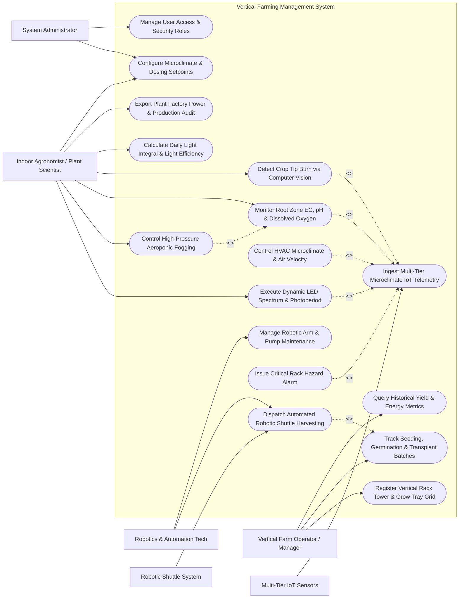

# Use Case Diagram — Vertical Farming Management System

## Mermaid Code

## Actor Table | Bang Actor

| # | Actor | Actor Type | Role Description | Related Use Cases |
|---|-------|------------|------------------|-------------------|
| 1 | Vertical Farm Operator / Manager | Primary | Plant factory operator registering rack towers, tracking seeding/harvesting batches, and monitoring output | UC01, UC11, UC12 |
| 2 | Indoor Agronomist / Plant Scientist | Primary | Domain specialist optimizing LED spectrum recipes, aeroponic EC/pH setpoints, DLI, and crop health | UC03, UC04, UC05, UC08, UC09, UC13, UC14 |
| 3 | Robotics & Automation Tech | Primary | Maintenance engineer managing automated shuttle lifts, robotic harvesters, and mechanical pumps | UC07, UC15 |
| 4 | System Administrator | Primary | Technical admin managing PID microclimate rules, system parameters, user roles, and security | UC14, UC16 |
| 5 | Multi-Tier IoT Sensors | Secondary / System | Sensor arrays installed across vertical rack tiers measuring temperature, RH, $CO_2$, PAR light, and airflow | UC02 |
| 6 | Robotic Shuttle System | Secondary / System | Automated shuttles and vertical lifts transporting grow trays between tiers and harvesting stations | UC07 |

## Use Case Table | Bang Use Case

| # | UC ID | Use Case Name | Primary Actor | Secondary Actor | Description | Priority |
|---|-------|---------------|---------------|-----------------|-------------|----------|
| 1 | UC01 | Register Vertical Rack Tower & Grow Tray Grid | Operator | None | Configures vertical rack towers, tier levels ($1-12+$), grow tray capacity, and barcode grid maps | High |
| 2 | UC02 | Ingest Multi-Tier Microclimate IoT Telemetry | System | Multi-Tier Sensors | Ingests tier-by-tier temperature, humidity, $CO_2$, PAR light, and air velocity streams | High |
| 3 | UC03 | Execute Dynamic LED Spectrum & Photoperiod | Agronomist | System | Controls multi-channel LED drivers to dynamically adjust Red/Blue/Far-Red ratios and photoperiod timers | High |
| 4 | UC04 | Control High-Pressure Aeroponic Fogging | Agronomist | System | Delivers micro-droplet ($10-50\mu m$) aeroponic nutrient mist pulses ($sec$) to hanging root chambers | High |
| 5 | UC05 | Monitor Root Zone EC, pH & Dissolved Oxygen | Agronomist | System | Monitors aeroponic nutrient solution Electrical Conductivity ($EC$), pH, and Dissolved Oxygen ($DO$) | High |
| 6 | UC06 | Control HVAC Microclimate & Air Velocity | System | Multi-Tier Sensors | Regulates cleanroom HVAC chilling, dehumidification, and vertical duct air velocity uniformity | High |
| 7 | UC07 | Dispatch Automated Robotic Shuttle Harvesting | Robotics Tech | Robotic Shuttle | Triggers robotic shuttle lifts to transport mature grow trays from upper tiers to automated harvest line | High |
| 8 | UC08 | Detect Crop Tip Burn via Computer Vision | Agronomist | System | Uses overhead RGB/Multispectral cameras to detect calcium-deficiency tip burn and leaf necrosis | Medium |
| 9 | UC09 | Calculate Daily Light Integral & Light Efficiency | Agronomist | System | Integrates PAR photon flux to track target DLI ($\text{mol/m}^2/\text{day}$) and light efficiency ($\text{g/kWh}$) | High |
| 10 | UC10 | Issue Critical Rack Hazard Alarm | System | Notification Gateway | Dispatches emergency alerts when aeroponic pressure drops or tier temperature exceeds safety limits | High |
| 11 | UC11 | Track Seeding, Germination & Transplant Batches | Operator | None | Tracks crop growth cycle: Seeding $\rightarrow$ Dark Germination $\rightarrow$ Nursery Tier $\rightarrow$ Production Tier $\rightarrow$ Harvest | High |
| 12 | UC12 | Query Historical Yield & Energy Metrics | Operator | None | Provides searchable historical database of crop yields ($kg/\text{tray}$), electricity costs, and DLI | Low |
| 13 | UC13 | Export Plant Factory Power & Production Audit | Agronomist | System | Generates plant factory audit reports: energy efficiency ($\text{kWh/kg}$ fresh produce), water savings, and yield | Medium |
| 14 | UC14 | Configure Microclimate & Dosing Setpoints | System Admin | Agronomist | Configures tier temperature setpoints, humidity bands, VPD targets, aeroponic EC/pH rules, and PID gains | High |
| 15 | UC15 | Manage Robotic Arm & Pump Maintenance | Robotics Tech | System | Tracks shuttle motor hours, high-pressure fogging pump diaphragm wear, and issues work orders | Medium |
| 16 | UC16 | Manage User Access & Security Roles | System Admin | None | Configures user accounts, operational roles (Operator, Agronomist, Tech, Admin), and API permissions | Low |

## Use Case Specification | Dac ta Use Case

---

### UC02 — Ingest Multi-Tier Microclimate IoT Telemetry

| Field | Detail |
|-------|--------|
| **UC ID** | UC02 |
| **Use Case Name** | Ingest Multi-Tier Microclimate IoT Telemetry |
| **Actor(s)** | Primary: System   Secondary: Multi-Tier IoT Sensors |
| **Description** | Ingests high-frequency sensor telemetry from multiple vertical tier levels (Tiers 1 to 12) across rack towers, measuring air temperature, relative humidity, $CO_2$ concentration, PAR light intensity, and air velocity to evaluate vertical microclimate micro-stratification. |
| **Precondition** | 1. Vertical rack towers and tier sensor nodes are registered in system (UC01).   2. Multi-tier sensor Modbus TCP / MQTT network connection is active. |
| **Main Flow** | 1. Sensor nodes installed at every tier level take readings every 15 seconds.   2. Sensor node packages telemetry payload: Facility ID, Tower Code, Tier Level ($1-12$), Air Temp ($^\circ C$), RH ($\%$), $CO_2$ ($ppm$), PAR Light ($\mu mol/m^2/s$), Air Velocity ($m/s$), and Root Zone Temp ($^\circ C$).   3. Node transmits payload to System gateway via Modbus TCP or MQTT over TLS.   4. System ingests packet, parses tier fields, and validates payload integrity.   5. System calculates tier-specific **Vapor Pressure Deficit (VPD)**:   &nbsp;&nbsp;&nbsp;&nbsp;$$\text{VPD} = VP_{sat}(T_{tier}) \times \left( 1 - \frac{RH_{tier}}{100} \right)$$   6. System evaluates vertical microclimate gradient ($\Delta T = T_{tier12} - T_{tier1}$) across the tower height.   7. If $\Delta T > 2.0^\circ C$ or air velocity at any tier drops below $0.3\text{ m/s}$ (stagnant boundary layer risk), system triggers HVAC duct fan modulation (UC06).   8. System stores validated 15-second telemetry record in time-series database and updates tier-by-tier heatmap dashboard. |
| **Alternative Flow** | **AF1** — Root Chamber Temperature Warning: If aeroponic root chamber temperature exceeds $22^\circ C$ (Pythium root-rot hazard), system alerts operator and activates nutrient solution chiller. |
| **Exception Flow** | **EX1** — Tier Communication Node Offline: Tier 6 sensor node stops transmitting data; system flags `TIER_SENSOR_OFFLINE`, interpolates values from Tiers 5 and 7, and alerts technician. |
| **Postcondition** | Multi-tier microclimate metrics logged, vertical temperature/humidity gradients computed, and VPD heatmaps updated. |
| **Business Rule** | **BR1**: Vertical temperature variation between the bottom tier (Tier 1) and top tier (Tier 12) must be maintained within $\pm 1.0^\circ C$ to prevent uneven crop growth rates. |

---

### UC03 — Execute Dynamic LED Spectrum & Photoperiod

| Field | Detail |
|-------|--------|
| **UC ID** | UC03 |
| **Use Case Name** | Execute Dynamic LED Spectrum & Photoperiod |
| **Actor(s)** | Primary: Indoor Agronomist / Plant Scientist   Secondary: System |
| **Description** | Controls multi-channel dimmable LED grow light fixtures at each rack tier, adjusting spectral wavelength ratios (Red 660nm, Blue 450nm, Far-Red 730nm, White 4000K) and photoperiod timers to optimize photosynthesis and crop morphology. |
| **Precondition** | 1. Multi-channel LED fixtures are installed above each grow tray tier.   2. Agronomist configures spectrum recipe for current crop growth stage (e.g., Vegetative vs Pre-Harvest Finishing). |
| **Main Flow** | 1. System checks active LED Light Recipe for target crop batch on specified rack tier.   2. System retrieves target spectral ratios and photoperiod parameters:   &nbsp;&nbsp;&nbsp;&nbsp;a. **Red ($660\text{ nm}$)**: $60\%$ intensity (drives Chlorophyll A/B photosynthesis).   &nbsp;&nbsp;&nbsp;&nbsp;b. **Blue ($450\text{ nm}$)**: $20\%$ intensity (prevents stretch, promotes stomatal opening).   &nbsp;&nbsp;&nbsp;&nbsp;c. **Far-Red ($730\text{ nm}$)**: $10\%$ intensity (accelerates leaf expansion).   &nbsp;&nbsp;&nbsp;&nbsp;d. **White ($4000\text{ K}$)**: $10\%$ intensity (provides visual inspection light).   &nbsp;&nbsp;&nbsp;&nbsp;e. **Photoperiod**: 18 hours ON / 6 hours OFF.   &nbsp;&nbsp;&nbsp;&nbsp;f. **Target DLI**: $16\text{ mol/m}^2/\text{day}$.   3. At scheduled photoperiod start time (e.g., 04:00 AM), System generates multi-channel PWM dimming signals ($0-100\%$) for each color channel.   4. System transmits PWM/DALI control signals to tier LED driver power supplies.   5. LED drivers energize fixtures, delivering specified photon flux density ($\text{PPFD} = 250\text{ }\mu mol/m^2/s$).   6. System integrates PAR sensor readings over time to compute cumulative Daily Light Integral (DLI).   7. At photoperiod end time (10:00 PM), system executes 15-minute Far-Red end-of-day burst before completely powering down lights for 6-hour dark rest.   8. System logs daily LED energy consumption ($kWh$) and light spectrum delivery. |
| **Alternative Flow** | **AF1** — Pre-Harvest Anthocyanin Color Boosting: 3 days prior to harvest, system shifts LED spectrum to $50\%$ Blue / $50\%$ Red to stimulate purple/red pigmentation in red-leaf lettuce. |
| **Exception Flow** | **EX1** — LED Driver Over-Temperature Lockout: LED fixture heatsink temperature exceeds $75^\circ C$; system automatically dims fixture to $30\%$ power to prevent thermal damage and alerts technician. |
| **Postcondition** | Multi-channel LED spectrum executed, target DLI delivered to crop tier, and photoperiod logged. |
| **Business Rule** | **BR1**: Photoperiod changes must be applied gradually to prevent crop physiological stress. |

---

### UC04 — Control High-Pressure Aeroponic Fogging

| Field | Detail |
|-------|--------|
| **UC ID** | UC04 |
| **Use Case Name** | Control High-Pressure Aeroponic Fogging |
| **Actor(s)** | Primary: Indoor Agronomist / Plant Scientist   Secondary: System |
| **Description** | Controls high-pressure ($80 - 120\text{ PSI}$) aeroponic misting pumps and solenoid valves to atomize nutrient solution into micro-droplets ($10 - 50\mu m$) delivered directly to hanging root systems at micro-second misting pulse intervals. |
| **Precondition** | 1. High-pressure aeroponic pump and solenoid valves are installed for target rack tower.   2. Nutrient solution in main reservoir is balanced for EC ($1.8\text{ mS/cm}$) and pH ($5.8$) (UC05). |
| **Main Flow** | 1. System retrieves active Aeroponic Fogging Schedule for target rack tier:   &nbsp;&nbsp;&nbsp;&nbsp;a. **Misting Pulse Duration**: 5 seconds ON.   &nbsp;&nbsp;&nbsp;&nbsp;b. **Misting Interval**: 4 minutes OFF (Day) / 8 minutes OFF (Night).   &nbsp;&nbsp;&nbsp;&nbsp;c. **Target Line Pressure**: $100\text{ PSI}$.   2. System verifies main supply line pressure is maintained at $100\text{ PSI}$ by high-pressure pump.   3. At scheduled pulse trigger, System energizes high-speed solenoid misting valves for target tier.   4. Solenoid valves open for 5 seconds, atomizing nutrient solution through specialized ruby-orifice misting nozzles into dense $30\mu m$ fog inside root chamber.   5. Micro-droplets coat hanging plant roots, providing optimal moisture, nutrient absorption, and maximum root zone oxygenation ($DO > 8.0\text{ mg/L}$).   6. Excess nutrient mist condenses on root box walls and drains back to primary reservoir via return manifold.   7. System closes solenoid valves after 5 seconds and resets misting interval timer.   8. System logs misting execution event, line pressure ($PSI$), and flow volume ($mL$). |
| **Alternative Flow** | **AF1** — Root Zone Humidity Responsive Fogging: System uses root box RH sensors ($>95\%$ RH target) to dynamically adjust misting OFF intervals rather than fixed timers. |
| **Exception Flow** | **EX1** — Aeroponic Pressure Loss / Dry-Root Hazard: Line pressure drops below $50\text{ PSI}$ during misting pulse (pump failure or burst line); system triggers `CRITICAL_DRY_ROOT_ALARM` (UC10) and activates secondary emergency backup pump within 60 seconds to prevent root desiccation. |
| **Postcondition** | High-pressure aeroponic fog delivered to plant roots, line pressure verified, and fogging transaction logged. |
| **Business Rule** | **BR1**: Aeroponic misting OFF intervals must never exceed 10 minutes; un-misted roots in dry air suffer irreversible desiccation damage within 15 minutes. |

---

### UC05 — Monitor Root Zone EC, pH & Dissolved Oxygen

| Field | Detail |
|-------|--------|
| **UC ID** | UC05 |
| **Use Case Name** | Monitor Root Zone EC, pH & Dissolved Oxygen |
| **Actor(s)** | Primary: Indoor Agronomist / Plant Scientist   Secondary: System |
| **Description** | Continuously monitors aeroponic nutrient solution Electrical Conductivity (EC), pH, and Dissolved Oxygen (DO) levels, executing automated A/B concentrated fertilizer dosing, acid injection, and oxygenation. |
| **Precondition** | 1. In-line industrial EC, pH, and optical Dissolved Oxygen (DO) probes are installed in primary nutrient reservoir and return manifold. |
| **Main Flow** | 1. System reads continuous signals from EC ($mS/cm$), pH, DO ($mg/L$), and Water Temperature ($^\circ C$) probes.   2. System applies temperature compensation formulas to normalize EC to $25^\circ C$ and DO to saturation percentage.   3. System compares readings against target agronomic setpoints: $\text{EC} = 1.8\text{ mS/cm}$, $\text{pH} = 5.8$, $\text{DO} = 8.5\text{ mg/L}$.   4. If EC drops below $1.7\text{ mS/cm}$ (nutrient depletion), system activates peristaltic dosing pumps for Concentrate Stock A (Calcium/Iron) and Stock B (NPK/Micro) in equal pulse ratios.   5. If pH rises above $6.1$ (alkaline drift), system activates micro-dosing pump for diluted Nitric/Phosphoric Acid until pH returns to $5.8$.   6. If DO drops below $7.0\text{ mg/L}$, system activates oxygen nanobubble generator in nutrient reservoir to boost DO to $>8.5\text{ mg/L}$.   7. System records dosing transaction volumes ($mL$) and updates real-time nutrient balance graphs on agronomist dashboard. |
| **Alternative Flow** | **AF1** — Automated Drain & Flush Cycle: Every 14 days, system triggers automated reservoir drain, flushes tank with clean RO water, and mixes fresh batch of nutrient solution to prevent sodium/chloride accumulation. |
| **Exception Flow** | **EX1** — Acid Over-Dosing Lockout: In-line pH probe reads $<4.5$ due to stuck acid pump; system instantly cuts power to acid pump, injects emergency neutralization buffer, and alerts agronomist. |
| **Postcondition** | Aeroponic nutrient solution EC, pH, and DO maintained within target limits and dosing logs recorded. |
| **Business Rule** | **BR1**: Dissolved Oxygen (DO) in aeroponic nutrient solution must be maintained above $7.0\text{ mg/L}$ to prevent Pythium root rot and maximize nutrient absorption rates. |

---

### UC07 — Dispatch Automated Robotic Shuttle Harvesting

| Field | Detail |
|-------|--------|
| **UC ID** | UC07 |
| **Use Case Name** | Dispatch Automated Robotic Shuttle Harvesting |
| **Actor(s)** | Primary: Automated Harvesting & Robotics Tech   Secondary: Robotic Shuttle System |
| **Description** | Coordinates automated vertical shuttle lifts and AGV transport vehicles to retrieve mature crop grow trays from upper rack tiers ($1-12+$) and transport them to the automated harvesting and packaging line. |
| **Precondition** | 1. Crop batch on target rack tier has reached harvest maturity date (UC11).   2. Robotic shuttle lifts and automated harvest line are online and cleared for operation. |
| **Main Flow** | 1. Operator or System triggers "Initiate Batch Harvest" for specified Rack Tower and Tier Levels (e.g., Tower B, Tier 8, Trays 1-20).   2. System generates **Robotic Transport Job Queue**:   &nbsp;&nbsp;&nbsp;&nbsp;a. Job 1: Navigate Shuttle Lift to Tower B, Tier 8.   &nbsp;&nbsp;&nbsp;&nbsp;b. Job 2: Extend telescopic gripper arms, latch onto Grow Tray 1, and pull onto shuttle bed.   &nbsp;&nbsp;&nbsp;&nbsp;c. Job 3: Lower shuttle elevator to Ground Transport Level.   &nbsp;&nbsp;&nbsp;&nbsp;d. Job 4: Transfer Grow Tray 1 onto AGV conveyor heading to Automated Harvest Line.   3. System transmits job queue to Robotic Shuttle Master Controller via EtherCAT / Wi-Fi.   4. Robotic shuttle executes commands, retrieving Grow Tray 1 from Tier 8 and lowering to ground level.   5. Conveyor delivers tray to Automated Harvest Station; cutter blades harvest leafy greens, weighing fresh crop yield ($kg$) (UC12).   6. Empty grow tray is routed to automated tray washer and sanitizer station.   7. Shuttle repeats process for remaining trays in job queue.   8. System updates tray status to `HARVESTED_EMPTY` and logs batch yield weight. |
| **Alternative Flow** | **AF1** — Automated Nursery Transplanting Shuttle: System dispatches shuttle to move young seedling trays from Germination Nursery Tier to High-Light Production Tier at Day 10. |
| **Exception Flow** | **EX1** — Shuttle Gripper Mechanical Jam: Telescopic gripper encounters mechanical obstruction during tray retrieval on Tier 8; shuttle stops motion, engages emergency brake, flags `SHUTTLE_GRIPPER_JAM`, and alerts robotics technician. |
| **Postcondition** | Grow trays retrieved from vertical tiers, mature crop harvested, empty trays sanitized, and harvest yield recorded. |
| **Business Rule** | **BR1**: Shuttle movements must be synchronized with cleanroom air lock doors to maintain HEPA air filtration standards. |
