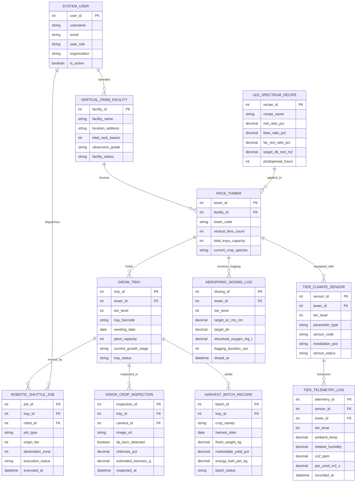

# Conceptual ERD — Vertical Farming Management System

## Mermaid Code

## Entity Description Table | Bang mo ta Entity

| # | Entity Name | Vietnamese Name | Description | Key Attributes | Main Relationships |
|---|-------------|-----------------|-------------|----------------|-------------------|
| 1 | VERTICAL_FARM_FACILITY | Cơ Sở Nông Nghiệp Thẳng Đứng | Master indoor plant factory facility profile, address, total rack towers, cleanroom ISO grade, and operational status | facility_id, facility_name, location_address, total_rack_towers, cleanroom_grade, facility_status | Houses RACK_TOWER, operated by SYSTEM_USER |
| 2 | RACK_TOWER | Tháp Tháp Kệ Trồng Thẳng Đứng | Represents individual vertical rack towers, number of vertical tiers ($1-12+$), tray capacity, and crop species | tower_id, facility_id, tower_code, vertical_tiers_count, total_trays_capacity, current_crop_species | Belongs to FACILITY, holds GROW_TRAY, equipped with TIER_SENSOR |
| 3 | GROW_TRAY | Khay Cây Trồng Thẳng Đứng | Stores individual grow tray barcodes, tier level position, seeding date, plant density, growth stage, and status | tray_id, tower_id, tier_level, tray_barcode, seeding_date, plant_capacity, current_growth_stage | Held in RACK_TOWER, moved by SHUTTLE_JOB, yields HARVEST_BATCH |
| 4 | TIER_CLIMATE_SENSOR | Cảm Biến Vi Khí Hậu Tầng Kệ | Stores tier-specific IoT sensor hardware metadata, tier level, measured parameters (Temp, RH, $CO_2$, PAR, Airflow) | sensor_id, tower_id, tier_level, parameter_type, sensor_code, installation_pos, sensor_status | Equipped in RACK_TOWER, measures TIER_TELEMETRY_LOG |
| 5 | TIER_TELEMETRY_LOG | Nhật Ký Vi Khí Hậu Tầng | High-frequency telemetry storing tier air temp ($^\circ C$), RH ($\%$), $CO_2$ ($ppm$), PAR light ($\mu mol/m^2/s$), and airflow | telemetry_id, sensor_id, tower_id, tier_level, ambient_temp, relative_humidity, co2_ppm, recorded_at | Measured by TIER_CLIMATE_SENSOR |
| 6 | LED_SPECTRUM_RECIPE | Công Thức Ánh Sáng Đèn LED | Defines growth-stage specific LED spectrum ratios (Red 660nm, Blue 450nm, Far-Red 730nm), target DLI, and photoperiod | recipe_id, recipe_name, red_ratio_pct, blue_ratio_pct, far_red_ratio_pct, target_dli_mol_m2 | Applied to RACK_TOWER |
| 7 | AEROPONIC_DOSING_LOG | Nhật Ký Phun Dinh Dưỡng Aeroponic | Records high-pressure aeroponic fogging mists, line pressure ($PSI$), measured EC, pH, Dissolved Oxygen ($DO$), and pulse duration | dosing_id, tower_id, tier_level, target_ec_ms_cm, target_ph, dissolved_oxygen_mg_l, fogging_duration_sec | Received by RACK_TOWER |
| 8 | ROBOTIC_SHUTTLE_JOB | Nhiệm Vụ Robot Vận Chuyển Khay | Manages automated shuttle transport jobs: moving grow trays between tiers, nursery zones, and automated harvest lines | job_id, tray_id, robot_id, job_type, origin_tier, destination_zone, execution_status, executed_at | Moves GROW_TRAY, dispatched by SYSTEM_USER |
| 9 | VISION_CROP_INSPECTION | Báo Cáo Kiểm Tra Computer Vision | Captures computer vision inspection results: tip-burn detection, leaf chlorosis $\%$, and estimated biomass weight ($g$) | inspection_id, tray_id, camera_id, image_url, tip_burn_detected, chlorosis_pct, estimated_biomass_g | Inspects GROW_TRAY |
| 10 | HARVEST_BATCH_RECORD | Báo Cáo Thu Hoạch Lô Cây | Tracks harvested crop fresh weight ($kg$), marketable yield $\%$, energy efficiency ($\text{kWh/kg}$), and batch status | batch_id, tray_id, crop_variety, harvest_date, fresh_weight_kg, marketable_yield_pct, energy_kwh_per_kg | Yielded from GROW_TRAY |
| 11 | SYSTEM_USER | Người Dùng Hệ Thống | User accounts, roles (Plant Factory Manager, Agronomist, Robotics Tech, Admin), organizations, and access permissions | user_id, username, user_role, organization, is_active | Operates VERTICAL_FARM_FACILITY, dispatches ROBOTIC_SHUTTLE_JOB |

## Relationship Description | Mo ta Quan he

| # | From Entity | Cardinality | To Entity | Relationship Label | Business Explanation |
|---|-------------|-------------|-----------|-------------------|----------------------|
| 1 | VERTICAL_FARM_FACILITY | one-to-many | RACK_TOWER | houses | An indoor vertical farm facility houses multiple multi-tier vertical rack towers |
| 2 | RACK_TOWER | one-to-many | GROW_TRAY | holds | A vertical rack tower holds multiple grow trays arranged across vertical tier levels ($1-12+$) |
| 3 | RACK_TOWER | one-to-many | TIER_CLIMATE_SENSOR | equipped_with | A rack tower is equipped with tier-specific microclimate sensors installed at every vertical level |
| 4 | TIER_CLIMATE_SENSOR | one-to-many | TIER_TELEMETRY_LOG | measures | A tier climate sensor measures high-frequency temperature, humidity, $CO_2$, and light telemetry |
| 5 | RACK_TOWER | one-to-many | AEROPONIC_DOSING_LOG | receives_fogging | A rack tower receives high-pressure aeroponic nutrient fogging mist pulses in its root chambers |
| 6 | GROW_TRAY | one-to-many | ROBOTIC_SHUTTLE_JOB | moved_by | A grow tray is moved by automated shuttle lifts between tiers and harvesting stations |
| 7 | GROW_TRAY | one-to-many | VISION_CROP_INSPECTION | inspected_in | A grow tray is inspected by overhead computer vision cameras to detect crop health and tip burn |
| 8 | GROW_TRAY | one-to-many | HARVEST_BATCH_RECORD | yields | A mature grow tray yields harvested fresh produce recorded in harvest batch logs |
| 9 | LED_SPECTRUM_RECIPE | one-to-many | RACK_TOWER | applied_to | An LED light spectrum recipe is applied to specific vertical rack towers based on crop stage |
| 10 | SYSTEM_USER | one-to-many | VERTICAL_FARM_FACILITY | operates | A plant factory manager system user operates vertical farm facility production |
| 11 | SYSTEM_USER | one-to-many | ROBOTIC_SHUTTLE_JOB | dispatches | A robotics technician system user dispatches and monitors automated shuttle transport jobs |
