# Swimlane Diagram — Vertical Farming Management System

## Mermaid Code

```mermaid
flowchart LR
    Start(["Start Plant Factory Production Cycle"])

    subgraph SensorVisionLane["Multi-Tier Sensors & Vision Cameras"]
        S1["Measure Tier Temp, RH, CO2 & PAR Light"]
        S2["Measure Aeroponic Pressure, EC, pH & DO"]
        S3["Capture Overhead Tray RGB Photos"]
    end

    subgraph SystemLane["Vertical Farming Management System"]
        M1["Calculate Tier VPD & Accumulated DLI"]
        M2["Run Vision Tip-Burn Detection Model"]
        M3{"Aeroponic Failure or Tip Burn Detected?"}
        M4["Calculate Multi-Channel LED & Fogging Commands"]
        M5["Trigger Aeroponic Backup Pump & Alarm"]
    end

    subgraph AgronomistLane["Indoor Agronomist / Plant Scientist"]
        A1["Review Tier VPD Gradients & DLI Curves"]
        A2["Adjust Red/Blue LED Ratios & Aeroponic EC"]
    end

    subgraph OperatorLane["Vertical Farm Operator / Manager"]
        G1["Monitor Plant Factory Yield & Power Ratio"]
        G2["Approve Automated Shuttle Harvest Batch"]
    end

    subgraph ActuatorRobotLane["LED Controllers, Aeroponic Pumps & Robots"]
        C1["Pulse Aeroponic Solenoids & Dosing Pumps"]
        C2["Dim Multi-Spectrum PWM LED Channels"]
        C3["Execute Robotic Shuttle Tray Retrieval"]
    end

    Finish(["End Operational Cycle"])

    Start --> S1 --> M1 --> M2 --> M3
    S2 --> M1
    S3 --> M2
    M3 -->|"Normal Growth Metrics"| M4 --> C1 --> C2 --> A1 --> A2 --> G1 --> G2 --> C3 --> Finish
    M3 -->|"Aeroponic Pressure Loss <50 PSI"| M5 --> C1 --> A1 --> Finish
```

## Flow Description | Mo ta luong

| Lane | Actor | Role in Flow |
|------|-------|-------------|
| 1 | Multi-Tier Sensors & Vision Cameras | Multi-depth sensor nodes measure tier air temp, RH, $CO_2$, PAR light, and airflow, aeroponic probes measure line pressure, EC, pH, and DO, while vision cameras capture tray photos |
| 2 | Vertical Farming Management System | Calculates tier-by-tier VPD and cumulative DLI, runs computer vision models to detect calcium tip burn, calculates multi-channel LED dimming and aeroponic fogging pulses, and manages dry-root emergency alarms |
| 3 | Indoor Agronomist / Plant Scientist | Monitors vertical temperature gradients and DLI growth curves, fine-tunes Red/Blue/Far-Red spectrum ratios, and adjusts aeroponic nutrient EC/pH setpoints |
| 4 | Vertical Farm Operator / Manager | Tracks plant factory yield efficiency ($\text{kWh/kg}$ fresh produce), approves harvest batch schedules, and monitors cleanroom operation metrics |
| 5 | LED Controllers, Aeroponic Pumps & Robots | High-pressure pumps and solenoids deliver $30\mu m$ aeroponic fog mists, multi-channel LED drivers dim spectrum fixtures, and robotic shuttles retrieve mature grow trays for harvest |
