# Action Tree — Vertical Farming Management System

## Mermaid Code

```mermaid
graph TD
    Root["Vertical Farming Management System"]

    Root --> M1["Plant Factory Facility & Rack Registry"]
    Root --> M2["Multi-Tier Telemetry & Air Velocity"]
    Root --> M3["Dynamic Multi-Spectrum LED & Photoperiod"]
    Root --> M4["Aeroponic Nutrient Fogging & EC/pH/DO"]
    Root --> M5["Robotic Shuttle Automation & Harvesting"]
    Root --> M6["AI Vision Crop Inspection & Energy Analytics"]
    Root --> M7["Cleanroom Maintenance & System Admin"]

    M1 --> A11["Register Vertical Rack Towers & Tier Levels"]
    M1 --> A12["Define Grow Tray Barcode Grids & Capacity"]
    M1 --> A13["Configure Crop Species & Growth Stage Timers"]
    M1 --> A14["Map Sensor & LED Hardware Channels"]

    M2 --> A21["Ingest 15-Second Multi-Tier IoT Telemetry"]
    M2 --> A22["Calculate Tier-by-Tier VPD & Thermal Gradients"]
    M2 --> A23["Monitor Cleanroom Air Velocity & HVAC Uniformity"]
    M2 --> A24["Detect Tier Sensor Communication Failures"]

    M3 --> A31["Configure Red, Blue, Far-Red & White LED Ratios"]
    M3 --> A32["Transmit DALI & PWM Multi-Channel Dimming"]
    M3 --> A33["Calculate Daily Light Integral DLI Accumulation"]
    M3 --> A34["Configure Pre-Harvest Anthocyanin Color Boosts"]

    M4 --> A41["Control High-Pressure 100 PSI Misting Solenoids"]
    M4 --> A42["Monitor Aeroponic Root Chamber Temperature"]
    M4 --> A43["Automate A/B Fertilizer & Acid Injection Dosing"]
    M4 --> A44["Control Nanobubble Oxygenation for High DO"]

    M5 --> A51["Generate Robotic Shuttle Tray Retrieval Jobs"]
    M5 --> A52["Coordinate Vertical Elevator & AGV Transporters"]
    M5 --> A53["Execute Automated Tray Washing & Sanitization"]
    M5 --> A54["Dispatch Nursery-to-Production Tier Transplants"]

    M6 --> A61["Run Computer Vision Tip Burn Detection Models"]
    M6 --> A62["Estimate Crop Biomass Weight via Overhead RGB"]
    M6 --> A63["Calculate Power Consumption per Kilogram Produce"]
    M6 --> A64["Export Plant Factory Yield & Power Audit Reports"]

    M7 --> A71["Record Sensor Zero-Span Calibration Offsets"]
    M7 --> A72["Track Robotic Shuttle Motor Hours & Servicing"]
    M7 --> A73["Monitor HEPA Filtration & Cleanroom Pressure"]
    M7 --> A74["Manage User Roles & Security Access Credentials"]
```

## Module Description | Mo ta Module

| # | Module | Description | Actions |
|---|--------|-------------|---------|
| 1 | Plant Factory Facility & Rack Registry | Manages plant factory facility profiles, vertical rack towers, tier levels ($1-12+$), grow tray barcode grids, and crop growth stage profiles | Register Vertical Rack Towers & Tier Levels, Define Grow Tray Barcode Grids & Capacity, Configure Crop Species & Growth Stage Timers, Map Sensor & LED Hardware Channels |
| 2 | Multi-Tier Telemetry & Air Velocity | Ingests 15-second multi-tier microclimate telemetry (Temp, RH, $CO_2$, PAR, Airflow), calculates tier VPD, and monitors vertical temperature gradients | Ingest 15-Second Multi-Tier IoT Telemetry, Calculate Tier-by-Tier VPD & Thermal Gradients, Monitor Cleanroom Air Velocity & HVAC Uniformity, Detect Tier Sensor Communication Failures |
| 3 | Dynamic Multi-Spectrum LED & Photoperiod | Controls multi-channel LED drivers (Red/Blue/Far-Red/White), calculates Daily Light Integral (DLI), and executes dusk spectrum bursts | Configure Red, Blue, Far-Red & White LED Ratios, Transmit DALI & PWM Multi-Channel Dimming, Calculate Daily Light Integral DLI Accumulation, Configure Pre-Harvest Anthocyanin Color Boosts |
| 4 | Aeroponic Nutrient Fogging & EC/pH/DO | Controls high-pressure ($100\text{ PSI}$) aeroponic solenoids, regulates root chamber temp, automates A/B EC/pH dosing, and manages nanobubble oxygenation | Control High-Pressure 100 PSI Misting Solenoids, Monitor Aeroponic Root Chamber Temperature, Automate A/B Fertilizer & Acid Injection Dosing, Control Nanobubble Oxygenation for High DO |
| 5 | Robotic Shuttle Automation & Harvesting | Generates robotic shuttle tray retrieval jobs, coordinates vertical elevators, automated tray washing, and nursery-to-production transplants | Generate Robotic Shuttle Tray Retrieval Jobs, Coordinate Vertical Elevator & AGV Transporters, Execute Automated Tray Washing & Sanitization, Dispatch Nursery-to-Production Tier Transplants |
| 6 | AI Vision Crop Inspection & Energy Analytics | Analyzes overhead tray RGB photos to detect tip burn, estimates biomass growth, calculates energy efficiency ($\text{kWh/kg}$), and exports audit reports | Run Computer Vision Tip Burn Detection Models, Estimate Crop Biomass Weight via Overhead RGB, Calculate Power Consumption per Kilogram Produce, Export Plant Factory Yield & Power Audit Reports |
| 7 | Cleanroom Maintenance & System Admin | Tracks sensor calibration offsets, monitors robotic shuttle motor operating hours, oversees HEPA air filtration pressure, and manages user roles | Record Sensor Zero-Span Calibration Offsets, Track Robotic Shuttle Motor Hours & Servicing, Monitor HEPA Filtration & Cleanroom Pressure, Manage User Roles & Security Access Credentials |
