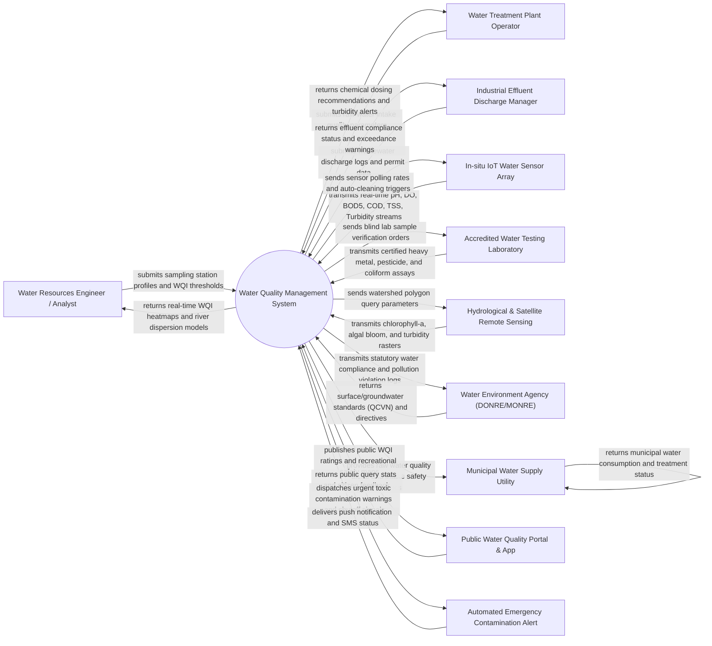

# Context Diagram — Water Quality Management System

## Mermaid Code

## Actor & Interaction Table | Bang Actor & Tuong tac

| # | Actor | Actor Type | Data Sent TO System | Data Received FROM System | Notes |
|---|-------|------------|---------------------|---------------------------|-------|
| 1 | Water Resources Engineer / Analyst | Primary | Sampling point GPS coordinates, sensor calibration curves, WQI formula weights, risk thresholds | River WQI heatmaps, plume dispersion models, watershed eutrophication reports, historical trends | Primary technical specialist monitoring river basins, reservoirs, and groundwater quality |
| 2 | Water Treatment Plant Operator | Primary | Raw water intake quality readings, plant flow rates, coagulation tank parameters | Coagulant/chlorine dosing recommendations, raw water turbidity alerts, intake shutoff warnings | Utility engineer operating municipal drinking water treatment facilities |
| 3 | Industrial Effluent Discharge Manager | Primary | Industrial wastewater discharge volumes, effluent CEMS telemetry, discharge permit details | Effluent QCVN compliance reports, parameter exceedance alarms, legal violation notices | EHS manager operating factory wastewater treatment plants (WWTP) discharging into rivers |
| 4 | In-situ IoT Water Sensor Array | Supporting System | Real-time pH, Dissolved Oxygen (DO), $BOD_5$, COD, Total Suspended Solids (TSS), Turbidity, Heavy Metals, Conductivity, Salinity | Polling interval commands, sensor cleaning air-purge triggers, zero-span calibration offsets | Submersible IoT water quality multiparameter sondes deployed in rivers, lakes, and estuaries |
| 5 | Accredited Water Testing Laboratory | Supporting System | Certified laboratory analysis certificates for heavy metals ($Pb, As, Cd, Hg$), organochlorine pesticides, E. coli, total coliforms | Blind sample tracking codes, chain of custody forms, laboratory analytical test requests | ISO/IEC 17025 accredited laboratory performing complex chemical and microbiological assays |
| 6 | Hydrological & Satellite Remote Sensing | Supporting System | Landsat/Sentinel-2 multispectral imagery, Chlorophyll-a concentration rasters, surface water temperature, turbidity layers | River basin GIS polygons, watershed query timestamps, spectral band request parameters | Remote sensing data feeds providing macro-level lake and coastal water quality mapping |
| 7 | Water Environment Agency (DONRE/MONRE) | Regulatory System | Statutory surface water (QCVN 08:2023), groundwater (QCVN 09), and industrial wastewater (QCVN 40) standards | Legal pollution violation logs, river basin WQI compliance statistics, annual water quality reports | Government environmental authority enforcing water pollution laws and issuing discharge permits |
| 8 | Municipal Water Supply Utility | Supporting System | Water intake pump status, daily production volumes, distribution grid pressure | Upstream raw water quality alerts, toxic spill warnings, automated intake gate closure signals | Water utility managing city drinking water supply network and reservoir protection zones |
| 9 | Public Water Quality Portal & App | Supporting System | Citizen location requests, beach/river recreational queries, public pollution reports | Real-time WQI ratings, swimming safety status, drinking water quality index badges | Public web portal and mobile app displaying water quality metrics for citizens and tourists |
| 10 | Automated Emergency Contamination Alert | Supporting System | SMS delivery logs, alert dispatch receipts | Emergency toxic spill alerts, high heavy metal warnings, municipal intake shutoff commands | High-priority notification gateway dispatching urgent alerts to water plant operators and agencies |

## System Boundary Description | Mo ta Pham vi He thong

The **Water Quality Management System** is an integrated environmental software platform designed to ingest high-frequency IoT sensor telemetry, industrial effluent logs, satellite remote sensing imagery, and laboratory chemical assays to compute Water Quality Index (WQI) ratings, model river contamination plume dispersion, manage industrial discharge compliance, and control water treatment plant dosing.

The **system boundary** encompasses IoT water sensor ingestion, WQI computation algorithms (VN-WQI & US NSF-WQI standards), 2D/3D river plume dispersion modeling, industrial effluent compliance auditing, watershed eutrophication and salinity intrusion risk analytics, chemical dosing decision support, and emergency contamination alert dispatching.

**External to the system boundary** are physical electrochemical reactions inside water sensor probes, physical chemical coagulation settling in treatment tanks, physical factory wastewater pipe plumbing, judicial legal prosecution of polluters, and satellite orbital operations. System interfaces connect via MQTT IoT protocols, Modbus RTU/TCP telemetry feeds, RESTful web APIs, and OGC geospatial GIS standards.
