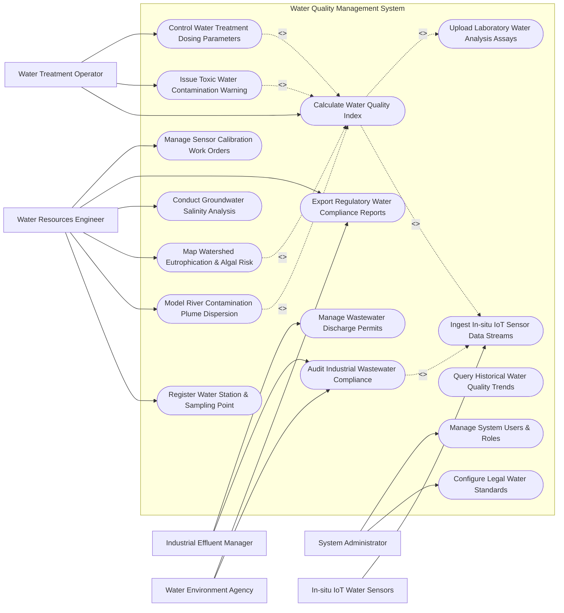

# Use Case Diagram — Water Quality Management System

## Mermaid Code

## Actor Table | Bang Actor

| # | Actor | Actor Type | Role Description | Related Use Cases |
|---|-------|------------|------------------|-------------------|
| 1 | Water Resources Engineer | Primary | Domain specialist modeling river basin quality, watershed risks, and managing station networks | UC01, UC05, UC09, UC10, UC13, UC15 |
| 2 | Water Treatment Operator | Primary | Utility engineer managing drinking water treatment intake gates, turbidity, and chemical dosing | UC03, UC06, UC08 |
| 3 | Industrial Effluent Manager | Primary | Factory EHS manager logging wastewater discharge rates, CEMS sensors, and permit parameters | UC07, UC11 |
| 4 | Water Environment Agency | Primary / Regulatory | Government authority auditing water body compliance, issuing discharge fines, and legal reports | UC07, UC13 |
| 5 | System Administrator | Primary | Technical admin managing legal water quality standards (QCVN), system rulesets, and user access | UC14, UC16 |
| 6 | In-situ IoT Water Sensors | Secondary / System | Submersible IoT sondes streaming real-time pH, DO, $BOD_5$, COD, TSS, and turbidity data | UC02 |

## Use Case Table | Bang Use Case

| # | UC ID | Use Case Name | Primary Actor | Secondary Actor | Description | Priority |
|---|-------|---------------|---------------|-----------------|-------------|----------|
| 1 | UC01 | Register Water Station & Sampling Point | Water Engineer | None | Configures new sampling point GIS coordinates, river mile marker, water body type, and sensor IDs | High |
| 2 | UC02 | Ingest In-situ IoT Sensor Data Streams | System | IoT Sensors | Ingests real-time water quality parameter streams (pH, DO, $BOD_5$, COD, TSS, Turbidity) via MQTT | High |
| 3 | UC03 | Calculate Water Quality Index | Water Operator | System | Computes sub-WQI and overall WQI ratings according to VN-WQI (QCVN 08:2023) and US NSF standards | High |
| 4 | UC04 | Upload Laboratory Water Analysis Assays | Water Engineer | Testing Lab | Ingests certified lab analysis reports for heavy metals ($Pb, As, Hg$), pesticides, and E. coli counts | High |
| 5 | UC05 | Model River Contamination Plume Dispersion | Water Engineer | System | Runs 2D/3D hydrodynamic dispersion models (QUAL2K / MIKE 11) to predict downstream toxic spill propagation | High |
| 6 | UC06 | Issue Toxic Water Contamination Warning | Water Operator | Alert Gateway | Dispatches emergency alerts and automated intake gate closure signals during heavy contamination spills | High |
| 7 | UC07 | Audit Industrial Wastewater Compliance | Water Discharge Manager | Water Agency | Compares industrial effluent CEMS telemetry against legal QCVN 40 discharge limits to detect violations | High |
| 8 | UC08 | Control Water Treatment Dosing Parameters | Water Operator | System | Computes optimal coagulant (PAC/Alum) and chlorine dosing rates based on raw water intake quality | High |
| 9 | UC09 | Map Watershed Eutrophication & Algal Risk | Water Engineer | Satellite Feed | Fuses satellite Chlorophyll-a rasters and nutrient levels (N, P) to generate algal bloom risk maps | Medium |
| 10 | UC10 | Conduct Groundwater Salinity Analysis | Water Engineer | System | Evaluates coastal aquifer salinity intrusion ($ppt$) and monitors freshwater-saltwater boundary movement | Medium |
| 11 | UC11 | Manage Wastewater Discharge Permits | Industrial Discharge Manager | Water Agency | Manages industrial facility discharge permits, maximum daily volume allocations ($m^3/day$), and renewals | High |
| 12 | UC12 | Query Historical Water Quality Trends | Water Engineer | None | Analyzes multi-year water quality trends, seasonal parameter fluctuations, and watershed recovery | Low |
| 13 | UC13 | Export Regulatory Water Compliance Reports | Water Engineer | Water Agency | Generates legal compliance reports, river basin health scorecards, and environmental audit logs | High |
| 14 | UC14 | Configure Legal Water Standards | System Administrator | Water Agency | Updates legal parameter threshold tables for QCVN 08 (Surface Water) and QCVN 40 (Wastewater) | Medium |
| 15 | UC15 | Manage Sensor Calibration Work Orders | Water Engineer | System | Tracks sensor probe calibration schedules, zero-span calibration logs, and sensor replacement work orders | Medium |
| 16 | UC16 | Manage System Users & Roles | System Administrator | None | Configures user credentials, organizational roles (Analyst, Operator, EHS, Regulatory), and permissions | Low |

## Use Case Specification | Dac ta Use Case

---

### UC02 — Ingest In-situ IoT Sensor Data Streams

| Field | Detail |
|-------|--------|
| **UC ID** | UC02 |
| **Use Case Name** | Ingest In-situ IoT Sensor Data Streams |
| **Actor(s)** | Primary: System   Secondary: In-situ IoT Water Sensors |
| **Description** | Ingests continuous, high-frequency water quality telemetry streams (pH, Dissolved Oxygen, $BOD_5$, COD, Total Suspended Solids, Turbidity, Electrical Conductivity, Temperature) from submersible IoT multiparameter sondes via secure MQTT/HTTP protocols. |
| **Precondition** | 1. Water monitoring station and sensor sonde are registered in system with active API access keys (UC01).   2. Sonde IoT gateway cellular/LoRaWAN connection is active. |
| **Main Flow** | 1. Submersible sensor sonde reads multiparameter water values at 5-minute sampling intervals.   2. Sonde IoT gateway packages readings into JSON payload containing: Station ID, Sensor Sonde ID, Timestamp, pH, Dissolved Oxygen ($mg/L$), $BOD_5 (mg/L)$, COD ($mg/L$), TSS ($mg/L$), Turbidity ($NTU$), Electrical Conductivity ($\mu S/cm$), Salinity ($ppt$), and Water Temperature ($^\circ C$).   3. Gateway transmits payload to System MQTT broker over TLS-encrypted connection.   4. System ingests packet, parses sensor fields, and validates payload integrity.   5. System executes Outlier & Sensor Fouling Detection Rules (e.g., checks if $pH < 1$ or $> 14$, or sudden DO drop to $0.00\text{ mg/L}$ caused by bio-fouling).   6. System applies sensor calibration slope and temperature-compensation factors based on active calibration log (UC15).   7. System writes validated 5-minute telemetry record to time-series database.   8. System updates real-time station monitoring dashboard and triggers 1-hour and 24-hour moving average calculations for WQI computation (UC03). |
| **Alternative Flow** | **AF1** — Batch Telemetry Upload: If station gateway operates in a remote area without continuous cellular coverage, gateway buffers telemetry locally and batch-uploads 24-hour data logs upon reaching network coverage. |
| **Exception Flow** | **EX1** — Bio-Fouling Signal Alert: Optical turbidity sensor lens experiences bio-fouling (flatline high reading); System flags sensor status as `FOULING_CLEANING_REQUIRED` and triggers automatic wiper air-purge mechanism.   **EX2** — Unauthorized Station Key: Ingestion request fails API key verification, system rejects payload and logs security security alert. |
| **Postcondition** | Calibrated, validated 5-minute water quality telemetry stored in time-series database and available for WQI calculation. |
| **Business Rule** | **BR1**: Raw unadjusted sensor values must be archived alongside calibrated values for audit trail integrity. |

---

### UC03 — Calculate Water Quality Index (WQI)

| Field | Detail |
|-------|--------|
| **UC ID** | UC03 |
| **Use Case Name** | Calculate Water Quality Index (WQI) |
| **Actor(s)** | Primary: Water Treatment Operator   Secondary: System |
| **Description** | Computes individual sub-WQI values for key water parameters (pH, DO, $BOD_5$, COD, $NH_4^+$, $PO_4^{3-}$, TSS, Turbidity, Coliforms) using 24-hour moving averages against legal breakpoint tables, determines the overall WQI rating, and categorizes water usability. |
| **Precondition** | 1. Validated telemetry data (UC02) or lab assay data (UC04) is recorded for target monitoring point.   2. National surface water quality standards (VN-WQI QCVN 08:2023/BTNMT) are configured in system (UC14). |
| **Main Flow** | 1. System retrieves 24-hour average values for physical, chemical, and microbiological parameters at target monitoring point.   2. System calculates sub-WQI ($q_i$) for each parameter using legal piecewise linear interpolation formulas:   &nbsp;&nbsp;&nbsp;&nbsp;$$q_i = \frac{BP_{Hi} - BP_{Lo}}{C_{Hi} - C_{Lo}} (C - C_{Lo}) + BP_{Lo}$$   &nbsp;&nbsp;&nbsp;&nbsp;where $C$ is parameter concentration and $BP$ are standard WQI score limits ($0 - 100$).   3. System calculates aggregate WQI score using the weighted multiplicative formula:   &nbsp;&nbsp;&nbsp;&nbsp;$$\text{WQI} = \text{WQI}_{pH} \times \left( \frac{1}{n} \sum_{i=1}^{n} q_i \right)^{0.5}$$   4. System maps calculated WQI score ($0 - 100$) to standardized color-coded usability categories:   &nbsp;&nbsp;&nbsp;&nbsp;a. **91 - 100** (Blue): `Very Good` — Suitable for domestic water supply.   &nbsp;&nbsp;&nbsp;&nbsp;b. **76 - 90** (Green): `Good` — Suitable for domestic supply with treatment, aquaculture.   &nbsp;&nbsp;&nbsp;&nbsp;c. **51 - 75** (Yellow): `Medium` — Suitable for agricultural irrigation, navigation.   &nbsp;&nbsp;&nbsp;&nbsp;d. **26 - 50** (Orange): `Poor` — Suitable for navigation only; restricted use.   &nbsp;&nbsp;&nbsp;&nbsp;e. **10 - 25** (Red): `Very Poor` — Heavily polluted; treatment required before any use.   &nbsp;&nbsp;&nbsp;&nbsp;f. **< 10** (Purple): `Severe Contamination` — Toxic pollution; immediate remediation required.   5. System identifies dominant polluting parameter causing WQI reduction (e.g., $BOD_5$ or $NH_4^+$).   6. System updates public web portal, mobile app feeds, and triggers alert evaluation if WQI $< 50$ (UC06). |
| **Alternative Flow** | **AF1** — US NSF WQI Calculation: System calculates WQI according to National Sanitation Foundation (NSF) 9-parameter weighted index for international reporting. |
| **Exception Flow** | **EX1** — Critical Dissolved Oxygen Depletion: Dissolved Oxygen drops below $1.0\text{ mg/L}$ (hypoxia/fish-kill threshold); system immediately triggers high-priority environmental emergency alarm. |
| **Postcondition** | Calculated sub-WQI scores, overall WQI value ($0-100$), and usability category saved in database and displayed on dashboards. |
| **Business Rule** | **BR1**: If pH is $< 5.5$ or $> 9.0$, overall WQI score must be automatically capped at maximum 50 regardless of other parameters. |

---

### UC05 — Model River Contamination Plume Dispersion

| Field | Detail |
|-------|--------|
| **UC ID** | UC05 |
| **Use Case Name** | Model River Contamination Plume Dispersion |
| **Actor(s)** | Primary: Water Resources Engineer   Secondary: System |
| **Description** | Simulates 2D/3D hydrodynamic river contaminant transport using advection-dispersion models (QUAL2K / MIKE 11) to predict the downstream travel speed, concentration decay, and arrival time of a chemical or industrial toxic spill. |
| **Precondition** | 1. River bathymetry, stream velocity ($m/s$), and flow rate ($m^3/s$) data are ingested.   2. Contaminant spill parameters (spill location, pollutant type, mass/volume spilled, release duration) are defined. |
| **Main Flow** | 1. Engineer selects "River Plume Dispersion Model" module and picks target river basin segment.   2. Engineer inputs spill details: Location GPS / River Kilometer Mark, Pollutant Code (e.g., Cyanide, Heavy Metal, Diesel Oil, Phenol), Spill Volume ($m^3$), and Concentration ($mg/L$).   3. System retrieves real-time river flow velocity ($m/s$) and water temperature from upstream IoT stations.   4. System executes 2D Advection-Dispersion differential equations incorporating decay coefficients ($k_d$):   &nbsp;&nbsp;&nbsp;&nbsp;$$\frac{\partial C}{\partial t} = D_x \frac{\partial^2 C}{\partial x^2} - u \frac{\partial C}{\partial x} - k_d C$$   5. System computes contaminant peak concentration ($mg/L$) and arrival time ($hours$) for downstream intake points (e.g., municipal water treatment plant intake 15 km downstream).   6. System generates animated spatial GIS plume map showing contaminant spread over 48 hours.   7. System identifies impacted water intakes, fish farms, and agricultural diversion canals along the river.   8. System prompts dispatch of automated warning alerts to downstream intake operators (UC06). |
| **Alternative Flow** | **AF1** — Estuary Tidal Plume Modeling: For coastal river mouths, system incorporates 3D tidal oscillation models to predict reverse salt wedge and contaminant movement during high tide. |
| **Exception Flow** | **EX1** — Unstable Model Convergence: Extreme river turbulence parameters cause numerical instability; system automatically adjusts time-step size ($\Delta t$) and re-executes solver. |
| **Postcondition** | Contaminant arrival times, peak concentration projections, and spatial GIS plume animations recorded in system database. |
| **Business Rule** | **BR1**: Downstream water treatment plant intakes must be notified at least 4 hours prior to predicted toxic plume arrival. |

---

### UC07 — Audit Industrial Wastewater Compliance

| Field | Detail |
|-------|--------|
| **UC ID** | UC07 |
| **Use Case Name** | Audit Industrial Wastewater Compliance |
| **Actor(s)** | Primary: Industrial Effluent Manager   Secondary: Water Environment Agency |
| **Description** | Continuously audits industrial factory wastewater treatment plant (WWTP) effluent discharge logs and CEMS telemetry against legal national standards (QCVN 40:2011/BTNMT) to detect parameter violations and manage discharge permits. |
| **Precondition** | 1. Industrial facility profile and active discharge permit (UC11) are registered.   2. Effluent CEMS telemetry sensors (flow rate, pH, Temp, COD, TSS, Heavy Metals) are active. |
| **Main Flow** | 1. System ingests continuous 5-minute effluent CEMS telemetry from factory discharge pipe (UC02).   2. System retrieves legal discharge parameters assigned to facility permit (Class A or Class B limits under QCVN 40).   3. System evaluates measured parameters against permit limits (e.g., $COD \le 75\text{ mg/L}$ for Class A, $pH$ between $6.0 - 9.0$, $TSS \le 50\text{ mg/L}$).   4. System calculates cumulative daily discharge volume ($m^3/day$) and compares against permitted daily quota.   5. If all parameters comply, system logs transaction as `COMPLIANT_EFFLUENT`.   6. If any parameter exceeds permit limits for $>15$ continuous minutes, system logs `VIOLATION_DETECTED`.   7. System compiles Violation Evidence Package: Facility Name, Tax Code, Pipe ID, Exceeded Parameter, Measured Concentration, Legal Limit, Duration, and Discharge Volume.   8. System dispatches real-time exceedance alert to Industrial Effluent Manager and Water Environment Agency enforcement officer.   9. Water Environment Agency generates formal Administrative Pollution Fine Notice (UC13). |
| **Alternative Flow** | **AF1** — Automated Outlet Shutoff Valve Trigger: For high-risk chemical plants, system sends automated signal to close motorized effluent discharge valve upon detecting acute cyanide or heavy metal spike. |
| **Exception Flow** | **EX1** — CEMS Telemetry Disconnection Violation: CEMS signal is lost for $>30$ minutes while factory is operating; system logs `TELEMETRY_TAMPERING_SUSPECTED` and flags site for emergency inspection. |
| **Postcondition** | Effluent audit transaction logged, compliance status updated, and violation notices generated if non-compliant. |
| **Business Rule** | **BR1**: Parameter exceedance lasting $>15$ continuous minutes constitutes a legal violation under national water protection law. |

---

### UC09 — Map Watershed Eutrophication & Algal Risk

| Field | Detail |
|-------|--------|
| **UC ID** | UC09 |
| **Use Case Name** | Map Watershed Eutrophication & Algal Risk |
| **Actor(s)** | Primary: Water Resources Engineer   Secondary: Hydrological & Satellite Feed |
| **Description** | Combines satellite Chlorophyll-a remote sensing rasters, in-situ nitrogen ($N$) and phosphorus ($P$) nutrient sampling, and water temperature data to map lake/reservoir eutrophication indices (Carlson Trophic State Index) and predict toxic cyanobacteria algal bloom outbreaks. |
| **Precondition** | 1. Satellite Chlorophyll-a and surface water temperature rasters are ingested.   2. Total Nitrogen (TN) and Total Phosphorus (TP) lab/sensor readings are available. |
| **Main Flow** | 1. Engineer selects target lake, reservoir, or river estuary basin.   2. System retrieves latest satellite Sentinel-2 multispectral Chlorophyll-a ($\mu g/L$) raster layer.   3. System fetches in-situ Total Nitrogen ($mg/L$), Total Phosphorus ($mg/L$), and Secchi Disk Transparency ($meters$) data.   4. System calculates Carlson Trophic State Index (TSI) for Chlorophyll-a ($\text{TSI}_{Chl}$), Phosphorus ($\text{TSI}_{TP}$), and Transparency ($\text{TSI}_{SD}$):   &nbsp;&nbsp;&nbsp;&nbsp;$$\text{TSI}_{Chl} = 9.81 \ln(\text{Chl-a}) + 30.6$$   5. System classifies trophic status: `Oligotrophic` ($TSI < 40$), `Mesotrophic` ($40 - 50$), `Eutrophic` ($50 - 70$), or `Hypereutrophic` ($TSI > 70$).   6. System evaluates algal bloom outbreak risk based on water temperature ($>25^\circ C$), solar radiation, and $N:P$ ratio.   7. System renders spatial GIS eutrophication map displaying algal bloom risk zones (Red = High Risk of Microcystin Cyanobacteria).   8. System dispatches warning notifications to municipal water treatment operators to adjust carbon filtration against taste/odor compounds. |
| **Alternative Flow** | **AF1** — Aquaculture Pond Algal Bloom Warning: System dispatches localized dissolved oxygen depletion warnings to fish/shrimp farmers when hypereutrophic conditions threaten nocturnal fish kills. |
| **Exception Flow** | **EX1** — Cloud Cover Interference: Heavy cloud cover obstructs satellite optical imagery; system uses in-situ sensor fluorometer Chlorophyll-a readings for spatial interpolation. |
| **Postcondition** | Trophic State Index (TSI) scores, eutrophication maps, and cyanobacteria risk alerts saved in system database. |
| **Business Rule** | **BR1**: $\text{TSI} > 70$ (Hypereutrophic) triggers mandatory cyanotoxin (Microcystin-LR) laboratory screening for drinking water reservoirs. |
