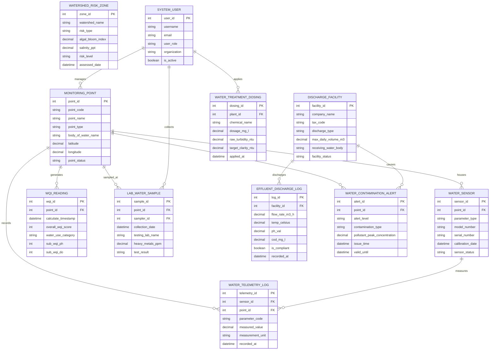

# Conceptual ERD — Water Quality Management System

## Mermaid Code

## Entity Description Table | Bang mo ta Entity

| # | Entity Name | Vietnamese Name | Description | Key Attributes | Main Relationships |
|---|-------------|-----------------|-------------|----------------|-------------------|
| 1 | MONITORING_POINT | Điểm Quan Trắc Nguồn Nước | Stores physical sampling station details, GIS coordinates, river mile marker, water body name, and point status | point_id, point_code, point_name, point_type, body_of_water_name, latitude, longitude, point_status | Houses WATER_SENSOR, records TELEMETRY_LOG, generates WQI_READING, triggers ALERT |
| 2 | WATER_SENSOR | Thiết Bị Cảm Biến Nước | Stores individual submersible sensor sonde specs, parameter measured (pH, DO, Turbidity), serials, and calibration dates | sensor_id, point_id, parameter_type, model_number, serial_number, sensor_status | Housed in MONITORING_POINT, measures WATER_TELEMETRY_LOG |
| 3 | WATER_TELEMETRY_LOG | Nhật Ký Telemetry Nguồn Nước | High-frequency telemetry storing raw measured water quality parameters, units, and timestamps | telemetry_id, sensor_id, point_id, parameter_code, measured_value, recorded_at | Measured by WATER_SENSOR, recorded at MONITORING_POINT |
| 4 | WQI_READING | Kết Quả Chỉ Số WQI | Captures computed Water Quality Index (WQI) scores ($0-100$), sub-WQI values, usability categories, and dominant pollutants | wqi_id, point_id, calculate_timestamp, overall_wqi_score, water_use_category, sub_wqi_ph, sub_wqi_do | Generated by MONITORING_POINT |
| 5 | LAB_WATER_SAMPLE | Mẫu Nước Kiểm Nghiệm Lab | Captures certified laboratory test results for heavy metals ($Pb, As, Hg$), pesticides, E. coli, and total coliforms | sample_id, point_id, sampler_id, collection_date, testing_lab_name, heavy_metals_ppm, test_result | Sampled at MONITORING_POINT, collected by SYSTEM_USER |
| 6 | DISCHARGE_FACILITY | Cơ Sở Xả Thải Công Nghiệp | Stores industrial factory master profile, corporate tax code, maximum daily discharge volume ($m^3/day$), and receiving river | facility_id, company_name, tax_code, discharge_type, max_daily_volume_m3, facility_status | Discharges EFFLUENT_DISCHARGE_LOG, causes WATER_CONTAMINATION_ALERT |
| 7 | EFFLUENT_DISCHARGE_LOG | Nhật Ký Xả Thải Nước Thải | Stores continuous industrial wastewater discharge telemetry (flow rate, pH, temp, COD, TSS) and compliance status | log_id, facility_id, flow_rate_m3_h, temp_celsius, ph_val, cod_mg_l, is_compliant, recorded_at | Discharged by DISCHARGE_FACILITY |
| 8 | WATER_CONTAMINATION_ALERT | Cảnh Báo Ô Nhiễm Nguồn Nước | Records emergency toxic spill alerts, peak pollutant concentrations, affected river stretches, and valid alert periods | alert_id, point_id, alert_level, contamination_type, pollutant_peak_concentration, issue_time | Triggered by MONITORING_POINT, caused by DISCHARGE_FACILITY |
| 9 | WATER_TREATMENT_DOSING | Liều Lượng Hóa Chất Xử Lý | Logs water treatment plant coagulant (PAC/Alum) and chlorine chemical dosing rates ($mg/L$) and turbidity results | dosing_id, plant_id, chemical_name, dosage_mg_l, raw_turbidity_ntu, target_clarity_ntu, applied_at | Applied by SYSTEM_USER |
| 10 | WATERSHED_RISK_ZONE | Vùng Rủi Ro Lưu Vực Sông | Tracks watershed eutrophication indices, Chlorophyll-a satellite rasters, salinity intrusion levels ($ppt$), and risk levels | zone_id, watershed_name, risk_type, algal_bloom_index, salinity_ppt, risk_level, assessed_date | Evaluates watershed regions |
| 11 | SYSTEM_USER | Người Dùng Hệ Thống | Stores user credentials, roles (Water Engineer, Treatment Operator, EHS Manager, Regulatory), and permissions | user_id, username, email, user_role, organization, is_active | Collects LAB_WATER_SAMPLE, applies WATER_TREATMENT_DOSING, manages MONITORING_POINT |

## Relationship Description | Mo ta Quan he

| # | From Entity | Cardinality | To Entity | Relationship Label | Business Explanation |
|---|-------------|-------------|-----------|-------------------|----------------------|
| 1 | MONITORING_POINT | one-to-many | WATER_SENSOR | houses | A water monitoring point houses multiple submersible sensor sondes (pH, DO, Turbidity) |
| 2 | MONITORING_POINT | one-to-many | WATER_TELEMETRY_LOG | records | A monitoring point records continuous time-series water quality telemetry log entries |
| 3 | WATER_SENSOR | one-to-many | WATER_TELEMETRY_LOG | measures | A water sensor device measures high-frequency parameter values over time |
| 4 | MONITORING_POINT | one-to-many | WQI_READING | generates | A monitoring point generates hourly and daily Water Quality Index (WQI) ratings |
| 5 | MONITORING_POINT | one-to-many | LAB_WATER_SAMPLE | sampled_at | Physical lab water samples are collected at specific registered monitoring points |
| 6 | MONITORING_POINT | one-to-many | WATER_CONTAMINATION_ALERT | triggers | Parameter spikes at a monitoring point trigger automated emergency contamination alerts |
| 7 | DISCHARGE_FACILITY | one-to-many | EFFLUENT_DISCHARGE_LOG | discharges | An industrial discharge facility discharges continuous effluent logged by CEMS sensors |
| 8 | SYSTEM_USER | one-to-many | LAB_WATER_SAMPLE | collects | A water sampling technician user collects physical field samples for laboratory analysis |
| 9 | SYSTEM_USER | one-to-many | WATER_TREATMENT_DOSING | applies | A treatment plant operator user applies chemical dosing adjustments at water treatment plants |
| 10 | SYSTEM_USER | one-to-many | MONITORING_POINT | manages | Water resources engineer users manage physical station metadata and sensor health |
| 11 | DISCHARGE_FACILITY | one-to-many | WATER_CONTAMINATION_ALERT | causes | An illegal industrial discharge from a facility can cause downstream contamination alerts |
