# Swimlane Diagram — Water Quality Management System

## Mermaid Code

```mermaid
flowchart LR
    Start(["Start Water Quality Cycle"])

    subgraph SensorLane["In-situ IoT Sensors & Effluent Meters"]
        S1["Measure Water Parameters in River/Effluent"]
        S2["Stream 5-Min Telemetry Data via MQTT"]
    end

    subgraph SystemLane["Water Quality Management System"]
        M1["Ingest & Validate Telemetry Data"]
        M2["Compute Sub-WQI & Overall WQI Score"]
        M3{"Toxic Spill or WQI < 50 Detected?"}
        M4["Generate River Dispersion Plume Model"]
        M5["Log Effluent Exceedance Violation"]
    end

    subgraph EngineerLane["Water Resources Engineer / Analyst"]
        E1["Monitor River Basin WQI Heatmap"]
        E2["Audit Downstream Plume Arrival Time"]
        E3["Issue Legal Violation Notice to Factory"]
    end

    subgraph DischargeLane["Industrial Effluent Discharge Manager"]
        D1["Receive Effluent Exceedance Alarm"]
        D2["Close Outlet Shutoff Valve"]
    end

    subgraph OperatorLane["Water Treatment Plant & Public Alert"]
        P1["Receive Raw Water Contamination Alert"]
        P2["Close Water Intake Gates"]
        P3["Adjust Coagulant & Chlorine Dosing"]
    end

    Finish(["End Operational Cycle"])

    Start --> S1 --> S2 --> M1 --> M2 --> M3
    M3 -->|"Normal WQI >= 50"| E1 --> P3 --> Finish
    M3 -->|"Toxic Spill / WQI < 50"| M4 --> E2 --> P1 --> P2 --> Finish
    M3 -->|"Industrial Effluent Violation"| M5 --> D1 --> D2 --> E3 --> Finish
```

## Flow Description | Mo ta luong

| Lane | Actor | Role in Flow |
|------|-------|-------------|
| 1 | In-situ IoT Sensors & Effluent Meters | Submersible IoT sondes and factory CEMS meters measure physical, chemical, and microbiological water parameters (pH, DO, $BOD_5$, COD, TSS, Turbidity) and stream 5-minute telemetry over TLS MQTT |
| 2 | Water Quality Management System | Ingests and validates water telemetry streams, calculates sub-WQI and overall WQI ratings ($0-100$), evaluates contamination thresholds ($WQI < 50$), models 2D/3D river plume dispersion, and logs effluent violations |
| 3 | Water Resources Engineer / Analyst | Monitors real-time river basin WQI heatmaps, audits downstream contaminant plume propagation speed and arrival times, and issues administrative violation fines to non-compliant factories |
| 4 | Industrial Effluent Discharge Manager | Receives automated wastewater parameter exceedance alarms, closes motorized effluent discharge shutoff valves, and adjusts internal factory WWTP chemical treatment processes |
| 5 | Water Treatment Plant & Public Alert | Receives high-priority raw water intake contamination alerts, executes emergency automated intake gate closures to protect municipal water supplies, and adjusts plant chemical dosing (PAC/Chlorine) |
