# Action Tree — Water Quality Management System

## Mermaid Code

```mermaid
graph TD
    Root["Water Quality Management System"]

    Root --> M1["Water Sampling Point & Sensor Registry"]
    Root --> M2["IoT & Effluent Telemetry Data Ingestion"]
    Root --> M3["WQI Computation & Plume Dispersion Modeling"]
    Root --> M4["Industrial Wastewater Discharge & Compliance"]
    Root --> M5["Eutrophication, Algae & Salinity Analytics"]
    Root --> M6["Toxic Contamination Alert & Dosing Control"]
    Root --> M7["Calibration Maintenance & System Administration"]

    M1 --> A11["Register River & Reservoir Sampling Point"]
    M1 --> A12["Configure Submersible IoT Sensor Sondes"]
    M1 --> A13["Set Sampling Frequency & Data Telemetry Protocols"]
    M1 --> A14["Track Station Power & Wiper Hardware Health"]

    M2 --> A21["Ingest 5-Minute IoT Water Sensor Data Streams"]
    M2 --> A22["Collect Factory WWTP Effluent CEMS Telemetry"]
    M2 --> A23["Execute Bio-Fouling Signal & Outlier Filtering"]
    M2 --> A24["Ingest Certified Lab Heavy Metal Assays"]

    M3 --> A31["Calculate Sub-WQI Scores per Parameter"]
    M3 --> A32["Determine Overall WQI & Usability Category"]
    M3 --> A33["Run 2D Hydrodynamic Plume Dispersion Simulation"]
    M3 --> A34["Predict Downstream Contaminant Arrival Times"]

    M4 --> A41["Audit Industrial Effluent vs QCVN 40 Limits"]
    M4 --> A42["Compile Violation Evidence Package"]
    M4 --> A43["Track Industrial Wastewater Discharge Permits"]
    M4 --> A44["Trigger Automated Discharge Pipe Shutoff Valves"]

    M5 --> A51["Ingest Satellite Chlorophyll-a Remote Sensing"]
    M5 --> A52["Calculate Carlson Trophic State Index (TSI)"]
    M5 --> A53["Map Cyanobacteria Algal Bloom Risk Zones"]
    M5 --> A54["Track Coastal Groundwater Salinity Intrusion"]

    M6 --> A61["Detect Acute Toxic Spill & Hypoxia Events"]
    M6 --> A62["Dispatch Water Treatment Intake Closure Signals"]
    M6 --> A63["Calculate Coagulant & Chlorine Treatment Dosing"]
    M6 --> A64["Broadcast Public Beach & Swimming Safety Alerts"]

    M7 --> A71["Record Sensor Zero-Span Calibration Logs"]
    M7 --> A72["Update QCVN 08 & 40 Legal Parameter Formulas"]
    M7 --> A73["Dispatch Sensor Sonde Cleaning Work Orders"]
    M7 --> A74["Manage User Roles & System Security Credentials"]
```

## Module Description | Mo ta Module

| # | Module | Description | Actions |
|---|--------|-------------|---------|
| 1 | Water Sampling Point & Sensor Registry | Manages river, lake, and estuary monitoring station registrations, GIS coordinates, submersible sensor sonde profiles, and hardware wiper maintenance status | Register River & Reservoir Sampling Point, Configure Submersible IoT Sensor Sondes, Set Sampling Frequency & Data Telemetry Protocols, Track Station Power & Wiper Hardware Health |
| 2 | IoT & Effluent Telemetry Data Ingestion | Ingests 5-minute IoT water quality telemetry, factory effluent CEMS data, filters out sensor bio-fouling anomalies, and integrates certified lab heavy metal test reports | Ingest 5-Minute IoT Water Sensor Data Streams, Collect Factory WWTP Effluent CEMS Telemetry, Execute Bio-Fouling Signal & Outlier Filtering, Ingest Certified Lab Heavy Metal Assays |
| 3 | WQI Computation & Plume Dispersion Modeling | Computes parameter sub-WQIs, overall WQI ratings ($0-100$), categorizes water usability, and runs 2D advection-dispersion plume models to predict downstream spill transport | Calculate Sub-WQI Scores per Parameter, Determine Overall WQI & Usability Category, Run 2D Hydrodynamic Plume Dispersion Simulation, Predict Downstream Contaminant Arrival Times |
| 4 | Industrial Wastewater Discharge & Compliance | Audits factory CEMS effluent logs against legal QCVN 40 limits, compiles legal violation evidence packages, tracks discharge permits, and triggers automated shutoff valves | Audit Industrial Effluent vs QCVN 40 Limits, Compile Violation Evidence Package, Track Industrial Wastewater Discharge Permits, Trigger Automated Discharge Pipe Shutoff Valves |
| 5 | Eutrophication, Algae & Salinity Analytics | Fuses satellite Chlorophyll-a rasters and nutrient levels to compute Carlson Trophic State Index (TSI), maps algal bloom risks, and tracks estuarine salinity intrusion | Ingest Satellite Chlorophyll-a Remote Sensing, Calculate Carlson Trophic State Index (TSI), Map Cyanobacteria Algal Bloom Risk Zones, Track Coastal Groundwater Salinity Intrusion |
| 6 | Toxic Contamination Alert & Dosing Control | Detects acute toxic spills and hypoxia, sends automated signals to close water treatment intake gates, calculates chemical dosing (PAC/Chlorine), and alerts the public | Detect Acute Toxic Spill & Hypoxia Events, Dispatch Water Treatment Intake Closure Signals, Calculate Coagulant & Chlorine Treatment Dosing, Broadcast Public Beach & Swimming Safety Alerts |
| 7 | Calibration Maintenance & System Admin | Tracks zero-span sensor calibration logs, updates QCVN 08/40 legal parameter breakpoint tables, dispatches probe cleaning work orders, and manages user security roles | Record Sensor Zero-Span Calibration Logs, Update QCVN 08 & 40 Legal Parameter Formulas, Dispatch Sensor Sonde Cleaning Work Orders, Manage User Roles & System Security Credentials |
