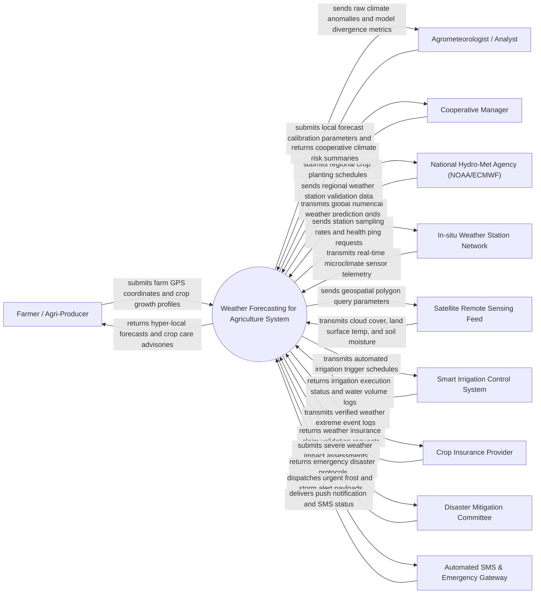

# Context Diagram — Weather Forecasting for Agriculture System

## Mermaid Code

## Actor & Interaction Table | Bang Actor & Tuong tac

| # | Actor | Actor Type | Data Sent TO System | Data Received FROM System | Notes |
|---|-------|------------|---------------------|---------------------------|-------|
| 1 | Farmer / Agri-Producer | Primary | Farm GPS coordinates, crop species, planting dates, soil type, irrigation setup | Hyper-local 7-day weather forecasts, evapotranspiration (ET0) metrics, frost alerts, spraying window advice | Primary beneficiary adjusting daily farming, spraying, and harvesting decisions based on climate forecasts |
| 2 | Agrometeorologist / Analyst | Primary | Downscaling model adjustments, regional weather bulletins, microclimate threshold calibrations | High-resolution climate anomaly maps, model prediction variance, historical climate comparisons | Expert meteorologist validating AI forecasting algorithms and publishing specialized agricultural bulletins |
| 3 | Cooperative Manager | Primary | Group farm locations, aggregated crop acreage, seasonal harvest timelines | Regional microclimate risk reports, group irrigation schedules, extreme weather exposure summaries | Manager coordinating planting and harvest schedules across multiple cooperative farm plots |
| 4 | National Hydro-Met Agency (NOAA/ECMWF) | Supporting System | Global GFS/ECMWF numerical weather prediction model feeds, radar precipitation grids | Station ground-truth data, regional microclimate feedback | Official meteorological organization supplying macro-level atmospheric dynamics and radar feeds |
| 5 | In-situ Weather Station Network | Supporting System | Real-time ambient temperature, solar radiation, wind speed, relative humidity, rainfall, leaf wetness | Sensor polling interval updates, station status queries, calibration offsets | Physical IoT weather stations deployed across agricultural fields measuring microclimate data |
| 6 | Satellite Remote Sensing Feed | Supporting System | Multispectral satellite thermal bands, land surface temperature (LST), SMAP soil moisture indices | Field polygon boundaries, spectral band request queries | Satellite imagery providers furnishing thermal and soil moisture data for downscaling models |
| 7 | Smart Irrigation Control System | Supporting System | Pump status logs, water applied volumes, soil moisture feedback readings | Daily evapotranspiration loss estimates, automated irrigation run-time schedules | Automated field valves and pumps executing variable-rate irrigation based on weather forecasts |
| 8 | Crop Insurance Provider | Supporting System | Weather index insurance policies, claim verification requests | Certified weather station telemetry logs, extreme rain/frost event certificates | Financial institution using verified weather telemetry to validate parametric crop disaster claims |
| 9 | Disaster Mitigation Committee | Supporting System | Regional flood/drought emergency directives, evacuation rules | Severe storm warnings, projected agricultural flood impact, drought severity indices | Government agency coordinating emergency response during extreme weather disasters |
| 10 | Automated SMS & Emergency Gateway | Supporting System | SMS delivery receipts, network dispatch status | High-priority frost alerts, heavy rain warnings, hail storm alerts | Notification gateway dispatching urgent alerts to farmers lacking smartphone data connections |

## System Boundary Description | Mo ta Pham vi He thong

The **Weather Forecasting for Agriculture System** is an advanced agrometeorological platform designed to ingest global weather models, downscale macro predictions using local IoT weather stations and satellite imagery, compute crop evapotranspiration (ET0), and generate actionable farming advisories.

The **system boundary** includes multi-source weather data ingestion, spatial downscaling algorithms, evapotranspiration and soil water balance modeling, microclimate alert generation, agricultural decision support (irrigation/spraying windows), insurance event certification, and emergency alert dispatching.

**External to the system boundary** are physical atmospheric weather satellite constellations, global supercomputer numerical weather prediction operations, physical weather station hardware manufacturing, automated irrigation valve mechanical operation, and financial insurance fund clearing. Interfaces operate via secure REST web services, MQTT telemetry brokers, GRIB2/NetCDF weather data decoders, and geospatial GIS feeds.
