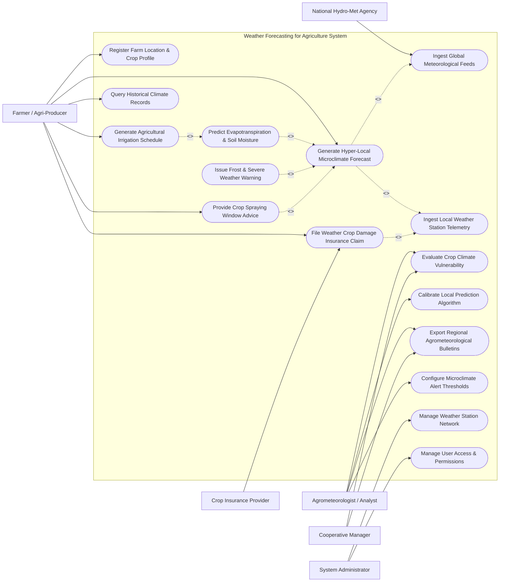

# Use Case Diagram — Weather Forecasting for Agriculture System

## Mermaid Code

## Actor Table | Bang Actor

| # | Actor | Actor Type | Role Description | Related Use Cases |
|---|-------|------------|------------------|-------------------|
| 1 | Farmer / Agri-Producer | Primary | Individual agricultural land operator using weather insights to optimize daily field activities | UC01, UC04, UC07, UC08, UC11, UC12 |
| 2 | Agrometeorologist / Analyst | Primary | Domain specialist analyzing microclimate patterns, calibrating downscaling AI models, and writing bulletins | UC09, UC10, UC13, UC14 |
| 3 | Cooperative Manager | Primary | Manager overseeing regional crop planning across multiple cooperative farm holdings | UC09, UC13 |
| 4 | System Administrator | Primary | Technical administrator maintaining IoT weather stations, system pipelines, and user roles | UC15, UC16 |
| 5 | National Hydro-Met Agency | Secondary / System | Weather service providing GFS/ECMWF global numerical weather prediction data feeds | UC02 |
| 6 | Crop Insurance Provider | Secondary / System | Financial organization verifying climate telemetry for parametric weather insurance claims | UC11 |

## Use Case Table | Bang Use Case

| # | UC ID | Use Case Name | Primary Actor | Secondary Actor | Description | Priority |
|---|-------|---------------|---------------|-----------------|-------------|----------|
| 1 | UC01 | Register Farm Location & Crop Profile | Farmer / Agri-Producer | None | Saves farm GPS polygon, crop species, growth stage, soil type, and elevation | High |
| 2 | UC02 | Ingest Global Meteorological Feeds | System | National Hydro-Met Agency | Decodes GRIB2/NetCDF feeds from GFS/ECMWF for macro-level weather models | High |
| 3 | UC03 | Ingest Local Weather Station Telemetry | System | Weather Station Network | Collects real-time IoT sensor readings (temp, humidity, rain, solar, wind) | High |
| 4 | UC04 | Generate Hyper-Local Microclimate Forecast | System | Agrometeorologist | Blends global models with station telemetry to output 1km-grid 7-day forecasts | High |
| 5 | UC05 | Predict Evapotranspiration & Soil Moisture | System | None | Calculates FAO-56 Penman-Monteith ET0 and estimates root zone soil water depletion | High |
| 6 | UC06 | Issue Frost & Severe Weather Warning | System | Notification Gateway | Dispatches emergency alerts for frost, heatwaves, heavy rainfall, or high winds | High |
| 7 | UC07 | Generate Agricultural Irrigation Schedule | Farmer / Agri-Producer | Smart Irrigation | Computes optimal irrigation water volume and run times based on ET0 and rainfall | High |
| 8 | UC08 | Provide Crop Spraying Window Advice | Farmer / Agri-Producer | None | Evaluates wind speed, rain probability, and temperature to find optimal spray hours | High |
| 9 | UC09 | Evaluate Crop Climate Vulnerability | Agrometeorologist | Cooperative Manager | Assesses seasonal drought, heat stress, or flood risks for specific crop varieties | Medium |
| 10 | UC10 | Calibrate Local Prediction Algorithm | Agrometeorologist | System | Adjusts machine learning downscaling model weights using historical station errors | Medium |
| 11 | UC11 | File Weather Crop Damage Insurance Claim | Farmer / Agri-Producer | Crop Insurance | Generates certified weather station telemetry reports for index insurance claims | Medium |
| 12 | UC12 | Query Historical Climate Records | Farmer / Agri-Producer | None | Analyzes multi-year historical rainfall, temperature trends, and degree-day units | Low |
| 13 | UC13 | Export Regional Agrometeorological Bulletins | Agrometeorologist | Cooperative Manager | Publishes weekly crop-weather advisories and regional seasonal climate outlooks | Medium |
| 14 | UC14 | Configure Microclimate Alert Thresholds | Agrometeorologist | None | Sets custom temperature, rainfall, or leaf wetness triggers for automated alerts | Medium |
| 15 | UC15 | Manage Weather Station Network | System Administrator | Weather Station Network | Monitors IoT station battery, sensor calibration status, and communications | High |
| 16 | UC16 | Manage User Access & Permissions | System Administrator | None | Manages user credentials, subscriber tiers, API tokens, and access roles | Low |

## Use Case Specification | Dac ta Use Case

---

### UC04 — Generate Hyper-Local Microclimate Forecast

| Field | Detail |
|-------|--------|
| **UC ID** | UC04 |
| **Use Case Name** | Generate Hyper-Local Microclimate Forecast |
| **Actor(s)** | Primary: System   Secondary: Agrometeorologist / Analyst |
| **Description** | Downscales global numerical weather prediction (NWP) models (GFS/ECMWF) using local weather station telemetry, DEM elevation models, and machine learning to produce 1km-grid hourly/daily forecasts for registered farm coordinates. |
| **Precondition** | 1. Global GRIB2 model feeds are successfully ingested for current run time (00z/12z).   2. Local weather station telemetry data is current within the last 15 minutes. |
| **Main Flow** | 1. System extracts macro forecast parameters (surface pressure, 2m temperature, 10m wind, precipitable water) for target farm grid.   2. System retrieves terrain elevation, slope, aspect, and coastal distance for the registered farm GPS coordinates.   3. System fetches real-time temperature, humidity, and pressure bias from the nearest IoT weather stations.   4. Machine learning downscaling algorithm applies spatial kriging and bias correction to calculate hyper-local weather parameters.   5. System computes 7-day hourly forecasts: temperature, relative humidity, precipitation amount & probability, wind speed/direction, solar irradiance, and atmospheric pressure.   6. System checks forecast output against physical consistency rules (e.g., max temp $\ge$ min temp).   7. System saves hyper-local forecast payload and pushes updates to farmer dashboard. |
| **Alternative Flow** | **AF1** — Station Telemetry Unavailable: If local weather station is offline, system uses satellite thermal imagery bias correction as backup downscaling input.   **AF2** — High Resolution Ensembles: For premium subscribers, system runs a 10-member ensemble forecast to output probabilistic confidence intervals (p10, p50, p90 rainfall). |
| **Exception Flow** | **EX1** — Global Model Ingestion Delay: If ECMWF feed is delayed, system automatically falls back to GFS model feed and logs warning.   **EX2** — Extreme Divergence Flag: If downscaled temperature differs by >$8^\circ\text{C}$ from physical station readings, system flags forecast for manual Agrometeorologist review (UC10). |
| **Postcondition** | 1km-resolution 7-day hyper-local forecast stored in database and available via API/mobile app. |
| **Business Rule** | **BR1**: Forecasts must be re-calculated every 6 hours following global model cycle updates.   **BR2**: Spatial grid resolution must not exceed $1\text{ km} \times 1\text{ km}$ for agricultural registered plots. |

---

### UC05 — Predict Evapotranspiration & Soil Moisture

| Field | Detail |
|-------|--------|
| **UC ID** | UC05 |
| **Use Case Name** | Predict Evapotranspiration & Soil Moisture |
| **Actor(s)** | Primary: System   Secondary: None |
| **Description** | Calculates reference crop evapotranspiration ($\text{ET}_0$) using the FAO-56 Penman-Monteith equation and estimates actual crop evapotranspiration ($\text{ET}_c$) and soil moisture depletion in the root zone. |
| **Precondition** | 1. Hyper-local forecast (UC04) is generated for target farm location.   2. Crop species, growth stage coefficient ($K_c$), and soil water capacity parameters are defined in crop profile. |
| **Main Flow** | 1. System extracts hourly solar radiation, 2m air temperature, relative humidity, and 2m wind speed from hyper-local forecast.   2. System executes FAO-56 Penman-Monteith equation to calculate daily reference evapotranspiration ($\text{ET}_0$ in mm/day).   3. System applies crop coefficient ($K_c$) based on crop growth stage (e.g., initial, mid-season, late-season) to compute actual crop evapotranspiration ($\text{ET}_c = K_c \times \text{ET}_0$).   4. System integrates forecasted precipitation and effective rainfall efficiency.   5. System runs root zone water balance model: $\text{Soil Depletion}_{t} = \text{Soil Depletion}_{t-1} + \text{ET}_c - \text{Rainfall}_t$.   6. System compares soil depletion against Readily Available Water (RAW) threshold.   7. System stores daily $\text{ET}_0$, $\text{ET}_c$, and estimated soil water deficit metrics. |
| **Alternative Flow** | **AF1** — Direct Soil Sensor Integration: If field has physical soil moisture probes, system calibrates calculated soil depletion against real-time volumetric water content ($\text{VWC}\%$) telemetry readings. |
| **Exception Flow** | **EX1** — Missing Solar Radiation Data: If solar radiation is unmeasured, system calculates solar irradiance using Hargreaves-Samani temperature range formula. |
| **Postcondition** | 7-day $\text{ET}_0$, $\text{ET}_c$, and root zone soil moisture depletion projections recorded in database. |
| **Business Rule** | **BR1**: $\text{ET}_0$ calculation must strictly follow FAO Irrigation and Drainage Paper No. 56 mathematical standards. |

---

### UC06 — Issue Frost & Severe Weather Warning

| Field | Detail |
|-------|--------|
| **UC ID** | UC06 |
| **Use Case Name** | Issue Frost & Severe Weather Warning |
| **Actor(s)** | Primary: System   Secondary: Automated Emergency Alert Gateway |
| **Description** | Monitors hyper-local forecasts and real-time weather station telemetry for extreme agricultural weather events (frost, freeze, heatwave, gale wind, torrential rain) and dispatches immediate warning notifications to affected farmers. |
| **Precondition** | 1. Farm location and crop frost sensitivity thresholds are configured.   2. Automated SMS & Notification Gateway is active. |
| **Main Flow** | 1. System continuously evaluates incoming 7-day hourly forecasts and real-time station readings against crop vulnerability limits.   2. System detects an upcoming extreme weather event (e.g., forecasted night temperature drops to $-1.5^\circ\text{C}$, exceeding crop frost threshold of $0.0^\circ\text{C}$).   3. System determines threat window (e.g., 02:00 AM to 06:00 AM tomorrow), severity level (`CRITICAL`), and affected farm location IDs.   4. System retrieves actionable mitigation steps (e.g., "Activate anti-frost sprinklers or wind machines by 01:30 AM").   5. System generates alert message payload containing event type, timing, severity, and mitigation advice.   6. System dispatches high-priority push notifications and automated SMS messages to registered farmers.   7. System logs alert delivery status and updates farm risk dashboard. |
| **Alternative Flow** | **AF1** — Heavy Rainfall / Flood Warning: System detects forecasted precipitation exceeding 80mm in 6 hours, issuing drainage alert to low-lying farms.   **AF2** — High Heat Stress Warning: System detects Temperature-Humidity Index (THI) > 84, issuing cooling alert to livestock farmers. |
| **Exception Flow** | **EX1** — SMS Dispatch Failure: If primary mobile network carrier fails, system immediately reroutes message payload through secondary backup gateway. |
| **Postcondition** | Severe weather alert record created, timestamped, and delivered to farmer mobile devices. |
| **Business Rule** | **BR1**: Frost and freeze warnings must be issued at least 12 hours prior to forecasted event onset.   **BR2**: Emergency alerts override user "Do Not Disturb" quiet hour settings in mobile app. |

---

### UC07 — Generate Agricultural Irrigation Schedule

| Field | Detail |
|-------|--------|
| **UC ID** | UC07 |
| **Use Case Name** | Generate Agricultural Irrigation Schedule |
| **Actor(s)** | Primary: Farmer / Agri-Producer   Secondary: Smart Irrigation Control System |
| **Description** | Combines crop evapotranspiration ($\text{ET}_c$), soil water deficit, and 7-day precipitation forecasts to generate an optimized, water-saving irrigation calendar and transmit execution commands to smart controllers. |
| **Precondition** | 1. Evapotranspiration prediction (UC05) is complete.   2. Irrigation system type (drip, sprinkler, flood) and pump flow rate are configured in farm profile. |
| **Main Flow** | 1. System queries current soil water depletion and 7-day forecasted $\text{ET}_c$ for target field parcel.   2. System evaluates forecasted precipitation probability for the next 48 hours.   3. If significant rainfall (>15mm, >70% probability) is predicted within 24 hours, system defers scheduled irrigation to prevent over-watering.   4. If soil water depletion exceeds Readily Available Water (RAW), system calculates required net irrigation depth ($\text{mm}$).   5. System computes gross irrigation depth considering irrigation application efficiency (e.g., 90% for drip, 70% for sprinkler).   6. System converts required water depth into pump run-time duration (hours/minutes).   7. System formats optimal watering window (e.g., 05:00 AM - 07:30 AM to minimize evaporation loss) and displays schedule to farmer.   8. With farmer authorization, system transmits automated run schedule commands to Smart Irrigation Control System. |
| **Alternative Flow** | **AF1** — Electricity Off-Peak Optimization: System aligns pump run times with local off-peak electricity tariff hours to minimize energy costs. |
| **Exception Flow** | **EX1** — High Wind Override: If forecasted wind speed exceeds 20 km/h during planned sprinkler window, system shifts schedule to avoid water drift losses. |
| **Postcondition** | 7-day irrigation schedule created, saved in calendar, and transmitted to smart controller. |
| **Business Rule** | **BR1**: Irrigation recommendations must prevent soil water from falling below Management Allowed Depletion (MAD) limit. |

---

### UC08 — Provide Crop Spraying Window Advice

| Field | Detail |
|-------|--------|
| **UC ID** | UC08 |
| **Use Case Name** | Provide Crop Spraying Window Advice |
| **Actor(s)** | Primary: Farmer / Agri-Producer   Secondary: None |
| **Description** | Analyzes hourly forecasted wind speed, wind gusts, rainfall probability, air temperature, relative humidity, and thermal inversion risk to identify optimal, safe time windows for pesticide and fertilizer application. |
| **Precondition** | 1. Hourly hyper-local weather forecast (UC04) is available for target location.   2. Farmer selects target chemical type (e.g., systemic fungicide, contact herbicide). |
| **Main Flow** | 1. Farmer inputs planned chemical application date range (e.g., next 3 days) and target chemical type.   2. System retrieves hourly forecasted weather metrics: 10m wind speed, wind gust, 2m air temp, relative humidity, precipitation, and delta T.   3. System checks safety criteria for spraying:   &nbsp;&nbsp;&nbsp;&nbsp;a. Wind speed between 3 km/h and 15 km/h (prevents drift and thermal inversion lock).   &nbsp;&nbsp;&nbsp;&nbsp;b. No precipitation forecasted for at least 4 hours post-application (prevents wash-off).   &nbsp;&nbsp;&nbsp;&nbsp;c. Air temperature $< 30^\circ\text{C}$ (prevents chemical droplet evaporation).   &nbsp;&nbsp;&nbsp;&nbsp;d. Delta T (dry bulb - wet bulb temp) between $2^\circ\text{C}$ and $8^\circ\text{C}$.   4. System rates each hour as `OPTIMAL` (Green), `MARGINAL` (Yellow), or `UNSUITABLE` (Red).   5. System generates visual timeline chart showing recommended spraying windows.   6. System displays recommended chemical wash-off safety hours and required PPE warnings based on weather. |
| **Alternative Flow** | **AF1** — Thermal Inversion Warning: If low wind (<2 km/h) and clear night skies indicate thermal inversion risk, system flags window as unsafe due to long-distance chemical vapor drift. |
| **Exception Flow** | **EX1** — No Suitable Windows Found: If weather conditions are unsuitable for entire 3-day range (continuous rain/wind), system alerts farmer to delay spraying and suggests biological alternatives. |
| **Postcondition** | Spraying window evaluation report saved and accessible on farmer mobile application. |
| **Business Rule** | **BR1**: Chemical spraying must be strictly marked UNSUITABLE if wind speed exceeds 18 km/h or rain probability is $> 40\%$ within 4 hours. |
