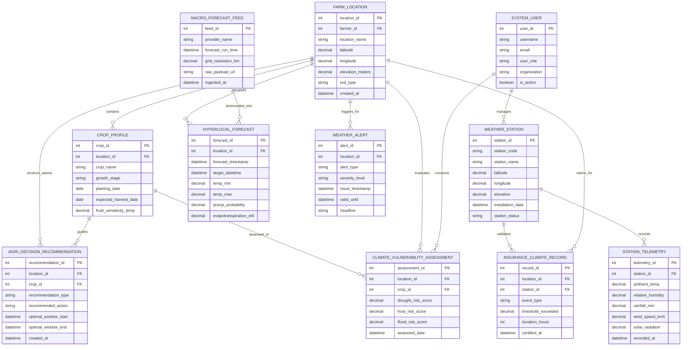

# Conceptual ERD — Weather Forecasting for Agriculture System

## Mermaid Code

## Entity Description Table | Bang mo ta Entity

| # | Entity Name | Vietnamese Name | Description | Key Attributes | Main Relationships |
|---|-------------|-----------------|-------------|----------------|-------------------|
| 1 | FARM_LOCATION | Vị Trí Trang Trại | Stores registered agricultural plot coordinates, terrain elevation, soil type, and location details | location_id, latitude, longitude, elevation_meters, soil_type | Has many CROP_PROFILE, HYPERLOCAL_FORECAST, WEATHER_ALERT, RECOMMENDATION |
| 2 | CROP_PROFILE | Hồ Sơ Cây Trồng | Captures active crop species, growth stage coefficients ($K_c$), planting dates, and frost sensitivity limits | crop_id, location_id, crop_name, growth_stage, frost_sensitivity_temp | Belongs to FARM_LOCATION, guides RECOMMENDATION and VULNERABILITY |
| 3 | WEATHER_STATION | Trạm Thời Tiết Nông Nghiệp | Stores physical IoT weather station metadata, installation coordinates, altitude, and operational status | station_id, station_code, latitude, longitude, station_status | Records STATION_TELEMETRY, validates INSURANCE_CLIMATE_RECORD |
| 4 | STATION_TELEMETRY | Dữ Liệu Quan Trắc Cảm Biến | High-frequency IoT telemetry storing temperature, humidity, rainfall, solar radiation, and wind speed | telemetry_id, station_id, ambient_temp, rainfall_mm, recorded_at | Belongs to WEATHER_STATION |
| 5 | MACRO_FORECAST_FEED | Nguồn Dự Báo Vi Mô | Tracks imported global weather model runs (GFS, ECMWF), run timestamps, and spatial grid resolution | feed_id, provider_name, forecast_run_time, grid_resolution_km | Downscaled into HYPERLOCAL_FORECAST |
| 6 | HYPERLOCAL_FORECAST | Dự Báo Thời Tiết Vi Khí Hậu | Stores 1km-resolution 7-day hourly weather forecasts, rainfall probabilities, and calculated ET0 values | forecast_id, location_id, target_datetime, temp_min, evapotranspiration_et0 | Belongs to FARM_LOCATION, downscaled from MACRO_FORECAST_FEED |
| 7 | WEATHER_ALERT | Cảnh Báo Thời Tiết Nông Nghiệp | Captures automated emergency alerts for frost, extreme heat, gale wind, or heavy rainfall events | alert_id, location_id, alert_type, severity_level, issue_timestamp | Triggers for FARM_LOCATION |
| 8 | AGRI_DECISION_RECOMMENDATION | Khuyến Cáo Lịch Nông Vụ | Generates actionable operational advice (irrigation run-time, chemical spraying windows, harvest dates) | recommendation_id, location_id, crop_id, recommendation_type, optimal_window_start | Receives advice for FARM_LOCATION, guided by CROP_PROFILE |
| 9 | CLIMATE_VULNERABILITY_ASSESSMENT | Đánh Giá Rủi Ro Khí Hậu | Evaluates long-term drought, frost, and flood vulnerability indices for specific farm fields | assessment_id, location_id, crop_id, drought_risk_score, assessed_date | Evaluates FARM_LOCATION and CROP_PROFILE, conducted by SYSTEM_USER |
| 10 | INSURANCE_CLIMATE_RECORD | Chứng Nhận Biến Cố Bảo Hiểm | Certified weather event records validating parametric crop insurance disaster claims | record_id, location_id, station_id, event_type, threshold_exceeded | Claims for FARM_LOCATION, validated by WEATHER_STATION |
| 11 | SYSTEM_USER | Người Dùng Hệ Thống | Stores accounts, roles, and access credentials for agrometeorologists, admins, and insurance auditors | user_id, username, user_role, organization, is_active | Manages WEATHER_STATION, conducts CLIMATE_VULNERABILITY_ASSESSMENT |

## Relationship Description | Mo ta Quan he

| # | From Entity | Cardinality | To Entity | Relationship Label | Business Explanation |
|---|-------------|-------------|-----------|-------------------|----------------------|
| 1 | FARM_LOCATION | one-to-many | CROP_PROFILE | contains | A registered farm location can contain one or more active crop cultivated plots |
| 2 | FARM_LOCATION | one-to-many | HYPERLOCAL_FORECAST | receives | A farm location receives hyper-local downscaled weather forecasts every 6 hours |
| 3 | FARM_LOCATION | one-to-many | WEATHER_ALERT | triggers_for | Extreme weather events trigger automated emergency alerts for specific farm locations |
| 4 | FARM_LOCATION | one-to-many | AGRI_DECISION_RECOMMENDATION | receives_advice | A farm location receives tailored irrigation and spraying decision recommendations |
| 5 | WEATHER_STATION | one-to-many | STATION_TELEMETRY | records | An IoT weather station continuously records high-frequency microclimate sensor readings |
| 6 | WEATHER_STATION | one-to-many | INSURANCE_CLIMATE_RECORD | validates | An official weather station validates extreme weather events for insurance claim certification |
| 7 | MACRO_FORECAST_FEED | one-to-many | HYPERLOCAL_FORECAST | downscaled_into | Global GFS/ECMWF macro forecast runs are spatially downscaled into hyper-local farm forecasts |
| 8 | CROP_PROFILE | one-to-many | AGRI_DECISION_RECOMMENDATION | guides | Crop growth stage and sensitivity parameters guide calculated irrigation and spraying advice |
| 9 | CROP_PROFILE | one-to-many | CLIMATE_VULNERABILITY_ASSESSMENT | assessed_in | Crop species sensitivity is evaluated in seasonal climate vulnerability assessments |
| 10 | FARM_LOCATION | one-to-many | CLIMATE_VULNERABILITY_ASSESSMENT | evaluates | A farm location is evaluated for spatial drought, frost, and flood climate risks |
| 11 | FARM_LOCATION | one-to-many | INSURANCE_CLIMATE_RECORD | claims_for | A farm location generates certified weather records for parametric crop damage claims |
| 12 | SYSTEM_USER | one-to-many | WEATHER_STATION | manages | System administrators manage physical IoT weather station metadata and health status |
| 13 | SYSTEM_USER | one-to-many | CLIMATE_VULNERABILITY_ASSESSMENT | conducts | Agrometeorologist users conduct and publish formal climate vulnerability assessments |
