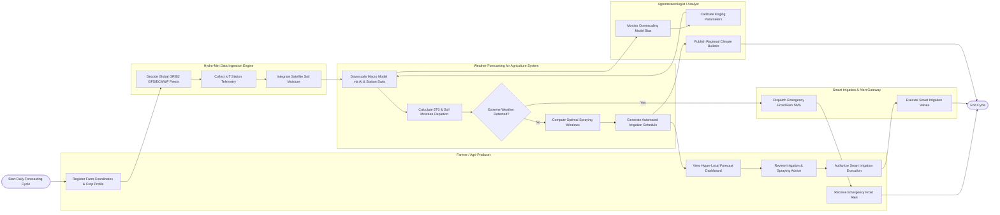

# Swimlane Diagram — Weather Forecasting for Agriculture System

## Mermaid Code

## Flow Description | Mo ta luong

| Lane | Actor | Role in Flow |
|------|-------|-------------|
| 1 | Farmer / Agri-Producer | Registers farm GPS coordinates and crop profiles, monitors 7-day microclimate forecasts, receives spraying and irrigation advice, authorizes smart pump execution, and receives urgent frost/storm alerts |
| 2 | Weather Forecasting for Agriculture System | Downscales global weather models using station telemetry, computes reference evapotranspiration ($\text{ET}_0$), evaluates severe weather risks, generates crop spraying windows, and builds automated irrigation schedules |
| 3 | Hydro-Met Data Ingestion Engine | Decodes raw GRIB2/NetCDF weather feeds from NOAA/ECMWF, streams real-time microclimate sensor telemetry from field weather stations, and ingests satellite land surface temperature data |
| 4 | Agrometeorologist / Analyst | Monitors forecasting model bias, calibrates downscaling kriging parameters against physical weather stations, and publishes weekly regional agricultural climate bulletins |
| 5 | Smart Irrigation & Alert Gateway | Dispatches high-priority SMS and push notification alerts during extreme frost/heat events, and transmits automated run-time commands to field irrigation valves |
