# Action Tree — Weather Forecasting for Agriculture System

## Mermaid Code

```mermaid
graph TD
    Root["Weather Forecasting for Agriculture System"]

    Root --> M1["Farm Location & Crop Profile Management"]
    Root --> M2["Hydro-Met & Sensor Ingestion"]
    Root --> M3["Hyper-Local Microclimate Forecasting"]
    Root --> M4["Agrometeorological Risk & Evapotranspiration"]
    Root --> M5["Smart Irrigation & Spraying Decision Support"]
    Root --> M6["Severe Weather Warning & Emergency Dispatch"]
    Root --> M7["Weather Station Network & System Admin"]

    M1 --> A11["Register Farm GPS Coordinates"]
    M1 --> A12["Configure Crop Growth Stage Parameters"]
    M1 --> A13["Set Soil Water Capacity & MAD Limits"]
    M1 --> A14["Link Farm Plot to Nearest Weather Station"]

    M2 --> A21["Decode GRIB2 GFS & ECMWF Weather Feeds"]
    M2 --> A22["Stream IoT Weather Station Telemetry"]
    M2 --> A23["Ingest Satellite Land Surface Temperature"]
    M2 --> A24["Execute Sensor Data Quality Validation"]

    M3 --> A31["Run Spatial Machine Learning Downscaling"]
    M3 --> A32["Compute 1km-Grid Hourly Forecasts"]
    M3 --> A33["Calculate Rainfall Probability & Accumulation"]
    M3 --> A34["Generate Solar Irradiance Profiles"]

    M4 --> A41["Compute FAO-56 Penman-Monteith ET0"]
    M4 --> A42["Model Root Zone Soil Water Depletion"]
    M4 --> A43["Evaluate Crop Growing Degree Days"]
    M4 --> A44["Generate Climate Vulnerability Scores"]

    M5 --> A51["Generate Water-Saving Irrigation Schedule"]
    M5 --> A52["Calculate Optimal Spraying Window"]
    M5 --> A53["Apply Off-Peak Energy Tariff Schedule"]
    M5 --> A54["Transmit Smart Controller Commands"]

    M6 --> A61["Detect Night Frost & Freeze Conditions"]
    M6 --> A62["Identify Heatwave & Heavy Rain Risks"]
    M6 --> A63["Dispatch High-Priority SMS & Push Alerts"]
    M6 --> A64["Generate Certified Insurance Event Reports"]

    M7 --> A71["Monitor Weather Station Battery & Sensors"]
    M7 --> A72["Calibrate Downscaling Model Kriging Offsets"]
    M7 --> A73["Publish Regional Agrometeorological Bulletins"]
    M7 --> A74["Manage User Roles & Subscriber API Tokens"]
```

## Module Description | Mo ta Module

| # | Module | Description | Actions |
|---|--------|-------------|---------|
| 1 | Farm Location & Crop Profile Management | Manages farm GPS polygon registrations, terrain elevation metadata, crop growth stage parameters ($K_c$), soil water retention capacities, and station links | Register Farm GPS Coordinates, Configure Crop Growth Stage Parameters, Set Soil Water Capacity & MAD Limits, Link Farm Plot to Nearest Weather Station |
| 2 | Hydro-Met & Sensor Ingestion | Ingests global GRIB2/NetCDF numerical weather prediction feeds (NOAA GFS, ECMWF), streams IoT weather station telemetry, and ingests satellite soil moisture feeds | Decode GRIB2 GFS & ECMWF Weather Feeds, Stream IoT Weather Station Telemetry, Ingest Satellite Land Surface Temperature, Execute Sensor Data Quality Validation |
| 3 | Hyper-Local Microclimate Forecasting | Executes machine learning spatial downscaling algorithms to generate 1km-resolution 7-day hourly forecasts for temperature, rainfall, humidity, wind, and solar radiation | Run Spatial Machine Learning Downscaling, Compute 1km-Grid Hourly Forecasts, Calculate Rainfall Probability & Accumulation, Generate Solar Irradiance Profiles |
| 4 | Agrometeorological Risk & Evapotranspiration | Calculates FAO-56 Penman-Monteith reference evapotranspiration ($\text{ET}_0$), models root zone soil moisture depletion, tracks Growing Degree Days (GDD), and assesses climate risks | Compute FAO-56 Penman-Monteith ET0, Model Root Zone Soil Water Depletion, Evaluate Crop Growing Degree Days, Generate Climate Vulnerability Scores |
| 5 | Smart Irrigation & Spraying Decision Support | Computes optimal irrigation water volumes, identifies safe pesticide/fertilizer spraying windows, optimizes energy tariffs, and commands smart irrigation pumps | Generate Water-Saving Irrigation Schedule, Calculate Optimal Spraying Window, Apply Off-Peak Energy Tariff Schedule, Transmit Smart Controller Commands |
| 6 | Severe Weather Warning & Emergency Dispatch | Detects impending frost, freeze, heatwave, gale wind, or heavy rainfall events, dispatches immediate SMS alerts, and generates certified climate records for insurance claims | Detect Night Frost & Freeze Conditions, Identify Heatwave & Heavy Rain Risks, Dispatch High-Priority SMS & Push Alerts, Generate Certified Insurance Event Reports |
| 7 | Weather Station Network & System Admin | Oversees IoT weather station health, calibrates model downscaling bias offsets, publishes regional agrometeorological bulletins, and manages user subscription tiers | Monitor Weather Station Battery & Sensors, Calibrate Downscaling Model Kriging Offsets, Publish Regional Agrometeorological Bulletins, Manage User Roles & Subscriber API Tokens |
