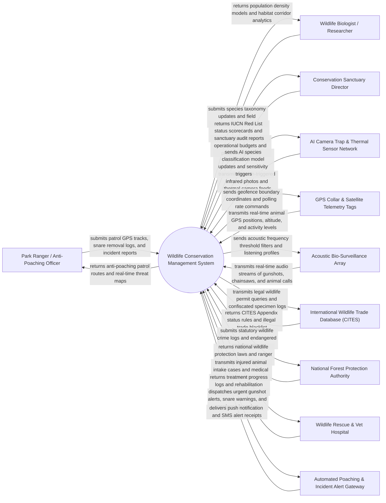

# Context Diagram — Wildlife Conservation Management System

## Mermaid Code

## Actor & Interaction Table | Bang Actor & Tuong tac

| # | Actor | Actor Type | Data Sent TO System | Data Received FROM System | Notes |
|---|-------|------------|---------------------|---------------------------|-------|
| 1 | Park Ranger / Anti-Poaching Officer | Primary | Foot patrol GPS tracks, snare/trap removal logs, poacher encounter reports, seized contraband | Optimal patrol route planning, real-time gunshot location alerts, threat heatmaps | Field ranger patrolling national parks, dismantling snares, and apprehending poachers |
| 2 | Wildlife Biologist / Researcher | Primary | Species observation notes, DNA sampling data, habitat quality metrics, animal body measurements | Population estimates, AI species recognition results, migration corridor maps, home-range telemetry | Scientific researcher tracking species behavior, population dynamics, and habitat ecology |
| 3 | Conservation Sanctuary Director | Primary | Sanctuary operational budgets, protection policies, staffing allocations, anti-poaching strategies | IUCN Red List status summaries, sanctuary protection scorecards, annual biodiversity reports | Executive director managing national park operations, donor funding, and conservation strategy |
| 4 | AI Camera Trap & Thermal Sensor Network | Supporting System | Motion-triggered infrared photos, thermal video streams, camera station battery/SD card status | AI computer vision model updates, motion sensitivity settings, time-lapse trigger schedules | Field-deployed motion-sensor cameras detecting wildlife, trespassers, and illegal vehicles |
| 5 | GPS Collar & Satellite Telemetry Tags | Supporting System | Real-time GPS coordinates, altitude, ambient temperature, 3D accelerometer activity levels | Geofence boundary polygons, satellite transmission intervals, drop-off mechanism triggers | Lightweight GPS collars fitted on key species (elephants, tigers, wolves) streaming location via satellite |
| 6 | Acoustic Bio-Surveillance Array | Supporting System | Continuous ambient audio streams, detected acoustic spikes (gunshots, chainsaws, vehicle engines, animal calls) | Acoustic signature filters, detection threshold settings, directional triangulation configs | Tree-mounted listening devices detecting illegal logging, poaching gunshots, and animal vocalizations |
| 7 | International Wildlife Trade Database (CITES) | Supporting System | CITES Appendix I/II/III listed species rules, international permit verification, illegal trade alerts | Confiscated specimen logs, illegal wildlife trade incident records, permit validation requests | Global database monitoring legal and illegal international trade in endangered flora and fauna |
| 8 | National Forest Protection Authority | Regulatory System | Statutory wildlife protection laws, national park boundaries, ranger enforcement mandates | Annual wildlife population reports, poaching crime statistics, endangered species status | Government forestry and wildlife department regulating national parks and enforcement |
| 9 | Wildlife Rescue & Vet Hospital | Supporting System | Animal admission records, medical diagnosis, surgery logs, health scores, release readiness | Injured animal field capture histories, microchip IDs, historical veterinary records | Specialized veterinary facility treating injured, snared, or confiscated wild animals for release |
| 10 | Automated Poaching & Incident Alert Gateway | Supporting System | SMS delivery receipts, alert dispatch status logs | High-priority gunshot alerts, geofence breach alarms, carcass detection warnings | Multi-channel communication service broadcasting urgent alerts to rangers and park directors |

## System Boundary Description | Mo ta Pham vi He thong

The **Wildlife Conservation Management System** is a mission-critical geospatial and bio-surveillance platform designed to monitor endangered species populations, track animal migration via GPS collars, detect poaching threats using AI camera traps and acoustic sensors, coordinate anti-poaching ranger patrols, and manage wildlife rehabilitation.

The **system boundary** encompasses species taxonomy management, individual animal profiling, satellite telemetry tracking, camera trap AI computer vision inference, acoustic gunshot triangulation, ranger patrol optimization (SMART tool standards), human-wildlife conflict tracking, veterinary rescue case management, and CITES compliance logging.

**External to the system boundary** are physical animal biological metabolism, physical bullet trajectories from poacher firearms, physical satellite orbital operations, veterinary surgical procedure execution, and legal judicial court sentencing. System interfaces operate via secure HTTPS REST APIs, MAVLink/CoAP IoT feeds, GIS spatial shapefile standards, and encrypted satellite data links.
