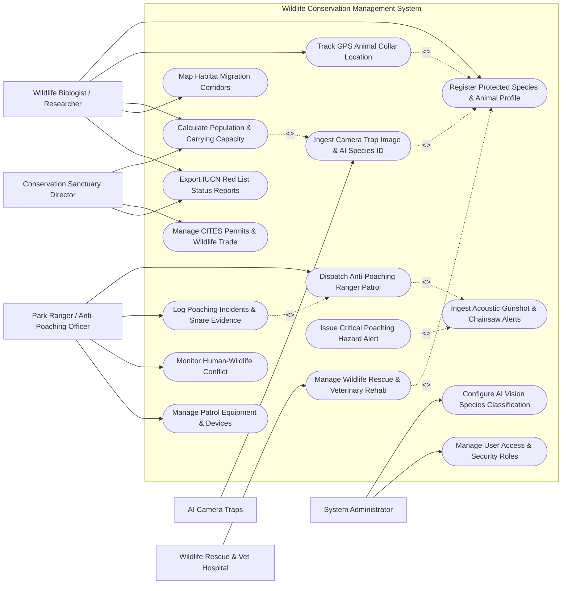

# Use Case Diagram — Wildlife Conservation Management System

## Mermaid Code

## Actor Table | Bang Actor

| # | Actor | Actor Type | Role Description | Related Use Cases |
|---|-------|------------|------------------|-------------------|
| 1 | Park Ranger / Anti-Poaching Officer | Primary | Field officer conducting patrols, dismantling snares, responding to gunshot alerts, and logging crimes | UC05, UC06, UC09, UC15 |
| 2 | Wildlife Biologist / Researcher | Primary | Domain specialist tracking individual animals, analyzing AI camera traps, and mapping migration corridors | UC01, UC03, UC08, UC12, UC13 |
| 3 | Conservation Sanctuary Director | Primary | Executive manager reviewing population trends, overseeing CITES legal permits, and directing strategy | UC08, UC11, UC13 |
| 4 | System Administrator | Primary | Technical admin managing AI computer vision models, acoustic listening nodes, and user access roles | UC14, UC16 |
| 5 | AI Camera Traps | Secondary / System | Field camera hardware transmitting motion-triggered photos for automated species classification | UC02 |
| 6 | Wildlife Rescue & Vet Hospital | Secondary / System | Veterinary hospital intake unit recording injured animal treatments, surgery, and release readiness | UC07 |

## Use Case Table | Bang Use Case

| # | UC ID | Use Case Name | Primary Actor | Secondary Actor | Description | Priority |
|---|-------|---------------|---------------|-----------------|-------------|----------|
| 1 | UC01 | Register Protected Species & Animal Profile | Biologist | None | Creates master profile for endangered species, individual microchip IDs, age, gender, and DNA markers | High |
| 2 | UC02 | Ingest Camera Trap Image & AI Species ID | System | AI Camera Traps | Ingests motion-triggered photos, runs deep learning species recognition, and counts animal individuals | High |
| 3 | UC03 | Track GPS Animal Collar Location | Biologist | System | Streams real-time GPS collar positions, tracks home range, and triggers alerts if animal leaves boundary | High |
| 4 | UC04 | Ingest Acoustic Gunshot & Chainsaw Alerts | System | None | Processes real-time audio streams from listening nodes to detect gunshots, chainsaws, and poacher activity | High |
| 5 | UC05 | Dispatch Anti-Poaching Ranger Patrol | Ranger | System | Plans optimal patrol routes (SMART standards), assigns ranger teams, and tracks live patrol GPS paths | High |
| 6 | UC06 | Log Poaching Incidents & Snare Evidence | Ranger | None | Records seized snares, illegal animal carcasses, poacher camps, weapons, and GPS incident coordinates | High |
| 7 | UC07 | Manage Wildlife Rescue & Veterinary Rehab | Vet Hospital | Biologist | Tracks treatment of snared/injured animals, medical histories, quarantine status, and wild release readiness | High |
| 8 | UC08 | Calculate Population & Carrying Capacity | Biologist | Director | Estimates species population density (Spatially Explicit Capture-Recapture SECR) and habitat capacity | High |
| 9 | UC09 | Monitor Human-Wildlife Conflict | Ranger | Biologist | Logs crop-raiding, livestock predation by wild predators, and dispatches non-lethal deterrent teams | High |
| 10 | UC10 | Issue Critical Poaching Hazard Alert | System | Notification Gateway | Dispatches emergency push/SMS alerts to nearest ranger units when gunshots or fence breaches occur | High |
| 11 | UC11 | Manage CITES Permits & Wildlife Trade | Director | Regulatory Authority | Verifies CITES export/import permits, tracks confiscated contraband, and reports illegal trade trends | Medium |
| 12 | UC12 | Map Habitat Migration Corridors | Biologist | System | Generates GIS movement heatmaps identifying critical wildlife corridors and road crossing risks | Medium |
| 13 | UC13 | Export IUCN Red List Status Reports | Biologist | Director | Generates statutory species vulnerability scorecards and annual conservation reports for IUCN/government | High |
| 14 | UC14 | Configure AI Vision Species Classification | System Admin | AI Camera Traps | Retrains and deploys deep learning vision models for identifying regional flora and fauna species | Medium |
| 15 | UC15 | Manage Patrol Equipment & Devices | Ranger | System Admin | Tracks radios, GPS handhelds, thermal scopes, night-vision gear, and drone surveillance units | Low |
| 16 | UC16 | Manage User Access & Security Roles | System Admin | None | Manages user accounts, roles (Ranger, Biologist, Vet, Director, Admin), and security permissions | Low |

## Use Case Specification | Dac ta Use Case

---

### UC02 — Ingest Camera Trap Image & AI Species ID

| Field | Detail |
|-------|--------|
| **UC ID** | UC02 |
| **Use Case Name** | Ingest Camera Trap Image & AI Species ID |
| **Actor(s)** | Primary: System   Secondary: AI Camera Traps |
| **Description** | Ingests motion-triggered infrared/RGB photos from field camera traps, executes deep learning computer vision models (MegaDetector / YOLOv8) to classify animal species, counts individuals, and flags human trespassers. |
| **Precondition** | 1. Camera trap station is registered in system with valid station ID and GPS coordinates.   2. AI species classification neural network model is active (UC14). |
| **Main Flow** | 1. Camera trap hardware captures motion-triggered image bundle (1 to 5 burst photos).   2. Camera trap IoT module (or SD card upload) transmits image files to System over cellular/satellite link.   3. System ingests image payload, extracts EXIF metadata (timestamp, ambient temp, station ID).   4. System passes image to AI Computer Vision Inference Engine.   5. AI Engine performs bounding box detection to isolate objects (`Animal`, `Human`, `Vehicle`, `Blank/Vegetation`).   6. If `Animal` detected, AI Engine runs multi-class species recognition model (e.g., *Panthera tigris* / Indochinese Tiger, 96.8% confidence).   7. AI Engine counts number of individuals in photo frame and assesses individual coat pattern markers (e.g., tiger stripe matching).   8. System saves diagnostic record, links image to Camera Trap Station ID, and updates species observation database. |
| **Alternative Flow** | **AF1** — Human / Poacher Detection Alarm: If AI Engine detects `Human` or `Armed Poacher` in a protected core zone during night hours, system sets status to `TRESPASS_ALERT` and triggers UC10.   **AF2** — Blank Image Filtering: System automatically filters out photos triggered by wind-blown vegetation ($>90\%$ blank images) to save storage. |
| **Exception Flow** | **EX1** — Low AI Confidence Classification: AI species classification confidence is $<70\%$; system marks image as `UNCLASSIFIED_SPECIES` and routes photo to Wildlife Biologist verification queue. |
| **Postcondition** | Geotagged camera trap image classified, species ID recorded, individual count updated, and observation mapped in GIS. |
| **Business Rule** | **BR1**: Photos containing human faces or poachers must be encrypted and restricted to authorized law enforcement officers. |

---

### UC03 — Track GPS Animal Collar Location

| Field | Detail |
|-------|--------|
| **UC ID** | UC03 |
| **Use Case Name** | Track GPS Animal Collar Location |
| **Actor(s)** | Primary: Wildlife Biologist / Researcher   Secondary: System |
| **Description** | Streams real-time satellite telemetry positions from GPS collars attached to high-priority animals (elephants, tigers, bears), tracks home-range movement, monitors activity levels via 3D accelerometers, and detects geofence breaches. |
| **Precondition** | 1. GPS collar is fitted on target individual animal and registered in system (UC01).   2. Satellite telemetry data feed (Iridium / Globalstar) is active. |
| **Main Flow** | 1. GPS collar on animal acquires satellite fix at scheduled intervals (e.g., every 1 hour).   2. Collar transmits satellite telemetry packet: Collar Tag ID, Animal ID, Latitude, Longitude, Altitude ($m$), Ambient Temp ($^\circ C$), 3D Accelerometer Activity Score, and Battery Voltage ($V$).   3. System ingests packet, validates payload integrity, and writes telemetry location record to database.   4. System plots real-time position point on interactive GIS map and connects track line from previous fixes.   5. System calculates movement speed ($km/h$) and step length to evaluate animal behavior (foraging, resting, fleeing).   6. System checks current GPS coordinate against virtual geofence boundaries (sanctuary core zone, park boundary, village buffer zone).   7. If position remains inside core zone, system updates home-range utilization distribution (Kernel Density Estimation). |
| **Alternative Flow** | **AF1** — Human-Wildlife Conflict Geofence Alert: Animal crosses virtual boundary into agricultural village zone; system triggers UC09 to dispatch non-lethal elephant/predator deterrence team. |
| **Exception Flow** | **EX1** — Animal Mortality / Immobility Alarm: 3D accelerometer activity score remains 0 (zero movement) for $>12$ consecutive hours; system triggers `MORTALITY_ALERT` and dispatches rangers to investigate possible poaching or natural death. |
| **Postcondition** | Animal telemetry position logged, movement trajectory mapped, and activity status updated on biologist dashboard. |
| **Business Rule** | **BR1**: GPS collar location data for Critically Endangered species must be encrypted to prevent poachers from intercepting signals. |

---

### UC05 — Dispatch Anti-Poaching Ranger Patrol

| Field | Detail |
|-------|--------|
| **UC ID** | UC05 |
| **Use Case Name** | Dispatch Anti-Poaching Ranger Patrol |
| **Actor(s)** | Primary: Park Ranger / Anti-Poaching Officer   Secondary: System |
| **Description** | Plans optimal anti-poaching patrol routes based on historical threat heatmaps and acoustic alerts (SMART tool standard), dispatches ranger teams with mobile GPS tracking, and records real-time patrol coverage. |
| **Precondition** | 1. Ranger team is assigned with active handheld GPS/radio devices (UC15).   2. Poaching threat heatmaps and acoustic gunshot alert locations are updated. |
| **Main Flow** | 1. Patrol Leader opens "Patrol Dispatch & SMART Planning" module.   2. System presents threat heatmap overlaying high-risk poaching sectors, recent snare discovery points, and acoustic alert locations (UC04).   3. System suggests optimal patrol route waypoints prioritizing uncovered core zones.   4. Patrol Leader selects assigned ranger team members, weapon inventory, transport method (Foot, Boat, Vehicle), and target duration (e.g., 3-day wilderness patrol).   5. Leader clicks "Dispatch Patrol".   6. System pushes mission route waypoints and offline GIS maps to rangers' rugged mobile handheld devices.   7. Ranger team begins patrol; mobile devices log continuous GPS tracklogs (location, time, speed) every 30 seconds.   8. Rangers log field observations on mobile app: animal sightings, human footprints, camp fires, dismantled snares (UC06).   9. Upon returning, system syncs full patrol tracklog, calculates total distance covered ($km$), area patrolled ($km^2$), and generates SMART Patrol Performance Scorecard. |
| **Alternative Flow** | **AF1** — Emergency Hot-Pursuit Dispatch: Real-time gunshot alert (UC04) triggers immediate emergency hot-pursuit dispatch of quick-reaction ranger team to exact acoustic coordinates. |
| **Exception Flow** | **EX1** — Ranger Distress Signal: Ranger presses emergency SOS button on radio device; system triggers top-priority `RANGER_IN_DANGER` panic alarm with exact GPS coordinates. |
| **Postcondition** | Patrol mission executed, tracklog recorded in SMART database, patrol coverage metrics updated, and evidence logged. |
| **Business Rule** | **BR1**: Patrol tracking must conform to Spatial Monitoring and Reporting Tool (SMART) global conservation standards. |

---

### UC07 — Manage Wildlife Rescue & Veterinary Rehab

| Field | Detail |
|-------|--------|
| **UC ID** | UC07 |
| **Use Case Name** | Manage Wildlife Rescue & Veterinary Rehab |
| **Actor(s)** | Primary: Wildlife Rescue & Vet Hospital   Secondary: Wildlife Biologist / Researcher |
| **Description** | Tracks the medical intake, surgical treatment, disease quarantine, rehabilitation progress, and wild release protocol for injured, snared, orphaned, or confiscated wild animals. |
| **Precondition** | 1. Animal is rescued in field or confiscated from illegal trade.   2. Veterinary hospital team is authenticated in system. |
| **Main Flow** | 1. Vet team opens "Wildlife Medical Intake" on hospital portal.   2. Vet creates medical case record: Rescue Location (GPS), Intake Date, Species ID, Rescuing Ranger Team ID, and Initial Condition.   3. Vet scans for existing microchip or implants new ISO RFID microchip ID into animal.   4. Vet conducts physical exam, records body weight, temperature, and diagnoses injury/illness (e.g., Snare Wire Wound on Left Forelimb, Dehydration).   5. Vet logs medical interventions: surgery performed, antibiotics administered, diagnostic X-rays, and lab bloodwork results.   6. Vet assigns animal to specific quarantine enclosure or rehabilitation flight cage.   7. Vet team updates weekly rehabilitation progress logs (weight gain, natural foraging behavior recovery, limb mobility).   8. Upon full recovery, Vet conducts Soft-Release Evaluation Checklist (verifies animal displays natural fear of humans and hunting capability).   9. Vet and Biologist approve wild release, select suitable soft-release site in sanctuary, and attach GPS tracking collar (UC03).   10. System updates animal status to `RELEASED_TO_WILD` and closes medical case. |
| **Alternative Flow** | **AF1** — Permanent Sanctuary Placement: If animal suffers permanent disability (e.g., amputated limb) preventing wild survival, system updates status to `PERMANENT_SANCTUARY_RESIDENT`. |
| **Exception Flow** | **EX1** — Euthanasia / Mortality in Rehab: Animal dies from severe injuries during treatment; vet performs necropsy, records cause of death, archives tissue DNA samples, and closes case as `DECEASED_IN_REHAB`. |
| **Postcondition** | Complete veterinary medical history recorded, microchip ID registered, and wild release or sanctuary placement documented. |
| **Business Rule** | **BR1**: Wild release candidate animals must pass 100% negative infectious disease screening (e.g., Tuberculosis, Rabies) prior to release authorization. |

---

### UC09 — Monitor Human-Wildlife Conflict (HWC)

| Field | Detail |
|-------|--------|
| **UC ID** | UC09 |
| **Use Case Name** | Monitor Human-Wildlife Conflict (HWC) |
| **Actor(s)** | Primary: Park Ranger / Anti-Poaching Officer   Secondary: Wildlife Biologist / Researcher |
| **Description** | Records and manages incidents of human-wildlife conflict (crop-raiding by wild elephants, livestock predation by tigers/leopards, structural damage), dispatches non-lethal response teams, and processes community compensation claims. |
| **Precondition** | 1. Conflict incident occurs in village buffer zone bordering protected park.   2. Local community representative or ranger reports conflict. |
| **Main Flow** | 1. Ranger receives conflict notification and opens "Human-Wildlife Conflict Manager" on mobile app.   2. Ranger logs incident details: Affected Village Name, GPS Coordinates, Timestamp, Wildlife Species Involved (e.g., Asian Elephant herd of 4), and Conflict Type (`CROP_RAIDING`, `LIVESTOCK_PREDATION`, `PROPERTY_DAMAGE`, `HUMAN_INJURY`).   3. System checks recent GPS animal collar telemetry (UC03) to identify specific individual animals present in the area.   4. Ranger assesses physical damage: crop hectares destroyed, number of cattle killed, or building damage, taking geotagged photos.   5. System estimates financial loss amount ($USD$) based on standard government crop/livestock valuation tables.   6. System dispatches Rapid Response Deterrence Team equipped with non-lethal deterrents (chili-smoke generators, beehive fences, spotlight sirens) to drive animals back into park.   7. System records mitigation action taken and routes damage appraisal to government HWC Relief Fund for community compensation payout.   8. System updates HWC spatial heatmap, highlighting high-risk village conflict hotspots. |
| **Alternative Flow** | **AF1** — Early Warning SMS Dispatch: When GPS collar telemetry detects elephant approaching within 1 km of village border, system automatically sends SMS alert to village chief to activate chili-fences before raiding occurs. |
| **Exception Flow** | **EX1** — Human Casualty Event: Incident involves human injury or fatality; system flags top-priority emergency escalation, dispatches medical evacuation, and triggers immediate senior director intervention. |
| **Postcondition** | HWC incident logged, spatial conflict heatmap updated, non-lethal deterrence recorded, and relief compensation claim initiated. |
| **Business Rule** | **BR1**: Deterrence measures must strictly utilize non-lethal methods approved by wildlife conservation regulations. |
