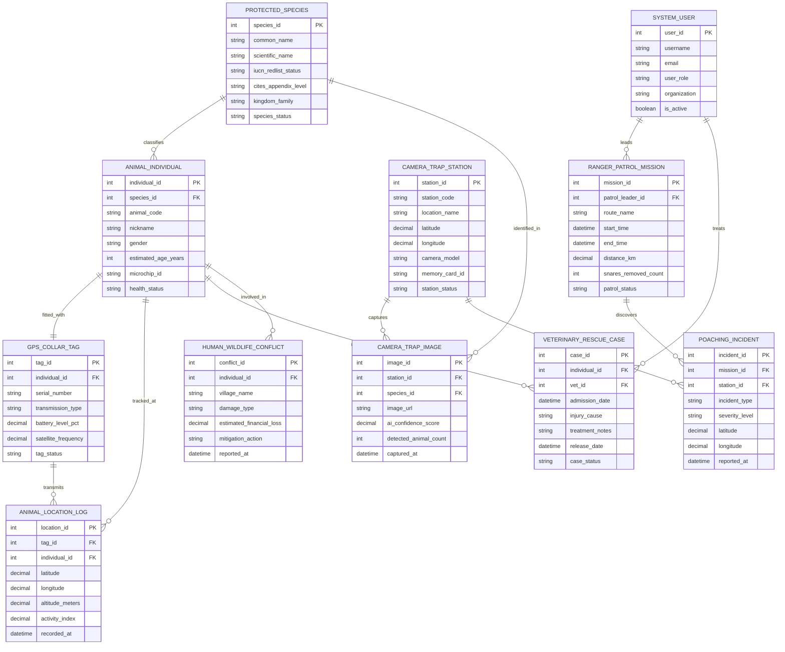

# Conceptual ERD — Wildlife Conservation Management System

## Mermaid Code

## Entity Description Table | Bang mo ta Entity

| # | Entity Name | Vietnamese Name | Description | Key Attributes | Main Relationships |
|---|-------------|-----------------|-------------|----------------|-------------------|
| 1 | PROTECTED_SPECIES | Loài Động Vật Được Bảo Tồn | Reference taxonomy master of endangered species, IUCN Red List status (CR, EN, VU), and CITES Appendix levels | species_id, common_name, scientific_name, iucn_redlist_status, cites_appendix_level, species_status | Classifies ANIMAL_INDIVIDUAL, identified in CAMERA_TRAP_IMAGE |
| 2 | ANIMAL_INDIVIDUAL | Cá Thể Động Vật | Stores tracked individual animal profiles, unique code, nickname, gender, age, microchip ID, and health status | individual_id, species_id, animal_code, nickname, gender, microchip_id, health_status | Belongs to PROTECTED_SPECIES, fitted with GPS_COLLAR, undergoes VET_CASE |
| 3 | GPS_COLLAR_TAG | Vòng Cổ Định Vị GPS | Stores satellite/cellular telemetry collar hardware metadata, serial numbers, battery status, and drop-off timers | tag_id, individual_id, serial_number, transmission_type, battery_level_pct, tag_status | Fitted on ANIMAL_INDIVIDUAL, transmits LOCATION_LOG |
| 4 | ANIMAL_LOCATION_LOG | Nhật Ký Tọa Độ Định Vị | High-frequency satellite telemetry storing animal GPS latitude/longitude, altitude, 3D activity scores, and timestamps | location_id, tag_id, individual_id, latitude, longitude, altitude_meters, recorded_at | Transmitted by GPS_COLLAR_TAG, tracks ANIMAL_INDIVIDUAL |
| 5 | CAMERA_TRAP_STATION | Trạm Bẫy Ảnh Tự Động | Stores field camera trap hardware location coordinates, camera model, memory card ID, battery state, and status | station_id, station_code, location_name, latitude, longitude, camera_model, station_status | Captures CAMERA_TRAP_IMAGE, detects POACHING_INCIDENT |
| 6 | CAMERA_TRAP_IMAGE | Ảnh Bẫy Tự Động | Stores motion-triggered photos, AI species classification confidence scores, animal counts, and detection timestamps | image_id, station_id, species_id, image_url, ai_confidence_score, detected_animal_count | Captured by CAMERA_TRAP_STATION, identifies SPECIES |
| 7 | RANGER_PATROL_MISSION | Chuyến Tuần Tra Kiểm Lâm | Tracks anti-poaching ranger patrol routes, start/end times, distance covered ($km$), snares removed, and SMART scores | mission_id, patrol_leader_id, route_name, start_time, distance_km, snares_removed_count, patrol_status | Led by SYSTEM_USER, discovers POACHING_INCIDENT |
| 8 | POACHING_INCIDENT | Biến Cố Bẫy Trộm & Săn Bắn | Logs illegal poaching incidents (snares discovered, carcasses, camp fires, gunshots), location GPS, and evidence | incident_id, mission_id, station_id, incident_type, severity_level, latitude, reported_at | Discovered in RANGER_PATROL_MISSION, detected by CAMERA_STATION |
| 9 | VETERINARY_RESCUE_CASE | Ca Cứu Hộ & Điều Trị Thú Y | Records injured animal medical intake, surgery notes, quarantine status, treatment progress, and release readiness | case_id, individual_id, vet_id, admission_date, injury_cause, release_date, case_status | Undergone by ANIMAL_INDIVIDUAL, treated by SYSTEM_USER |
| 10 | HUMAN_WILDLIFE_CONFLICT | Xung Đột Người & Động Vật | Logs crop-raiding, livestock predation, village damage incidents, financial loss estimates, and non-lethal deterrent actions | conflict_id, individual_id, village_name, damage_type, estimated_financial_loss, mitigation_action | Involves ANIMAL_INDIVIDUAL |
| 11 | SYSTEM_USER | Người Dùng Hệ Thống | Stores user credentials, conservation roles (Ranger, Biologist, Vet, Director, Admin), organizations, and access rights | user_id, username, user_role, organization, is_active | Leads RANGER_PATROL_MISSION, treats VETERINARY_RESCUE_CASE |

## Relationship Description | Mo ta Quan he

| # | From Entity | Cardinality | To Entity | Relationship Label | Business Explanation |
|---|-------------|-------------|-----------|-------------------|----------------------|
| 1 | PROTECTED_SPECIES | one-to-many | ANIMAL_INDIVIDUAL | classifies | A protected species entry classifies multiple registered individual animals in the sanctuary |
| 2 | PROTECTED_SPECIES | one-to-many | CAMERA_TRAP_IMAGE | identified_in | A protected species can be identified in multiple motion-triggered camera trap photos |
| 3 | ANIMAL_INDIVIDUAL | one-to-one | GPS_COLLAR_TAG | fitted_with | High-priority individual animals can be fitted with one active GPS satellite telemetry collar |
| 4 | GPS_COLLAR_TAG | one-to-many | ANIMAL_LOCATION_LOG | transmits | A GPS collar tag transmits continuous time-series location and activity telemetry logs |
| 5 | ANIMAL_INDIVIDUAL | one-to-many | ANIMAL_LOCATION_LOG | tracked_at | An individual animal is tracked across multiple satellite GPS location log fixes over time |
| 6 | CAMERA_TRAP_STATION | one-to-many | CAMERA_TRAP_IMAGE | captures | A field camera trap station captures hundreds of motion-triggered photos and videos |
| 7 | CAMERA_TRAP_STATION | one-to-many | POACHING_INCIDENT | detects | A camera trap station can detect trespassers or illegal poacher activities logged as incidents |
| 8 | RANGER_PATROL_MISSION | one-to-many | POACHING_INCIDENT | discovers | An anti-poaching ranger patrol mission discovers and logs poaching snares, camps, and crimes |
| 9 | ANIMAL_INDIVIDUAL | one-to-many | VETERINARY_RESCUE_CASE | undergoes | An individual animal can undergo veterinary medical rescue cases for injuries or illness |
| 10 | ANIMAL_INDIVIDUAL | one-to-many | HUMAN_WILDLIFE_CONFLICT | involved_in | An individual wild animal (e.g., bull elephant) can be involved in human-wildlife conflict events |
| 11 | SYSTEM_USER | one-to-many | RANGER_PATROL_MISSION | leads | A park ranger system user leads and executes anti-poaching patrol missions in the field |
| 12 | SYSTEM_USER | one-to-many | VETERINARY_RESCUE_CASE | treats | A wildlife veterinarian system user treats injured animals in medical rescue cases |
