# Swimlane Diagram — Wildlife Conservation Management System

## Mermaid Code

```mermaid
flowchart LR
    Start(["Start Conservation Monitoring Cycle"])

    subgraph SensorLane["Camera Traps & GPS Animal Collars"]
        S1["Capture Motion Photo & Audio Stream"]
        S2["Transmit Satellite GPS Location Fix"]
    end

    subgraph SystemLane["Wildlife Conservation Management System"]
        M1["Run AI Computer Vision & Acoustic Model"]
        M2["Evaluate Geofence & Gunshot Threat"]
        M3{"Poacher Trespass or Injured Animal?"}
        M4["Calculate SECR Population Density"]
        M5["Log Poaching Incident & Evidence"]
    end

    subgraph RangerLane["Park Ranger / Anti-Poaching Officer"]
        R1["Receive Emergency Patrol Dispatch"]
        R2["Execute SMART Patrol & Remove Snares"]
        R3["Apprehend Suspects & Seize Contraband"]
    end

    subgraph VetLane["Wildlife Biologist / Vet"]
        V1["Execute Veterinary Medical Intake"]
        V2["Perform Surgery & Rehabilitation"]
        V3["Authorize Wild Release Protocol"]
    end

    subgraph DirectorLane["Sanctuary Director & Alert Gateway"]
        D1["Review Threat Heatmap & SMART Scorecard"]
        D2["Export CITES & IUCN Compliance Reports"]
    end

    Finish(["End Operational Cycle"])

    Start --> S1 --> M1 --> M2 --> M3
    S2 --> M2
    M3 -->|"Normal Species Sighting"| M4 --> D1 --> D2 --> Finish
    M3 -->|"Gunshot / Poaching Threat"| M5 --> R1 --> R2 --> R3 --> D1 --> Finish
    M3 -->|"Snared / Injured Animal"| V1 --> V2 --> V3 --> Finish
```

## Flow Description | Mo ta luong

| Lane | Actor | Role in Flow |
|------|-------|-------------|
| 1 | Camera Traps & GPS Animal Collars | Captures motion-triggered infrared photos, streams real-time satellite GPS collar locations, and records continuous ambient bio-acoustic audio streams (gunshots, chainsaws) |
| 2 | Wildlife Conservation Management System | Executes deep learning species classification (YOLOv8/MegaDetector), evaluates geofence boundaries, triangulates gunshot sound spikes, calculates SECR population density, and logs poaching evidence |
| 3 | Park Ranger / Anti-Poaching Officer | Receives emergency patrol dispatch notifications, executes SMART-compliant anti-poaching patrols, dismantles illegal wire snares, apprehends poachers, and seizes contraband |
| 4 | Wildlife Biologist / Vet | Conducts emergency field rescue, performs veterinary surgery on injured/snared animals, manages quarantine rehabilitation, and authorizes wild release protocols |
| 5 | Sanctuary Director & Alert Gateway | Reviews regional poaching threat heatmaps and SMART ranger performance scorecards, oversees sanctuary operations, and exports statutory IUCN Red List and CITES compliance reports |
