# Action Tree — Wildlife Conservation Management System

## Mermaid Code

```mermaid
graph TD
    Root["Wildlife Conservation Management System"]

    Root --> M1["Species Taxonomy & Individual Animal Registry"]
    Root --> M2["Camera Trap, Acoustic & Satellite Ingestion"]
    Root --> M3["AI Vision Species Classification & Counting"]
    Root --> M4["Anti-Poaching Ranger Patrol & Incidents"]
    Root --> M5["Veterinary Rehabilitation & Wildlife Rescue"]
    Root --> M6["Human-Wildlife Conflict & Migration Corridors"]
    Root --> M7["CITES Permits & Conservation System Admin"]

    M1 --> A11["Register Protected Species IUCN Red List Status"]
    M1 --> A12["Create Individual Animal Microchip & DNA Profile"]
    M1 --> A13["Register Satellite GPS Collar Telemetry Tags"]
    M1 --> A14["Track Animal Health & Mortality Records"]

    M2 --> A21["Ingest Motion-Triggered Camera Trap Images"]
    M2 --> A22["Stream Satellite GPS Collar Location Fixes"]
    M2 --> A23["Process Acoustic Gunshot & Chainsaw Alerts"]
    M2 --> A24["Filter Blank Camera Trap Vegetation Photos"]

    M3 --> A31["Run Deep Learning Species Recognition Model"]
    M3 --> A32["Detect & Count Individual Animal Populations"]
    M3 --> A33["Calculate SECR Population Density Models"]
    M3 --> A34["Identify Human & Armed Poacher Trespassers"]

    M4 --> A41["Plan SMART Standards Anti-Poaching Patrol Routes"]
    M4 --> A42["Track Real-Time Ranger Patrol GPS Tracklogs"]
    M4 --> A43["Log Dismantled Wire Snares & Illegal Camps"]
    M4 --> A44["Dispatch Emergency Hot-Pursuit Ranger Teams"]

    M5 --> A51["Create Injured Animal Veterinary Intake Case"]
    M5 --> A52["Log Veterinary Surgery & Medication History"]
    M5 --> A53["Manage Enclosure Quarantine & Rehabilitation"]
    M5 --> A54["Execute Soft-Release Wild Reintroduction"]

    M6 --> A61["Log Crop-Raiding & Livestock Predation Events"]
    M6 --> A62["Dispatch Non-Lethal Wildlife Deterrent Teams"]
    M6 --> A63["Map Habitat Migration Corridors & Bottlenecks"]
    M6 --> A64["Calculate Community Conflict Compensation"]

    M7 --> A71["Verify CITES Import & Export Legal Permits"]
    M7 --> A72["Retrain AI Camera Trap Species Vision Models"]
    M7 --> A73["Export IUCN Red List Annual Status Reports"]
    M7 --> A74["Manage User System Access Roles & Permissions"]
```

## Module Description | Mo ta Module

| # | Module | Description | Actions |
|---|--------|-------------|---------|
| 1 | Species Taxonomy & Individual Animal Registry | Manages endangered species taxonomy (IUCN Red List, CITES Appendices), individual animal microchips, DNA profiles, satellite GPS collar registration, and health status | Register Protected Species IUCN Red List Status, Create Individual Animal Microchip & DNA Profile, Register Satellite GPS Collar Telemetry Tags, Track Animal Health & Mortality Records |
| 2 | Camera Trap, Acoustic & Satellite Ingestion | Ingests motion-triggered camera trap photos, satellite GPS collar location fixes, acoustic bio-surveillance audio streams (gunshots, chainsaws), and filters blank images | Ingest Motion-Triggered Camera Trap Images, Stream Satellite GPS Collar Location Fixes, Process Acoustic Gunshot & Chainsaw Alerts, Filter Blank Camera Trap Vegetation Photos |
| 3 | AI Vision Species Classification & Counting | Runs deep learning vision models (YOLOv8/MegaDetector) to identify species, count populations, estimate SECR densities, and detect human/armed poacher trespassers | Run Deep Learning Species Recognition Model, Detect & Count Individual Animal Populations, Calculate SECR Population Density Models, Identify Human & Armed Poacher Trespassers |
| 4 | Anti-Poaching Ranger Patrol & Incidents | Plans SMART-compliant patrol routes, tracks live ranger GPS movements, logs seized snares and illegal poacher camps, and dispatches hot-pursuit response teams | Plan SMART Standards Anti-Poaching Patrol Routes, Track Real-Time Ranger Patrol GPS Tracklogs, Log Dismantled Wire Snares & Illegal Camps, Dispatch Emergency Hot-Pursuit Ranger Teams |
| 5 | Veterinary Rehabilitation & Wildlife Rescue | Manages medical intake cases for snared/injured animals, logs surgeries and treatments, oversees quarantine enclosures, and executes wild release reintroduction protocols | Create Injured Animal Veterinary Intake Case, Log Veterinary Surgery & Medication History, Manage Enclosure Quarantine & Rehabilitation, Execute Soft-Release Wild Reintroduction |
| 6 | Human-Wildlife Conflict & Migration Corridors | Records crop-raiding and livestock predation incidents, dispatches non-lethal deterrence teams, maps spatial migration corridors, and calculates community damage compensation | Log Crop-Raiding & Livestock Predation Events, Dispatch Non-Lethal Wildlife Deterrent Teams, Map Habitat Migration Corridors & Bottlenecks, Calculate Community Conflict Compensation |
| 7 | CITES Permits & Conservation System Admin | Verifies legal CITES trade permits, retrains camera trap AI computer vision models, exports annual IUCN Red List scorecards, and manages system user security roles | Verify CITES Import & Export Legal Permits, Retrain AI Camera Trap Species Vision Models, Export IUCN Red List Annual Status Reports, Manage User System Access Roles & Permissions |
