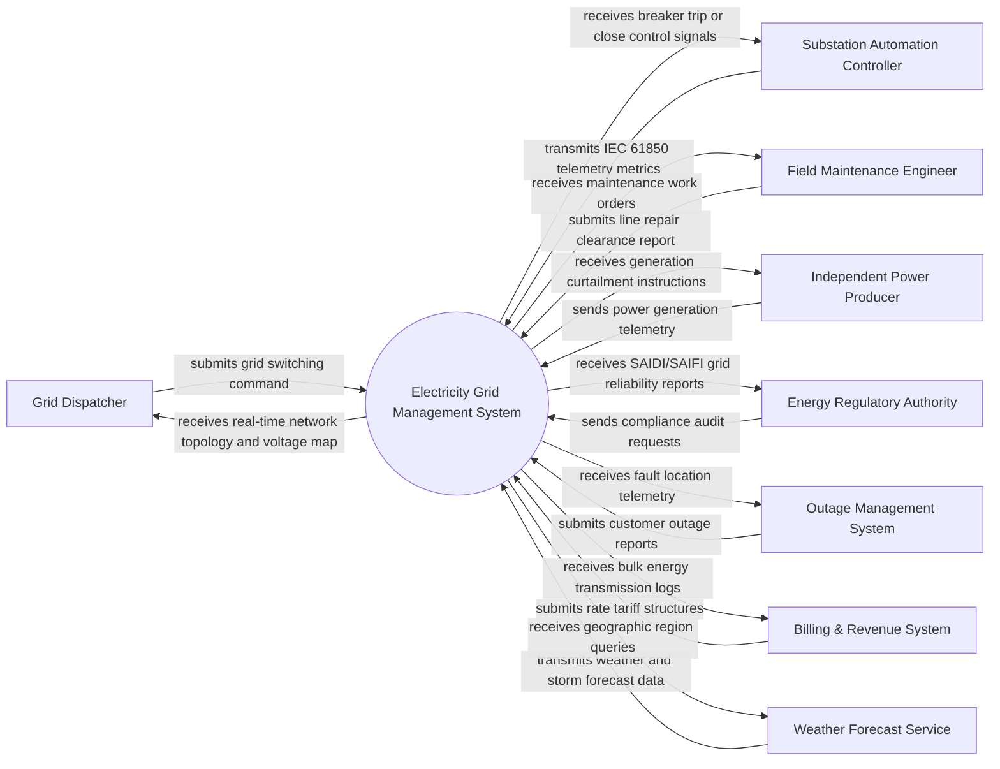

# Context Diagram — Electricity Grid Management System

## Mermaid Code

## Actor & Interaction Table | Bảng Actor & Tương tác

| # | Actor | Actor Type | Data Sent TO System | Data Received FROM System | Notes |
|---|-------|------------|---------------------|---------------------------|-------|
| 1 | Grid Dispatcher | Primary | submits grid switching command | receives real-time network topology and voltage map | Monitors overall power grid stability and controls breakers |
| 2 | Substation Automation Controller | Supporting System | transmits IEC 61850 telemetry metrics | receives breaker trip or close control signals | Automated RTU/IED devices inside electrical substations |
| 3 | Field Maintenance Engineer | Primary | submits line repair clearance report | receives maintenance work orders | On-site technician performing physical repairs on power lines |
| 4 | Independent Power Producer | Supporting System | sends power generation telemetry | receives generation curtailment instructions | External solar, wind, or thermal power plant injecting power into grid |
| 5 | Energy Regulatory Authority | Regulatory | sends compliance audit requests | receives SAIDI/SAIFI grid reliability reports | Government body enforcing national electrical safety and reliability standards |
| 6 | Outage Management System | Supporting System | submits customer outage reports | receives fault location telemetry | Enterprise IT system tracking customer power disruptions |
| 7 | Billing & Revenue System | Supporting System | submits rate tariff structures | receives bulk energy transmission logs | Financial platform managing wholesale wheeling charges |
| 8 | Weather Forecast Service | Supporting System | transmits weather and storm forecast data | receives geographic region queries | External API providing wind and solar irradiance data |

## System Boundary Description | Mô tả Phạm vi Hệ thống

The Electricity Grid Management System (EGMS) monitors and controls high-voltage power transmission lines, substations, transformer stations, and distribution feeders in real-time. It processes telemetry data from SCADA and smart sensors, executes load balancing, isolates faults automatically, and integrates with wholesale power markets and distributed energy resources.
