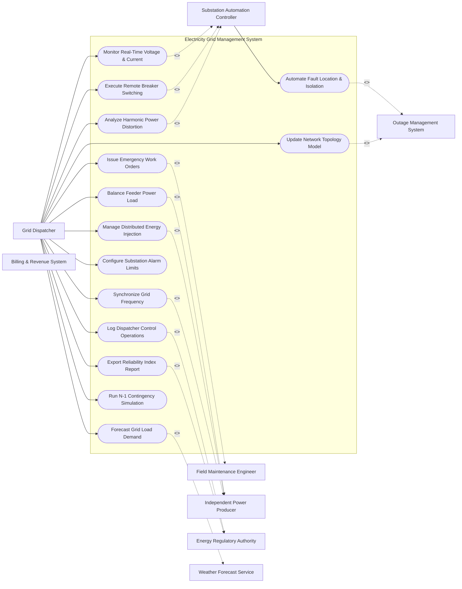

# Use Case Diagram — Electricity Grid Management System

## Mermaid Code

## Actor Table | Bảng Actor

| # | Actor | Actor Type | Role Description | Related Use Cases |
|---|-------|------------|------------------|-------------------|
| 1 | Grid Dispatcher | Primary | Monitors overall power grid stability and controls breakers | UC01, UC02, UC04, UC05, UC06, UC07, UC08, UC09, UC10, UC11, UC12, UC13, UC14 |
| 2 | Substation Automation Controller | Supporting System | Automated RTU/IED devices inside electrical substations | UC01, UC02, UC03, UC10 |
| 3 | Field Maintenance Engineer | Primary | On-site technician performing physical repairs on power lines | UC05 |
| 4 | Independent Power Producer | Supporting System | External solar, wind, or thermal power plant injecting power into grid | UC04, UC07, UC12 |
| 5 | Energy Regulatory Authority | Regulatory | Government body enforcing national electrical safety and reliability standards | UC08, UC11 |
| 6 | Outage Management System | Supporting System | Enterprise IT system tracking customer power disruptions | UC03, UC13 |
| 7 | Billing & Revenue System | Supporting System | Financial platform managing wholesale wheeling charges | UC01, UC02 |
| 8 | Weather Forecast Service | Supporting System | External API providing wind and solar irradiance data | UC06 |

## Use Case Table | Bảng Use Case

| # | UC ID | Use Case Name | Primary Actor | Secondary Actor | Description | Priority |
|---|-------|---------------|---------------|-----------------|-------------|----------|
| 1 | UC01 | Monitor Real-Time Voltage & Current | Grid Dispatcher | Substation Automation Controller | Monitors real-time electrical metrics across all grid substations. | High |
| 2 | UC02 | Execute Remote Breaker Switching | Grid Dispatcher | Substation Automation Controller | Remotely opens or closes circuit breakers to re-route electrical power. | High |
| 3 | UC03 | Automate Fault Location & Isolation | Substation Automation Controller | Outage Management System | Automatically detects line short circuits and isolates damaged feeder segments. | High |
| 4 | UC04 | Balance Feeder Power Load | Grid Dispatcher | Independent Power Producer | Adjusts active and reactive power levels to prevent transformer overload. | High |
| 5 | UC05 | Issue Emergency Work Orders | Grid Dispatcher | Field Maintenance Engineer | Dispatches emergency repair tickets to field maintenance crews. | Medium |
| 6 | UC06 | Forecast Grid Load Demand | Grid Dispatcher | Weather Forecast Service | Calculates short-term power demand using historical trends and weather models. | High |
| 7 | UC07 | Manage Distributed Energy Injection | Grid Dispatcher | Independent Power Producer | Controls solar and wind power feed-in to maintain grid frequency. | High |
| 8 | UC08 | Log Dispatcher Control Operations | Grid Dispatcher | Energy Regulatory Authority | Records every remote switching command for safety and regulatory compliance. | Medium |
| 9 | UC09 | Configure Substation Alarm Limits | Grid Dispatcher | None | Sets warning thresholds for voltage drop, overload, and frequency deviation. | Medium |
| 10 | UC10 | Analyze Harmonic Power Distortion | Grid Dispatcher | Substation Automation Controller | Evaluates power quality metrics and harmonic levels on high-voltage buses. | Medium |
| 11 | UC11 | Export Reliability Index Report | Grid Dispatcher | Energy Regulatory Authority | Generates SAIDI (outage duration) and SAIFI (outage frequency) reports. | Low |
| 12 | UC12 | Synchronize Grid Frequency | Grid Dispatcher | Independent Power Producer | Regulates generator governors to hold frequency strictly at 50/60 Hz. | High |
| 13 | UC13 | Update Network Topology Model | Grid Dispatcher | Outage Management System | Modifies node-breaker connectivity models when new substations commission. | Low |
| 14 | UC14 | Run N-1 Contingency Simulation | Grid Dispatcher | None | Simulates single transmission line failure to evaluate backup power routes. | Medium |

## Use Case Specification | Đặc tả Use Case

---

### UC01 — Monitor Real-Time Voltage & Current

| Field | Detail |
|-------|--------|
| **UC ID** | UC01 |
| **Use Case Name** | Monitor Real-Time Voltage & Current |
| **Actor(s)** | Primary: Grid Dispatcher / Secondary: Substation Automation Controller |
| **Description** | Monitors real-time electrical metrics across all grid substations. |
| **Precondition** | 1. System is operational and authenticated.   2. Primary actor has active session credentials. |
| **Main Flow** | 1. Grid Dispatcher initiates monitor real-time voltage & current request.   2. System validates actor authorization.   3. System retrieves current telemetry state.   4. System executes requested action safely.   5. System logs operation status.   6. System displays success confirmation message. |
| **Alternative Flow** | **AF1** — Bulk Processing: If processing multiple assets, System executes queued batch workflow.   **AF2** — Offline Mode: If network connection drops, System buffers request locally and syncs upon reconnection. |
| **Exception Flow** | **EX1** — Unauthorized Access: System rejects operation and flags security alert.   **EX2** — Sensor Timeout: System returns error notification and dispatches health check. |
| **Postcondition** | Target system state updated cleanly and audit log entry created. |
| **Business Rule** | **BR1**: All operations must comply with IEEE/ISO industry safety standards.   **BR2**: Changes must be logged into immutable audit log. |

---

### UC02 — Execute Remote Breaker Switching

| Field | Detail |
|-------|--------|
| **UC ID** | UC02 |
| **Use Case Name** | Execute Remote Breaker Switching |
| **Actor(s)** | Primary: Grid Dispatcher / Secondary: Substation Automation Controller |
| **Description** | Remotely opens or closes circuit breakers to re-route electrical power. |
| **Precondition** | 1. System is operational and authenticated.   2. Primary actor has active session credentials. |
| **Main Flow** | 1. Grid Dispatcher initiates execute remote breaker switching request.   2. System validates actor authorization.   3. System retrieves current telemetry state.   4. System executes requested action safely.   5. System logs operation status.   6. System displays success confirmation message. |
| **Alternative Flow** | **AF1** — Bulk Processing: If processing multiple assets, System executes queued batch workflow.   **AF2** — Offline Mode: If network connection drops, System buffers request locally and syncs upon reconnection. |
| **Exception Flow** | **EX1** — Unauthorized Access: System rejects operation and flags security alert.   **EX2** — Sensor Timeout: System returns error notification and dispatches health check. |
| **Postcondition** | Target system state updated cleanly and audit log entry created. |
| **Business Rule** | **BR1**: All operations must comply with IEEE/ISO industry safety standards.   **BR2**: Changes must be logged into immutable audit log. |

---

### UC03 — Automate Fault Location & Isolation

| Field | Detail |
|-------|--------|
| **UC ID** | UC03 |
| **Use Case Name** | Automate Fault Location & Isolation |
| **Actor(s)** | Primary: Substation Automation Controller / Secondary: Outage Management System |
| **Description** | Automatically detects line short circuits and isolates damaged feeder segments. |
| **Precondition** | 1. System is operational and authenticated.   2. Primary actor has active session credentials. |
| **Main Flow** | 1. Substation Automation Controller initiates automate fault location & isolation request.   2. System validates actor authorization.   3. System retrieves current telemetry state.   4. System executes requested action safely.   5. System logs operation status.   6. System displays success confirmation message. |
| **Alternative Flow** | **AF1** — Bulk Processing: If processing multiple assets, System executes queued batch workflow.   **AF2** — Offline Mode: If network connection drops, System buffers request locally and syncs upon reconnection. |
| **Exception Flow** | **EX1** — Unauthorized Access: System rejects operation and flags security alert.   **EX2** — Sensor Timeout: System returns error notification and dispatches health check. |
| **Postcondition** | Target system state updated cleanly and audit log entry created. |
| **Business Rule** | **BR1**: All operations must comply with IEEE/ISO industry safety standards.   **BR2**: Changes must be logged into immutable audit log. |

---

### UC04 — Balance Feeder Power Load

| Field | Detail |
|-------|--------|
| **UC ID** | UC04 |
| **Use Case Name** | Balance Feeder Power Load |
| **Actor(s)** | Primary: Grid Dispatcher / Secondary: Independent Power Producer |
| **Description** | Adjusts active and reactive power levels to prevent transformer overload. |
| **Precondition** | 1. System is operational and authenticated.   2. Primary actor has active session credentials. |
| **Main Flow** | 1. Grid Dispatcher initiates balance feeder power load request.   2. System validates actor authorization.   3. System retrieves current telemetry state.   4. System executes requested action safely.   5. System logs operation status.   6. System displays success confirmation message. |
| **Alternative Flow** | **AF1** — Bulk Processing: If processing multiple assets, System executes queued batch workflow.   **AF2** — Offline Mode: If network connection drops, System buffers request locally and syncs upon reconnection. |
| **Exception Flow** | **EX1** — Unauthorized Access: System rejects operation and flags security alert.   **EX2** — Sensor Timeout: System returns error notification and dispatches health check. |
| **Postcondition** | Target system state updated cleanly and audit log entry created. |
| **Business Rule** | **BR1**: All operations must comply with IEEE/ISO industry safety standards.   **BR2**: Changes must be logged into immutable audit log. |

