# Conceptual ERD — Electricity Grid Management System

## Mermaid Code

```mermaid
graph TD
    %% Định dạng hình dạng: [] là Thực thể (Hình chữ nhật), {} là Mối quan hệ (Hình thoi)

    SUBSTATION["SUBSTATION"]
    TRANSFORMER["TRANSFORMER"]
    CIRCUIT_BREAKER["CIRCUIT_BREAKER"]
    GRID_FEEDER["GRID_FEEDER"]
    TELEMETRY_LOG["TELEMETRY_LOG"]
    GRID_FAULT["GRID_FAULT"]
    WORK_ORDER["WORK_ORDER"]
    POWER_PRODUCER["POWER_PRODUCER"]
    DISPATCH_EVENT["DISPATCH_EVENT"]

    %% Các khối hình thoi quan hệ
    rel_manages{"manages"}
    rel_2_manages{"manages"}
    rel_3_manages{"manages"}
    rel_4_manages{"manages"}
    rel_5_manages{"manages"}
    rel_6_manages{"manages"}
    rel_7_manages{"manages"}
    rel_8_manages{"manages"}

    %% Kết nối 1-N
    SUBSTATION ---|1| rel_manages ---|N| TRANSFORMER
    TRANSFORMER ---|1| rel_2_manages ---|N| CIRCUIT_BREAKER
    CIRCUIT_BREAKER ---|1| rel_3_manages ---|N| GRID_FEEDER
    GRID_FEEDER ---|1| rel_4_manages ---|N| TELEMETRY_LOG
    TELEMETRY_LOG ---|1| rel_5_manages ---|N| GRID_FAULT
    GRID_FAULT ---|1| rel_6_manages ---|N| WORK_ORDER
    WORK_ORDER ---|1| rel_7_manages ---|N| POWER_PRODUCER
    POWER_PRODUCER ---|1| rel_8_manages ---|N| DISPATCH_EVENT

```

## Entity Description Table | Bảng mô tả Entity

| # | Entity Name | Vietnamese Name | Description | Key Attributes | Main Relationships |
|---|-------------|-----------------|-------------|----------------|-------------------|
| 1 | SUBSTATION | Trạm biến áp | Physical high-voltage grid substation facility | substation_id PK, code, name, voltage_rating_kv, latitude, longitude, status | contains transformers and breakers |
| 2 | TRANSFORMER | Máy biến áp | Power transformer altering voltage levels | transformer_id PK, substation_id FK, serial_no, capacity_mva, primary_kv, secondary_kv | belongs to substation |
| 3 | CIRCUIT_BREAKER | Máy cắt điện | Switching safety breaker interrupting fault currents | breaker_id PK, substation_id FK, code, status, rated_amps, last_inspected | belongs to substation |
| 4 | GRID_FEEDER | Đường dây phân phối | Distribution power line connecting substations to loads | feeder_id PK, substation_id FK, feeder_name, length_km, max_current_a, status | originates from substation |
| 5 | TELEMETRY_LOG | Nhật ký đo xa | Time-series sensor telemetry data recorded by RTUs | log_id PK, breaker_id FK, voltage_kv, current_a, active_mw, reactive_mvar, logged_at | recorded from circuit breaker |
| 6 | GRID_FAULT | Sự cố lưới điện | Electrical fault incident occurring on grid equipment | fault_id PK, feeder_id FK, fault_type, current_spike_a, detected_at, status | occurs on feeder line |
| 7 | WORK_ORDER | Lệnh công tác | Maintenance work ticket dispatched to field engineers | order_id PK, fault_id FK, engineer_id FK, description, priority, status, created_at | resolves grid fault |
| 8 | POWER_PRODUCER | Đơn vị sản xuất điện | External power generation company supplying electricity | producer_id PK, company_name, energy_source, max_capacity_mw, contract_id | injects power into grid |
| 9 | DISPATCH_EVENT | Sự kiện điều độ | Logged control action executed by grid operators | event_id PK, dispatcher_id FK, target_device, action_type, timestamp, result | logged by dispatcher |

## Relationship Description | Mô tả Quan hệ

| # | From Entity | Cardinality | To Entity | Relationship Label | Business Explanation |
|---|-------------|-------------|-----------|-------------------|----------------------|
| 1 | SUBSTATION | one-to-many | TRANSFORMER | manages | Single SUBSTATION record can manage multiple TRANSFORMER entries. |
| 2 | TRANSFORMER | one-to-many | CIRCUIT_BREAKER | manages | Single TRANSFORMER record can manage multiple CIRCUIT_BREAKER entries. |
| 3 | CIRCUIT_BREAKER | one-to-many | GRID_FEEDER | manages | Single CIRCUIT_BREAKER record can manage multiple GRID_FEEDER entries. |
| 4 | GRID_FEEDER | one-to-many | TELEMETRY_LOG | manages | Single GRID_FEEDER record can manage multiple TELEMETRY_LOG entries. |
| 5 | TELEMETRY_LOG | one-to-many | GRID_FAULT | manages | Single TELEMETRY_LOG record can manage multiple GRID_FAULT entries. |
| 6 | GRID_FAULT | one-to-many | WORK_ORDER | manages | Single GRID_FAULT record can manage multiple WORK_ORDER entries. |
| 7 | WORK_ORDER | one-to-many | POWER_PRODUCER | manages | Single WORK_ORDER record can manage multiple POWER_PRODUCER entries. |
| 8 | POWER_PRODUCER | one-to-many | DISPATCH_EVENT | manages | Single POWER_PRODUCER record can manage multiple DISPATCH_EVENT entries. |
