# Action Tree — Electricity Grid Management System

## Mermaid Code

```mermaid
graph TD
    Root["Electricity Grid Management System"]

    Root --> M1["Telemetry & Monitoring"]
    M1 --> A11["View Grid Map"]
    M1 --> A12["Monitor Bus Voltage"]
    M1 --> A13["Analyze Power Quality"]
    M1 --> A14["Configure Alarm Limits"]

    Root --> M2["Switching & Dispatch"]
    M2 --> A21["Execute Breaker Trip"]
    M2 --> A22["Schedule Load Shedding"]
    M2 --> A23["Control Generator Feed"]
    M2 --> A24["Synchronize Grid Frequency"]

    Root --> M3["Fault Isolation (FLISR)"]
    M3 --> A31["Detect Short Circuit"]
    M3 --> A32["Trigger Auto-Recloser"]
    M3 --> A33["Isolate Feeder Segment"]
    M3 --> A34["Calculate Affected Customers"]

    Root --> M4["Field Repair Management"]
    M4 --> A41["Create Work Order"]
    M4 --> A42["Assign Field Engineer"]
    M4 --> A43["Track Repair Progress"]
    M4 --> A44["Clear Line Safety"]

    Root --> M5["Analytics & Compliance"]
    M5 --> A51["Simulate N-1 Contingency"]
    M5 --> A52["Forecast Peak Load"]
    M5 --> A53["Export SAIDI/SAIFI Report"]
    M5 --> A54["Generate Audit Trail"]

```

## Module Description | Mô tả Module

| # | Module | Description | Actions |
|---|--------|-------------|---------|
| 1 | Telemetry & Monitoring | Real-time grid voltage, current, and telemetry monitoring | View Grid Map, Monitor Bus Voltage, Analyze Power Quality, Configure Alarm Limits |
| 2 | Switching & Dispatch | Remote switching and active/reactive power dispatch | Execute Breaker Trip, Schedule Load Shedding, Control Generator Feed, Synchronize Grid Frequency |
| 3 | Fault Isolation (FLISR) | Automatic fault detection and feeder isolation | Detect Short Circuit, Trigger Auto-Recloser, Isolate Feeder Segment, Calculate Affected Customers |
| 4 | Field Repair Management | Work order issuance and field maintenance dispatch | Create Work Order, Assign Field Engineer, Track Repair Progress, Clear Line Safety |
| 5 | Analytics & Compliance | Load forecasting and regulatory reporting | Simulate N-1 Contingency, Forecast Peak Load, Export SAIDI/SAIFI Report, Generate Audit Trail |
