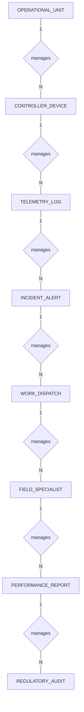

# Conceptual ERD — Solar Farm Management System

## Mermaid Code

## Entity Description Table | Bảng mô tả Entity

| # | Entity Name | Vietnamese Name | Description | Key Attributes | Main Relationships |
|---|-------------|-----------------|-------------|----------------|-------------------|
| 1 | OPERATIONAL_UNIT | Đơn vị vận hành | Primary functional facility or asset of Solar Farm Management System | unit_id PK, code, name, location, capacity, status | contains devices and sensors |
| 2 | CONTROLLER_DEVICE | Thiết bị điều khiển | IoT sensor or controller device installed on unit | device_id PK, unit_id FK, serial_no, ip_address, installed_date, status | monitors operational unit |
| 3 | TELEMETRY_LOG | Nhật ký đo xa | Time-series measurement data collected from devices | log_id PK, device_id FK, metric_value, status_code, timestamp | recorded from controller device |
| 4 | INCIDENT_ALERT | Cảnh báo sự cố | System alarm triggered by abnormal telemetry | alert_id PK, unit_id FK, alert_type, severity, triggered_at, status | occurs on operational unit |
| 5 | WORK_DISPATCH | Lệnh điều động | Maintenance dispatch order issued to technicians | dispatch_id PK, alert_id FK, tech_id FK, description, priority, status | resolves incident alert |
| 6 | FIELD_SPECIALIST | Chuyên viên hiện trường | Technical staff performing physical tasks | tech_id PK, full_name, phone, skill_level, status | assigned to work dispatches |
| 7 | PERFORMANCE_REPORT | Báo cáo hiệu suất | Aggregated analytical report generated by system | report_id PK, generated_by FK, period_start, period_end, efficiency_score, created_at | evaluates operational unit |
| 8 | REGULATORY_AUDIT | Kiểm toán pháp lý | Audit record verified by government agency | audit_id PK, report_id FK, agency_name, audit_result, verified_at | verifies performance report |

## Relationship Description | Mô tả Quan hệ

| # | From Entity | Cardinality | To Entity | Relationship Label | Business Explanation |
|---|-------------|-------------|-----------|-------------------|----------------------|
| 1 | OPERATIONAL_UNIT | one-to-many | CONTROLLER_DEVICE | manages | Single OPERATIONAL_UNIT record can manage multiple CONTROLLER_DEVICE entries. |
| 2 | CONTROLLER_DEVICE | one-to-many | TELEMETRY_LOG | manages | Single CONTROLLER_DEVICE record can manage multiple TELEMETRY_LOG entries. |
| 3 | TELEMETRY_LOG | one-to-many | INCIDENT_ALERT | manages | Single TELEMETRY_LOG record can manage multiple INCIDENT_ALERT entries. |
| 4 | INCIDENT_ALERT | one-to-many | WORK_DISPATCH | manages | Single INCIDENT_ALERT record can manage multiple WORK_DISPATCH entries. |
| 5 | WORK_DISPATCH | one-to-many | FIELD_SPECIALIST | manages | Single WORK_DISPATCH record can manage multiple FIELD_SPECIALIST entries. |
| 6 | FIELD_SPECIALIST | one-to-many | PERFORMANCE_REPORT | manages | Single FIELD_SPECIALIST record can manage multiple PERFORMANCE_REPORT entries. |
| 7 | PERFORMANCE_REPORT | one-to-many | REGULATORY_AUDIT | manages | Single PERFORMANCE_REPORT record can manage multiple REGULATORY_AUDIT entries. |
