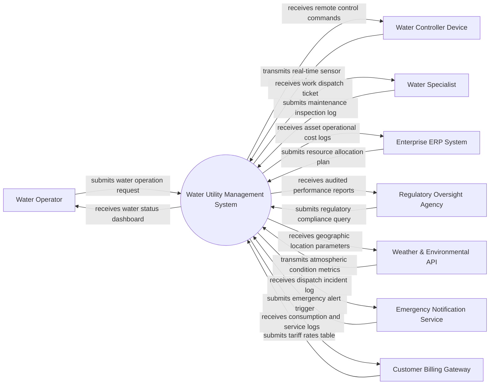

# Context Diagram — Water Utility Management System

## Mermaid Code

## Actor & Interaction Table | Bảng Actor & Tương tác

| # | Actor | Actor Type | Data Sent TO System | Data Received FROM System | Notes |
|---|-------|------------|---------------------|---------------------------|-------|
| 1 | Water Operator | Primary | submits water operation request | receives water status dashboard | Main operator controlling Water Utility Management System |
| 2 | Water Controller Device | Supporting System | transmits real-time sensor metrics | receives remote control commands | Automated IoT hardware monitoring Water Utility Management System |
| 3 | Water Specialist | Primary | submits maintenance inspection log | receives work dispatch ticket | Field engineer handling physical assets for Water Utility Management System |
| 4 | Enterprise ERP System | Supporting System | submits resource allocation plan | receives asset operational cost logs | Enterprise software platform for asset planning |
| 5 | Regulatory Oversight Agency | Regulatory | submits regulatory compliance query | receives audited performance reports | Government authority supervising safety and environmental compliance |
| 6 | Weather & Environmental API | Supporting System | transmits atmospheric condition metrics | receives geographic location parameters | External service supplying environmental data |
| 7 | Emergency Notification Service | Supporting System | submits emergency alert trigger | receives dispatch incident log | System broadcasting critical safety alerts |
| 8 | Customer Billing Gateway | Supporting System | submits tariff rates table | receives consumption and service logs | Billing engine computing utility tariffs |

## System Boundary Description | Mô tả Phạm vi Hệ thống

The Water Utility Management System (WUS) controls and optimizes all core domain operational processes. It ingests field IoT sensor data, automates workflow execution, provides analytical dashboards, and maintains secure data interfaces with external regulatory authorities and enterprise software platforms.
