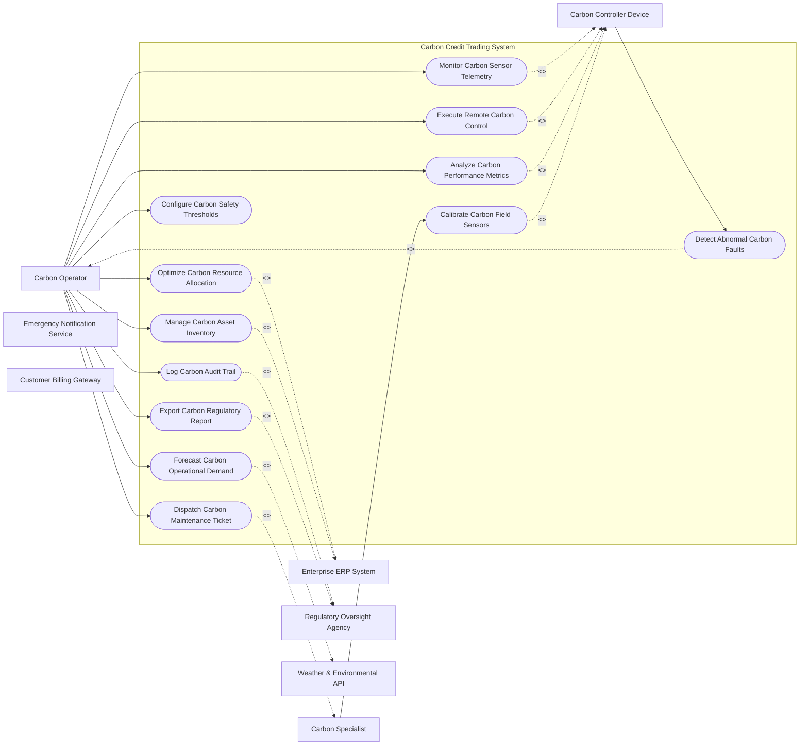

# Use Case Diagram — Carbon Credit Trading System

## Mermaid Code

## Actor Table | Bảng Actor

| # | Actor | Actor Type | Role Description | Related Use Cases |
|---|-------|------------|------------------|-------------------|
| 1 | Carbon Operator | Primary | Main operator controlling Carbon Credit Trading System | UC01, UC02, UC03, UC04, UC05, UC06, UC07, UC08, UC09, UC10, UC12 |
| 2 | Carbon Controller Device | Supporting System | Automated IoT hardware monitoring Carbon Credit Trading System | UC01, UC02, UC03, UC09, UC11 |
| 3 | Carbon Specialist | Primary | Field engineer handling physical assets for Carbon Credit Trading System | UC05, UC11 |
| 4 | Enterprise ERP System | Supporting System | Enterprise software platform for asset planning | UC04, UC12 |
| 5 | Regulatory Oversight Agency | Regulatory | Government authority supervising safety and environmental compliance | UC08, UC10 |
| 6 | Weather & Environmental API | Supporting System | External service supplying environmental data | UC06 |
| 7 | Emergency Notification Service | Supporting System | System broadcasting critical safety alerts | UC01, UC02 |
| 8 | Customer Billing Gateway | Supporting System | Billing engine computing utility tariffs | UC01, UC02 |

## Use Case Table | Bảng Use Case

| # | UC ID | Use Case Name | Primary Actor | Secondary Actor | Description | Priority |
|---|-------|---------------|---------------|-----------------|-------------|----------|
| 1 | UC01 | Monitor Carbon Sensor Telemetry | Carbon Operator | Carbon Controller Device | Monitors real-time telemetry and operational state for Carbon Credit Trading System. | High |
| 2 | UC02 | Execute Remote Carbon Control | Carbon Operator | Carbon Controller Device | Sends automated control commands to field devices. | High |
| 3 | UC03 | Detect Abnormal Carbon Faults | Carbon Controller Device | Carbon Operator | Fires automated warnings when operational thresholds are breached. | High |
| 4 | UC04 | Optimize Carbon Resource Allocation | Carbon Operator | Enterprise ERP System | Balances operational load and resource distribution. | High |
| 5 | UC05 | Dispatch Carbon Maintenance Ticket | Carbon Operator | Carbon Specialist | Generates work orders for scheduled and corrective field maintenance. | Medium |
| 6 | UC06 | Forecast Carbon Operational Demand | Carbon Operator | Weather & Environmental API | Predicts future demand patterns using historical sensor telemetry. | High |
| 7 | UC07 | Configure Carbon Safety Thresholds | Carbon Operator | None | Sets warning parameters and automatic trip limits. | Medium |
| 8 | UC08 | Log Carbon Audit Trail | Carbon Operator | Regulatory Oversight Agency | Records all critical operator actions for safety compliance. | Medium |
| 9 | UC09 | Analyze Carbon Performance Metrics | Carbon Operator | Carbon Controller Device | Evaluates efficiency, uptime, and energy consumption metrics. | Medium |
| 10 | UC10 | Export Carbon Regulatory Report | Carbon Operator | Regulatory Oversight Agency | Generates standardized compliance documents. | Low |
| 11 | UC11 | Calibrate Carbon Field Sensors | Carbon Specialist | Carbon Controller Device | Performs remote or on-site sensor zero-point calibration. | Medium |
| 12 | UC12 | Manage Carbon Asset Inventory | Carbon Operator | Enterprise ERP System | Tracks lifecycle, depreciation, and warranty for system hardware. | Low |

## Use Case Specification | Đặc tả Use Case

---

### UC01 — Monitor Carbon Sensor Telemetry

| Field | Detail |
|-------|--------|
| **UC ID** | UC01 |
| **Use Case Name** | Monitor Carbon Sensor Telemetry |
| **Actor(s)** | Primary: Carbon Operator / Secondary: Carbon Controller Device |
| **Description** | Monitors real-time telemetry and operational state for Carbon Credit Trading System. |
| **Precondition** | 1. System is operational and authenticated.   2. Primary actor has active session credentials. |
| **Main Flow** | 1. Carbon Operator initiates monitor carbon sensor telemetry request.   2. System validates actor authorization.   3. System retrieves current telemetry state.   4. System executes requested action safely.   5. System logs operation status.   6. System displays success confirmation message. |
| **Alternative Flow** | **AF1** — Bulk Processing: If processing multiple assets, System executes queued batch workflow.   **AF2** — Offline Mode: If network connection drops, System buffers request locally and syncs upon reconnection. |
| **Exception Flow** | **EX1** — Unauthorized Access: System rejects operation and flags security alert.   **EX2** — Sensor Timeout: System returns error notification and dispatches health check. |
| **Postcondition** | Target system state updated cleanly and audit log entry created. |
| **Business Rule** | **BR1**: All operations must comply with IEEE/ISO industry safety standards.   **BR2**: Changes must be logged into immutable audit log. |

---

### UC02 — Execute Remote Carbon Control

| Field | Detail |
|-------|--------|
| **UC ID** | UC02 |
| **Use Case Name** | Execute Remote Carbon Control |
| **Actor(s)** | Primary: Carbon Operator / Secondary: Carbon Controller Device |
| **Description** | Sends automated control commands to field devices. |
| **Precondition** | 1. System is operational and authenticated.   2. Primary actor has active session credentials. |
| **Main Flow** | 1. Carbon Operator initiates execute remote carbon control request.   2. System validates actor authorization.   3. System retrieves current telemetry state.   4. System executes requested action safely.   5. System logs operation status.   6. System displays success confirmation message. |
| **Alternative Flow** | **AF1** — Bulk Processing: If processing multiple assets, System executes queued batch workflow.   **AF2** — Offline Mode: If network connection drops, System buffers request locally and syncs upon reconnection. |
| **Exception Flow** | **EX1** — Unauthorized Access: System rejects operation and flags security alert.   **EX2** — Sensor Timeout: System returns error notification and dispatches health check. |
| **Postcondition** | Target system state updated cleanly and audit log entry created. |
| **Business Rule** | **BR1**: All operations must comply with IEEE/ISO industry safety standards.   **BR2**: Changes must be logged into immutable audit log. |

---

### UC03 — Detect Abnormal Carbon Faults

| Field | Detail |
|-------|--------|
| **UC ID** | UC03 |
| **Use Case Name** | Detect Abnormal Carbon Faults |
| **Actor(s)** | Primary: Carbon Controller Device / Secondary: Carbon Operator |
| **Description** | Fires automated warnings when operational thresholds are breached. |
| **Precondition** | 1. System is operational and authenticated.   2. Primary actor has active session credentials. |
| **Main Flow** | 1. Carbon Controller Device initiates detect abnormal carbon faults request.   2. System validates actor authorization.   3. System retrieves current telemetry state.   4. System executes requested action safely.   5. System logs operation status.   6. System displays success confirmation message. |
| **Alternative Flow** | **AF1** — Bulk Processing: If processing multiple assets, System executes queued batch workflow.   **AF2** — Offline Mode: If network connection drops, System buffers request locally and syncs upon reconnection. |
| **Exception Flow** | **EX1** — Unauthorized Access: System rejects operation and flags security alert.   **EX2** — Sensor Timeout: System returns error notification and dispatches health check. |
| **Postcondition** | Target system state updated cleanly and audit log entry created. |
| **Business Rule** | **BR1**: All operations must comply with IEEE/ISO industry safety standards.   **BR2**: Changes must be logged into immutable audit log. |

---

### UC04 — Optimize Carbon Resource Allocation

| Field | Detail |
|-------|--------|
| **UC ID** | UC04 |
| **Use Case Name** | Optimize Carbon Resource Allocation |
| **Actor(s)** | Primary: Carbon Operator / Secondary: Enterprise ERP System |
| **Description** | Balances operational load and resource distribution. |
| **Precondition** | 1. System is operational and authenticated.   2. Primary actor has active session credentials. |
| **Main Flow** | 1. Carbon Operator initiates optimize carbon resource allocation request.   2. System validates actor authorization.   3. System retrieves current telemetry state.   4. System executes requested action safely.   5. System logs operation status.   6. System displays success confirmation message. |
| **Alternative Flow** | **AF1** — Bulk Processing: If processing multiple assets, System executes queued batch workflow.   **AF2** — Offline Mode: If network connection drops, System buffers request locally and syncs upon reconnection. |
| **Exception Flow** | **EX1** — Unauthorized Access: System rejects operation and flags security alert.   **EX2** — Sensor Timeout: System returns error notification and dispatches health check. |
| **Postcondition** | Target system state updated cleanly and audit log entry created. |
| **Business Rule** | **BR1**: All operations must comply with IEEE/ISO industry safety standards.   **BR2**: Changes must be logged into immutable audit log. |

