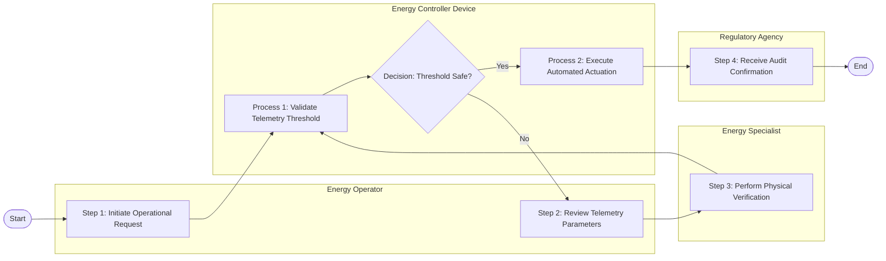

# Swimlane Diagram — Energy Compliance & Regulatory System

## Mermaid Code

## Flow Description | Mô tả luồng

| Lane | Actor | Role in Flow |
|------|-------|-------------|
| 1 | Energy Operator | Responsible for step execution in operational phase 1 |
| 2 | Energy Controller Device | Responsible for step execution in operational phase 2 |
| 3 | Energy Specialist | Responsible for step execution in operational phase 3 |
| 4 | Regulatory Agency | Responsible for step execution in operational phase 4 |
