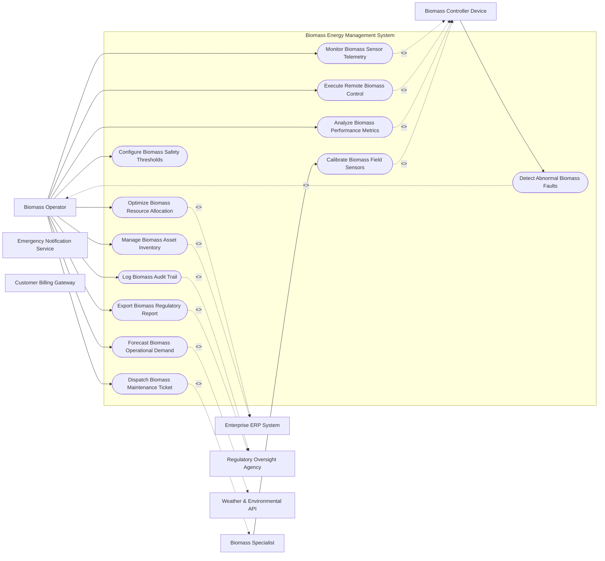

# Use Case Diagram — Biomass Energy Management System

## Mermaid Code

## Actor Table | Bảng Actor

| # | Actor | Actor Type | Role Description | Related Use Cases |
|---|-------|------------|------------------|-------------------|
| 1 | Biomass Operator | Primary | Main operator controlling Biomass Energy Management System | UC01, UC02, UC03, UC04, UC05, UC06, UC07, UC08, UC09, UC10, UC12 |
| 2 | Biomass Controller Device | Supporting System | Automated IoT hardware monitoring Biomass Energy Management System | UC01, UC02, UC03, UC09, UC11 |
| 3 | Biomass Specialist | Primary | Field engineer handling physical assets for Biomass Energy Management System | UC05, UC11 |
| 4 | Enterprise ERP System | Supporting System | Enterprise software platform for asset planning | UC04, UC12 |
| 5 | Regulatory Oversight Agency | Regulatory | Government authority supervising safety and environmental compliance | UC08, UC10 |
| 6 | Weather & Environmental API | Supporting System | External service supplying environmental data | UC06 |
| 7 | Emergency Notification Service | Supporting System | System broadcasting critical safety alerts | UC01, UC02 |
| 8 | Customer Billing Gateway | Supporting System | Billing engine computing utility tariffs | UC01, UC02 |

## Use Case Table | Bảng Use Case

| # | UC ID | Use Case Name | Primary Actor | Secondary Actor | Description | Priority |
|---|-------|---------------|---------------|-----------------|-------------|----------|
| 1 | UC01 | Monitor Biomass Sensor Telemetry | Biomass Operator | Biomass Controller Device | Monitors real-time telemetry and operational state for Biomass Energy Management System. | High |
| 2 | UC02 | Execute Remote Biomass Control | Biomass Operator | Biomass Controller Device | Sends automated control commands to field devices. | High |
| 3 | UC03 | Detect Abnormal Biomass Faults | Biomass Controller Device | Biomass Operator | Fires automated warnings when operational thresholds are breached. | High |
| 4 | UC04 | Optimize Biomass Resource Allocation | Biomass Operator | Enterprise ERP System | Balances operational load and resource distribution. | High |
| 5 | UC05 | Dispatch Biomass Maintenance Ticket | Biomass Operator | Biomass Specialist | Generates work orders for scheduled and corrective field maintenance. | Medium |
| 6 | UC06 | Forecast Biomass Operational Demand | Biomass Operator | Weather & Environmental API | Predicts future demand patterns using historical sensor telemetry. | High |
| 7 | UC07 | Configure Biomass Safety Thresholds | Biomass Operator | None | Sets warning parameters and automatic trip limits. | Medium |
| 8 | UC08 | Log Biomass Audit Trail | Biomass Operator | Regulatory Oversight Agency | Records all critical operator actions for safety compliance. | Medium |
| 9 | UC09 | Analyze Biomass Performance Metrics | Biomass Operator | Biomass Controller Device | Evaluates efficiency, uptime, and energy consumption metrics. | Medium |
| 10 | UC10 | Export Biomass Regulatory Report | Biomass Operator | Regulatory Oversight Agency | Generates standardized compliance documents. | Low |
| 11 | UC11 | Calibrate Biomass Field Sensors | Biomass Specialist | Biomass Controller Device | Performs remote or on-site sensor zero-point calibration. | Medium |
| 12 | UC12 | Manage Biomass Asset Inventory | Biomass Operator | Enterprise ERP System | Tracks lifecycle, depreciation, and warranty for system hardware. | Low |

## Use Case Specification | Đặc tả Use Case

---

### UC01 — Monitor Biomass Sensor Telemetry

| Field | Detail |
|-------|--------|
| **UC ID** | UC01 |
| **Use Case Name** | Monitor Biomass Sensor Telemetry |
| **Actor(s)** | Primary: Biomass Operator / Secondary: Biomass Controller Device |
| **Description** | Monitors real-time telemetry and operational state for Biomass Energy Management System. |
| **Precondition** | 1. System is operational and authenticated.   2. Primary actor has active session credentials. |
| **Main Flow** | 1. Biomass Operator initiates monitor biomass sensor telemetry request.   2. System validates actor authorization.   3. System retrieves current telemetry state.   4. System executes requested action safely.   5. System logs operation status.   6. System displays success confirmation message. |
| **Alternative Flow** | **AF1** — Bulk Processing: If processing multiple assets, System executes queued batch workflow.   **AF2** — Offline Mode: If network connection drops, System buffers request locally and syncs upon reconnection. |
| **Exception Flow** | **EX1** — Unauthorized Access: System rejects operation and flags security alert.   **EX2** — Sensor Timeout: System returns error notification and dispatches health check. |
| **Postcondition** | Target system state updated cleanly and audit log entry created. |
| **Business Rule** | **BR1**: All operations must comply with IEEE/ISO industry safety standards.   **BR2**: Changes must be logged into immutable audit log. |

---

### UC02 — Execute Remote Biomass Control

| Field | Detail |
|-------|--------|
| **UC ID** | UC02 |
| **Use Case Name** | Execute Remote Biomass Control |
| **Actor(s)** | Primary: Biomass Operator / Secondary: Biomass Controller Device |
| **Description** | Sends automated control commands to field devices. |
| **Precondition** | 1. System is operational and authenticated.   2. Primary actor has active session credentials. |
| **Main Flow** | 1. Biomass Operator initiates execute remote biomass control request.   2. System validates actor authorization.   3. System retrieves current telemetry state.   4. System executes requested action safely.   5. System logs operation status.   6. System displays success confirmation message. |
| **Alternative Flow** | **AF1** — Bulk Processing: If processing multiple assets, System executes queued batch workflow.   **AF2** — Offline Mode: If network connection drops, System buffers request locally and syncs upon reconnection. |
| **Exception Flow** | **EX1** — Unauthorized Access: System rejects operation and flags security alert.   **EX2** — Sensor Timeout: System returns error notification and dispatches health check. |
| **Postcondition** | Target system state updated cleanly and audit log entry created. |
| **Business Rule** | **BR1**: All operations must comply with IEEE/ISO industry safety standards.   **BR2**: Changes must be logged into immutable audit log. |

---

### UC03 — Detect Abnormal Biomass Faults

| Field | Detail |
|-------|--------|
| **UC ID** | UC03 |
| **Use Case Name** | Detect Abnormal Biomass Faults |
| **Actor(s)** | Primary: Biomass Controller Device / Secondary: Biomass Operator |
| **Description** | Fires automated warnings when operational thresholds are breached. |
| **Precondition** | 1. System is operational and authenticated.   2. Primary actor has active session credentials. |
| **Main Flow** | 1. Biomass Controller Device initiates detect abnormal biomass faults request.   2. System validates actor authorization.   3. System retrieves current telemetry state.   4. System executes requested action safely.   5. System logs operation status.   6. System displays success confirmation message. |
| **Alternative Flow** | **AF1** — Bulk Processing: If processing multiple assets, System executes queued batch workflow.   **AF2** — Offline Mode: If network connection drops, System buffers request locally and syncs upon reconnection. |
| **Exception Flow** | **EX1** — Unauthorized Access: System rejects operation and flags security alert.   **EX2** — Sensor Timeout: System returns error notification and dispatches health check. |
| **Postcondition** | Target system state updated cleanly and audit log entry created. |
| **Business Rule** | **BR1**: All operations must comply with IEEE/ISO industry safety standards.   **BR2**: Changes must be logged into immutable audit log. |

---

### UC04 — Optimize Biomass Resource Allocation

| Field | Detail |
|-------|--------|
| **UC ID** | UC04 |
| **Use Case Name** | Optimize Biomass Resource Allocation |
| **Actor(s)** | Primary: Biomass Operator / Secondary: Enterprise ERP System |
| **Description** | Balances operational load and resource distribution. |
| **Precondition** | 1. System is operational and authenticated.   2. Primary actor has active session credentials. |
| **Main Flow** | 1. Biomass Operator initiates optimize biomass resource allocation request.   2. System validates actor authorization.   3. System retrieves current telemetry state.   4. System executes requested action safely.   5. System logs operation status.   6. System displays success confirmation message. |
| **Alternative Flow** | **AF1** — Bulk Processing: If processing multiple assets, System executes queued batch workflow.   **AF2** — Offline Mode: If network connection drops, System buffers request locally and syncs upon reconnection. |
| **Exception Flow** | **EX1** — Unauthorized Access: System rejects operation and flags security alert.   **EX2** — Sensor Timeout: System returns error notification and dispatches health check. |
| **Postcondition** | Target system state updated cleanly and audit log entry created. |
| **Business Rule** | **BR1**: All operations must comply with IEEE/ISO industry safety standards.   **BR2**: Changes must be logged into immutable audit log. |

