# Action Tree — Hydrogen Energy Management System

## Mermaid Code

```mermaid
graph TD
    Root["Hydrogen Energy Management System"]

    Root --> M1["Telemetry & Monitoring"]
    M1 --> A11["View Live Telemetry"]
    M1 --> A12["Monitor Device Uptime"]
    M1 --> A13["Configure Thresholds"]
    M1 --> A14["Analyze Sensor Drift"]

    Root --> M2["Device Control & Operations"]
    M2 --> A21["Send Control Command"]
    M2 --> A22["Execute Emergency Shutoff"]
    M2 --> A23["Schedule Operation"]
    M2 --> A24["Calibrate Device"]

    Root --> M3["Fault & Incident Management"]
    M3 --> A31["Detect Sensor Anomaly"]
    M3 --> A32["Trigger System Alarm"]
    M3 --> A33["Isolate Fault Area"]
    M3 --> A34["Log Emergency Event"]

    Root --> M4["Field Service Management"]
    M4 --> A41["Create Maintenance Ticket"]
    M4 --> A42["Assign Field Engineer"]
    M4 --> A43["Track Service Progress"]
    M4 --> A44["Close Repair Job"]

    Root --> M5["Reporting & Compliance"]
    M5 --> A51["Generate Efficiency Score"]
    M5 --> A52["Run Demand Prediction"]
    M5 --> A53["Export Regulatory PDF"]
    M5 --> A54["Audit Control Log"]

```

## Module Description | Mô tả Module

| # | Module | Description | Actions |
|---|--------|-------------|---------|
| 1 | Telemetry & Monitoring | Real-time sensor monitoring for Hydrogen Energy Management System | View Live Telemetry, Monitor Device Uptime, Configure Thresholds, Analyze Sensor Drift |
| 2 | Device Control & Operations | Remote device actuation and automated control | Send Control Command, Execute Emergency Shutoff, Schedule Operation, Calibrate Device |
| 3 | Fault & Incident Management | Automated alarm generation and fault isolation | Detect Sensor Anomaly, Trigger System Alarm, Isolate Fault Area, Log Emergency Event |
| 4 | Field Service Management | Maintenance dispatch and repair tracking | Create Maintenance Ticket, Assign Field Engineer, Track Service Progress, Close Repair Job |
| 5 | Reporting & Compliance | Analytical dashboards and regulatory export | Generate Efficiency Score, Run Demand Prediction, Export Regulatory PDF, Audit Control Log |
