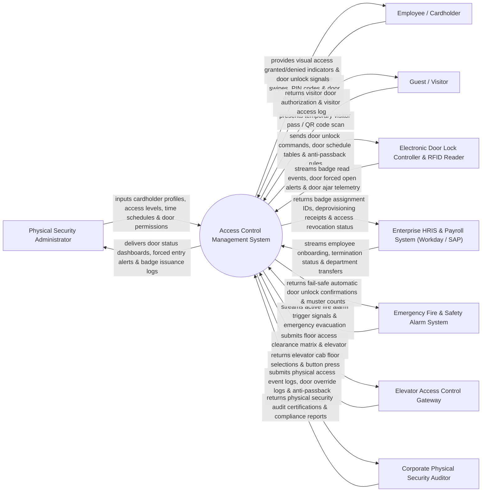

# Context Diagram — Access Control Management System

## Mermaid Code

## Actor & Interaction Table | Bảng Actor & Tương tác

| # | Actor | Actor Type | Data Sent TO System | Data Received FROM System | Notes |
|---|-------|------------|---------------------|---------------------------|-------|
| 1 | Physical Security Administrator | Primary | Cardholder profiles, access levels, time schedules, door permission matrices. | Door status dashboards, forced entry alerts, badge issuance logs, clearance reports. | Security staff provisioning RFID badges, setting door schedules, and handling lockdown rules. |
| 2 | Employee / Cardholder | Primary | RFID badge swipes, PIN code entries, biometric scans at door readers. | Visual access granted/denied LED indicators, electronic strike door unlock signals. | Corporate staff member tapping smartcard badge to unlock perimeter doors and turnstiles. |
| 3 | Guest / Visitor | Primary | Temporary visitor RFID pass swipes or mobile QR code scans at turnstiles. | Temporary door access authorization, visual green/red door indicator. | Temporary visitor scanning temporary pass for authorized escort or restricted lobby entry. |
| 4 | Electronic Door Lock Controller & RFID Reader | Supporting | Badge read card numbers, door forced open alerts, door held ajar telemetry, tamper signals. | Door unlock pulse commands, holiday schedule lookup tables, anti-passback rules. | Hardware door controllers (HID, Mercury Security) controlling door strikes and readers. |
| 5 | Enterprise HRIS & Payroll System | Supporting | Employee onboarding data, involuntary termination events, department changes. | Badge assignment IDs, deprovisioning receipts, access revocation status logs. | HR platform (Workday / Active Directory) synchronizing employee employment lifecycle. |
| 6 | Emergency Fire Alarm System | Supporting | Active fire alarm trigger signals, building evacuation alerts. | Fail-safe automatic door unlock confirmations, facility muster clearance counts. | Building fire alarm panel commanding immediate fail-safe unlocking of emergency exit doors. |
| 7 | Elevator Access Control Gateway | Supporting | Elevator cab floor selections, destination dispatch button presses. | Floor access clearance matrix, elevator relay enable/disable commands. | Hardware integration managing elevator floor button enablement based on badge access level. |
| 8 | Corporate Physical Security Auditor | Supporting / Regulatory | Physical security audit findings, compliance policies, inspection notes. | Physical access event logs, door override logs, anti-passback violation records. | Auditor inspecting physical access security logs for SOC 2 and ISO 27001 compliance. |

## System Boundary Description | Mô tả Phạm vi Hệ thống

The **Access Control Management System** is an enterprise physical security access, RFID smartcard badge provisioning, door controller management, anti-passback, and emergency facility lockdown platform.

**Inside System Scope:**
- Centralized cardholder identity management, smartcard RFID credential encoding, and access privilege assignment.
- Real-time door status monitoring (Door Open, Door Closed, Door Forced Open, Door Held Ajar).
- Time schedule and holiday calendar management governing automatic door locking/unlocking hours.
- Anti-passback enforcement preventing credential sharing or tailgating across perimeter barriers.
- Emergency facility lockdown execution and automated fire alarm fail-safe door release integration.

**Outside System Scope:**
- Direct physical mounting and wiring of door magnetic locks and strike plates (handled by Electricians).
- Direct physical security guard response to un-authorized forced entry (handled by Guard Patrol).
- Direct employee payroll calculation (handled by Enterprise HRIS & Payroll).
