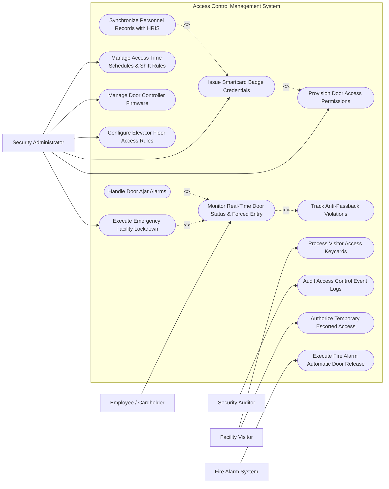

# Use Case Diagram — Access Control Management System

## Mermaid Code

## Actor Table | Bảng Actor

| # | Actor | Actor Type | Role Description | Related Use Cases |
|---|-------|------------|------------------|-------------------|
| 1 | Security Administrator | Primary | Provisions RFID credentials, defines access levels, configures door time schedules, and executes facility lockdowns. | UC01, UC02, UC04, UC05, UC09, UC10 |
| 2 | Employee / Cardholder | Primary | Swipes RFID badges at readers to request door entry and access authorized zones. | UC03 |
| 3 | Facility Visitor | Primary | Uses temporary visitor keycards or QR code passes for escorted facility entry. | UC07, UC13 |
| 4 | Security Auditor | Secondary | Audits physical access event logs, tailgating alerts, anti-passback violations, and door override records. | UC08 |
| 5 | Fire Alarm System | Supporting / System | Triggers building-wide emergency signal demanding fail-safe automatic unlocking of exit doors. | UC14 |

## Use Case Table | Bảng Use Case

| # | UC ID | Use Case Name | Primary Actor | Secondary Actor | Description | Priority |
|---|-------|---------------|---------------|-----------------|-------------|----------|
| 1 | UC01 | Issue Smartcard Badge Credentials | Security Admin | HRIS System | Encodes and issues RFID smartcard badges or mobile Bluetooth credentials to personnel. | High |
| 2 | UC02 | Provision Door Access Permissions | Security Admin | None | Assigns Access Levels (group of doors and valid times) to individual cardholders or departments. | High |
| 3 | UC03 | Monitor Real-Time Door Status & Forced Entry | Cardholder | Security Admin | Tracks real-time door lock states, authorized entries, door forced open alarms, and invalid badge swipes. | High |
| 4 | UC04 | Execute Emergency Facility Lockdown | Security Admin | None | Immediately locks down all or targeted facility zones, overriding normal badge access rights. | High |
| 5 | UC05 | Manage Access Time Schedules & Shift Rules | Security Admin | None | Configures recurring time zones (e.g., 8:00 AM - 5:00 PM weekdays) and holiday door schedule overrides. | High |
| 6 | UC06 | Track Anti-Passback Violations | Cardholder | Security Admin | Prevents a cardholder from passing their badge back to another user by requiring sequential entry/exit swipes. | High |
| 7 | UC07 | Process Visitor Access Keycards | Facility Visitor | Security Admin | Issues temporary, auto-expiring access passes for guests restricted to specific lobby or meeting rooms. | Medium |
| 8 | UC08 | Audit Access Control Event Logs | Security Auditor | None | Generates searchable audit trails of all door access events, system admin edits, and alarm history. | Medium |
| 9 | UC09 | Manage Door Controller Firmware | Security Admin | Hardware Controller | Pushes configuration updates and security firmware patches to network hardware door controllers. | Low |
| 10 | UC10 | Configure Elevator Floor Access Rules | Security Admin | Elevator Gateway | Maps cardholder access levels to specific elevator floor relay buttons. | Medium |
| 11 | UC11 | Handle Door Ajar Alarms | Security Admin | None | Triggers audible and visual alerts when a door is held open beyond the configured timeout limit. | Medium |
| 12 | UC12 | Synchronize Personnel Records with HRIS | Security Admin | HRIS System | Automatically deactivates RFID badges when an employee is terminated in HRIS. | High |
| 13 | UC13 | Authorize Temporary Escorted Access | Facility Visitor | Cardholder | Grants one-time access authorization for a guest accompanied by an authorized employee host. | Medium |
| 14 | UC14 | Execute Fire Alarm Automatic Door Release | Fire Alarm System | Security Admin | Releases all magnetic door locks instantly upon receiving a verified fire alarm signal for life safety. | High |

## Use Case Specification | Đặc tả Use Case

---

### UC01 — Issue Smartcard Badge Credentials

| Field | Detail |
|-------|--------|
| **UC ID** | UC01 |
| **Use Case Name** | Issue Smartcard Badge Credentials |
| **Actor(s)** | Primary: Security Administrator   Secondary: HRIS System |
| **Description** | Encodes RFID smartcard chip credentials, prints employee photo badge, and assigns badge ID to cardholder profile. |
| **Precondition** | 1. Employee profile exists in system (imported from HRIS).   2. RFID badge encoder printer is online. |
| **Main Flow** | 1. Administrator selects target employee in Cardholder Management module.   2. System retrieves employee photo, department, and employment status.   3. Administrator places unencoded RFID smartcard into encoder tray and clicks "Encode & Print Badge".   4. System generates unique 32-bit facility code and card number, encoding data onto RFID chip.   5. System prints employee photo, legal name, and barcode onto badge surface.   6. System binds RFID card number to employee profile and sets status to "ACTIVE". |
| **Alternative Flow** | **AF1** — Mobile Credential Issuance: Administrator issues virtual Bluetooth/NFC credential directly to employee smartphone app. |
| **Exception Flow** | **EX1** — Encoder Jam / Error: System detects card encoding failure, voids card number, and alerts administrator to re-insert blank card. |
| **Postcondition** | RFID badge is encoded, printed, and active for door access. |
| **Business Rule** | **BR1**: An employee shall hold only one active physical RFID badge credential at any given time. |

---

### UC02 — Provision Door Access Permissions

| Field | Detail |
|-------|--------|
| **UC ID** | UC02 |
| **Use Case Name** | Provision Door Access Permissions |
| **Actor(s)** | Primary: Security Administrator   Secondary: None |
| **Description** | Assigns predefined Access Levels (group of doors + valid time schedule) to cardholders based on role and facility requirements. |
| **Precondition** | 1. Access Levels (e.g., "Server Room 24/7", "General HQ Weekday") are defined. |
| **Main Flow** | 1. Administrator opens Cardholder Profile and navigates to Access Permissions.   2. System displays current assigned Access Levels and door list.   3. Administrator selects target Access Level (e.g., "R&D Lab Floor 3") and sets start/expiration dates.   4. System validates administrator authorization to grant access to target sensitive zone.   5. System pushes updated cardholder access rule payload to hardware door controllers.   6. Door controllers update local memory databases, confirming rule sync. |
| **Alternative Flow** | **AF1** — Role-Based Auto Provisioning: System automatically assigns Access Levels based on employee HRIS department code (e.g., IT staff automatically get Data Center access). |
| **Exception Flow** | **EX1** — Controller Memory Full: Door controller returns memory full error. System alerts administrator and triggers controller memory cleanup. |
| **Postcondition** | Door controllers are updated with new cardholder permission rules. |
| **Business Rule** | **BR1**: Access permissions to High-Security zones (Server Rooms, Vaults) require dual-manager approval before provisioning. |

---

### UC03 — Monitor Real-Time Door Status & Forced Entry

| Field | Detail |
|-------|--------|
| **UC ID** | UC03 |
| **Use Case Name** | Monitor Real-Time Door Status & Forced Entry |
| **Actor(s)** | Primary: Employee / Cardholder   Secondary: Security Administrator |
| **Description** | Processes real-time badge swipes at door readers, verifies permissions, unlocks doors, and detects unauthorized forced entry. |
| **Precondition** | 1. Hardware door controllers and RFID readers are online. |
| **Main Flow** | 1. Employee taps RFID badge on door reader.   2. Reader reads card number and sends payload to Door Controller.   3. Controller checks local database for card number, time schedule, and anti-passback status.   4. If valid, controller energizes door strike relay to unlock door, flashes green LED, and logs "ACCESS GRANTED".   5. Employee pushes door open and enters. Door position sensor confirms door open then closed.   6. Controller re-locks door strike and transmits event log to Central System. |
| **Alternative Flow** | **AF1** — Invalid Badge / Access Denied: If card is invalid or expired, controller denies access, flashes red LED, beeps error, and logs "ACCESS DENIED - UNAUTHORIZED LEVEL". |
| **Exception Flow** | **EX1** — Door Forced Open (DFO): If door position sensor detects door opened without a valid badge swipe or exit request, controller immediately triggers high-priority "DOOR FORCED OPEN ALARM" to Security Administrator. |
| **Postcondition** | Door swipe transaction or forced entry alarm is logged in real-time. |
| **Business Rule** | **BR1**: Hardware door strikes must unlock within 200 milliseconds of a valid badge swipe. |

---

### UC04 — Execute Emergency Facility Lockdown

| Field | Detail |
|-------|--------|
| **UC ID** | UC04 |
| **Use Case Name** | Execute Emergency Facility Lockdown |
| **Actor(s)** | Primary: Security Administrator   Secondary: None |
| **Description** | Triggers an immediate facility-wide or zone-specific security lockdown, disabling normal cardholder badge entry while keeping emergency exits functional. |
| **Precondition** | 1. Active security threat (e.g., active shooter, civil unrest) requires emergency lockdown. |
| **Main Flow** | 1. Administrator clicks "EMERGENCY LOCKDOWN" button on control console or inputs physical lockdown keycode.   2. System prompts for confirmation and lockdown zone scope (Entire Facility OR Building B).   3. Administrator confirms lockdown execution.   4. System transmits high-priority broadcast command to all target door controllers.   5. Door controllers lock exterior doors, disable all standard badge readers, and flash warning red LEDs.   6. System displays Lockdown Active status dashboard, displaying real-time door lock verification. |
| **Alternative Flow** | **AF1** — Hard Lockdown vs Soft Lockdown: In Soft Lockdown, internal doors remain accessible with master badges; in Hard Lockdown, all badges except Emergency Responder Master Keys are blocked. |
| **Exception Flow** | **EX1** — Controller Offline: System detects a door controller failing to acknowledge lockdown signal and alerts administrator to dispatch security guards to manually secure the door. |
| **Postcondition** | Facility doors are secured in lockdown state and all standard badge access is suspended. |
| **Business Rule** | **BR1**: Emergency exit crash bars must remain mechanically operable from the inside during a security lockdown for life safety. |

---

### UC08 — Audit Access Control Event Logs

| Field | Detail |
|-------|--------|
| **UC ID** | UC08 |
| **Use Case Name** | Audit Access Control Event Logs |
| **Actor(s)** | Primary: Security Auditor   Secondary: None |
| **Description** | Generates detailed, immutable audit reports of all physical door accesses, badge swipes, administrator edits, and door alarms for compliance verification. |
| **Precondition** | 1. Auditor has Read-Only Audit permissions in system. |
| **Main Flow** | 1. Auditor opens "Access Control Audit & Reporting" workspace.   2. Auditor selects query parameters (Date/Time Range, Cardholder Name, Specific Door/Building, Event Type [Granted/Denied/Forced]).   3. System queries indexed event database and returns matching audit log table.   4. System displays event timestamp, cardholder name, door name, controller ID, and outcome.   5. Auditor reviews events, inspects anti-passback violations or manual door overrides.   6. Auditor exports certified audit report in PDF/CSV format. |
| **Alternative Flow** | **AF1** — Scheduled Compliance Report: System automatically generates weekly physical access reports for Data Center doors and emails report to Compliance Officer. |
| **Exception Flow** | **EX1** — Missing Log Gap: System detects missing log timestamps from an offline controller, flags "LOG DISCONTINUITY WARNING", and fetches buffered logs from controller memory. |
| **Postcondition** | Certified physical access audit report is generated and logged. |
| **Business Rule** | **BR1**: Physical access event logs must be retained in an immutable storage database for a minimum of 365 days. |
