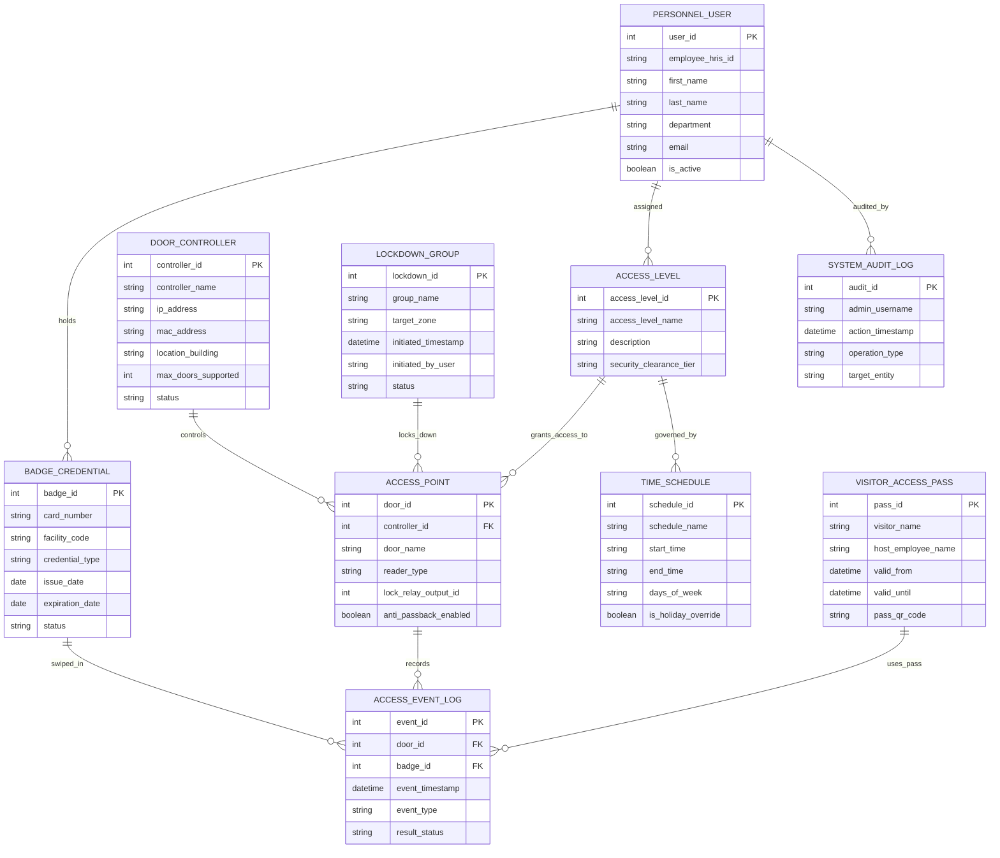

# Conceptual ERD — Access Control Management System

## Mermaid Code

## Entity Description Table | Bảng mô tả Entity

| # | Entity Name | Vietnamese Name | Description | Key Attributes | Main Relationships |
|---|-------------|-----------------|-------------|----------------|-------------------|
| 1 | BADGE_CREDENTIAL | Thẻ Ra vào RFID | Master record storing physical RFID card numbers, facility codes, expiration dates, and status. | badge_id, card_number, facility_code, status | Held by PERSONNEL_USER; swiped in ACCESS_EVENT_LOG. |
| 2 | PERSONNEL_USER | Nhân sự / Chủ thẻ | Stores employee demographic data, department codes, HRIS links, and active employment status. | user_id, employee_hris_id, first_name, department | Holds BADGE_CREDENTIAL; assigned ACCESS_LEVEL. |
| 3 | ACCESS_LEVEL | Cấp độ Truy cập (Access Level) | Defines groups of authorized doors and time schedules mapped to cardholder roles. | access_level_id, access_level_name, security_clearance_tier | Assigned to PERSONNEL_USER; grants access to ACCESS_POINT. |
| 4 | DOOR_CONTROLLER | Bộ Điều khiển Cửa Hardware | Stores network hardware door controller IP addresses, location buildings, and hardware status. | controller_id, controller_name, ip_address, status | Controls multiple ACCESS_POINT doors. |
| 5 | ACCESS_POINT | Điểm Ra vào / Cửa | Master record for door readers, lock relay outputs, reader types, and anti-passback rules. | door_id, door_name, reader_type, anti_passback_enabled | Controlled by DOOR_CONTROLLER; records ACCESS_EVENT_LOG. |
| 6 | TIME_SCHEDULE | Khung Giờ Hoạt động | Defines valid door unlocking hours, shift start/end times, and holiday schedule overrides. | schedule_id, schedule_name, start_time, days_of_week | Governs ACCESS_LEVEL. |
| 7 | ACCESS_EVENT_LOG | Nhật ký Sự kiện Ra vào | Stores real-time door swipe records, timestamps, event types (Granted, Denied, Forced), and result status. | event_id, event_timestamp, event_type, result_status | Belongs to ACCESS_POINT and BADGE_CREDENTIAL. |
| 8 | LOCKDOWN_GROUP | Nhóm Phong tỏa Khan cấp | Manages emergency lockdown execution parameters, target facility zones, and status. | lockdown_id, group_name, target_zone, status | Locks down multiple ACCESS_POINT doors. |
| 9 | VISITOR_ACCESS_PASS | Thẻ Khách Tạm thời | Stores temporary guest QR codes/passes, host employee names, and valid time windows. | pass_id, visitor_name, valid_from, valid_until | Uses pass in ACCESS_EVENT_LOG. |
| 10 | SYSTEM_AUDIT_LOG | Nhật ký Kiểm toán Quản trị | Captures administrator configuration changes, access provisioning edits, and override actions. | audit_id, admin_username, action_timestamp, operation_type | Audits edits to PERSONNEL_USER and system. |

## Relationship Description | Mô tả Quan hệ

| # | From Entity | Cardinality | To Entity | Relationship Label | Business Explanation |
|---|-------------|-------------|-----------|-------------------|----------------------|
| 1 | PERSONNEL_USER | one-to-many | BADGE_CREDENTIAL | holds | An employee can hold one or more RFID badge credentials over time. |
| 2 | PERSONNEL_USER | many-to-many | ACCESS_LEVEL | assigned | An employee is assigned one or more door access levels. |
| 3 | ACCESS_LEVEL | many-to-many | ACCESS_POINT | grants_access_to | An access level grants authorization to multiple door access points. |
| 4 | ACCESS_LEVEL | one-to-many | TIME_SCHEDULE | governed_by | An access level is governed by specific valid time schedules. |
| 5 | DOOR_CONTROLLER | one-to-many | ACCESS_POINT | controls | A hardware door controller controls multiple door access points. |
| 6 | ACCESS_POINT | one-to-many | ACCESS_EVENT_LOG | records | A door access point records real-time door swipe and alarm events. |
| 7 | BADGE_CREDENTIAL | one-to-many | ACCESS_EVENT_LOG | swiped_in | An RFID badge credential is swiped in multiple door access events. |
| 8 | LOCKDOWN_GROUP | many-to-many | ACCESS_POINT | locks_down | An emergency lockdown group secures multiple target door access points. |
