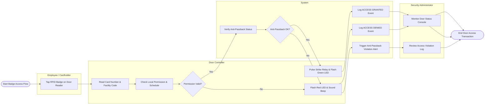

# Swimlane Diagram — Access Control Management System

## Mermaid Code

## Flow Description | Mô tả luồng

| Lane | Actor | Role in Flow |
|------|-------|-------------|
| 1 | Employee / Cardholder | Swipes physical RFID smartcard badge at the door reader to request access. |
| 2 | Door Controller | Hardware panel reading card data, verifying local memory permissions, checking time schedules, and energizing door strike relays. |
| 3 | System | Validates anti-passback sequence rules, logs access granted/denied transaction entries, and generates real-time security alerts. |
| 4 | Security Administrator | Monitors live door event dashboards, receives anti-passback violation alerts, and manages access exceptions. |
