# Action Tree — Access Control Management System

## Mermaid Code

```mermaid
graph TD
    Root["Access Control Management System"]

    Root --> M1["Credential & Badge Management"]
    Root --> M2["Access Rights & Schedules"]
    Root --> M3["Real-Time Door Monitoring"]
    Root --> M4["Emergency Lockdown & Safety"]
    Root --> M5["Audit & System Logs"]

    M1 --> A1["Encode Smartcard RFID Chip"]
    M1 --> A2["Print Photo Employee Badge"]
    M1 --> A3["Issue Virtual Mobile Credential"]
    M1 --> A4["Revoke Terminated Employee Badge"]

    M2 --> B1["Create Access Level Group"]
    M2 --> B2["Configure Time Schedules"]
    M2 --> B3["Set Anti-Passback Rules"]
    M2 --> B4["Configure Elevator Floor Relay"]

    M3 --> C1["View Door Status Dashboard"]
    M3 --> C2["Process Door Strike Unlock"]
    M3 --> C3["Log Door Forced Open Alert"]
    M3 --> C4["Log Door Held Ajar Warning"]

    M4 --> D1["Trigger Zone Security Lockdown"]
    M4 --> D2["Execute Fire Alarm Door Release"]
    M4 --> D3["Issue Emergency Master Keycard"]
    M4 --> D4["Generate Evacuation Muster Count"]

    M5 --> E1["Search Physical Access Event Logs"]
    M5 --> E2["Export SOC 2 Compliance Report"]
    M5 --> E3["Audit Door Override Commands"]
    M5 --> E4["Sync Cardholder Records with HRIS"]
```

## Module Description | Mô tả Module

| # | Module | Description | Actions |
|---|--------|-------------|---------|
| 1 | Credential & Badge Management | RFID smartcard chip encoding, photo badge printing, mobile Bluetooth credential issuance, and card revocation. | Encode Smartcard RFID Chip, Print Photo Employee Badge, Issue Virtual Mobile Credential, Revoke Terminated Employee Badge |
| 2 | Access Rights & Schedules | Access level group definition, time schedule configuration, anti-passback rules, and elevator floor clearance rules. | Create Access Level Group, Configure Time Schedules, Set Anti-Passback Rules, Configure Elevator Floor Relay |
| 3 | Real-Time Door Monitoring | Live door status dashboard, door strike unlock processing, door forced open alerts, and door held ajar warnings. | View Door Status Dashboard, Process Door Strike Unlock, Log Door Forced Open Alert, Log Door Held Ajar Warning |
| 4 | Emergency Lockdown & Safety | Instant facility security lockdown, fire alarm fail-safe door release, emergency master keys, and evacuation muster lists. | Trigger Zone Security Lockdown, Execute Fire Alarm Door Release, Issue Emergency Master Keycard, Generate Evacuation Muster Count |
| 5 | Audit & System Logs | Physical access log queries, SOC 2/ISO 27001 compliance export, manual door override auditing, and HRIS directory sync. | Search Physical Access Event Logs, Export SOC 2 Compliance Report, Audit Door Override Commands, Sync Cardholder Records with HRIS |
