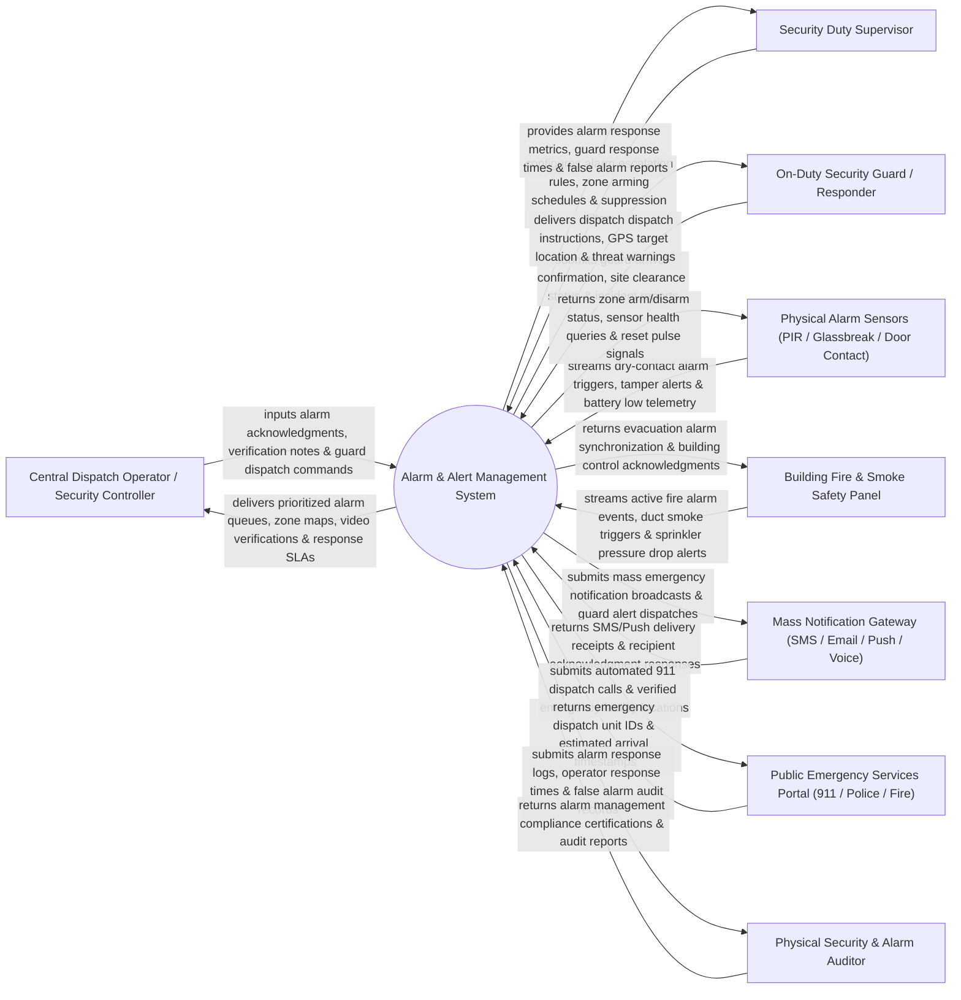

# Context Diagram — Alarm & Alert Management System

## Mermaid Code

## Actor & Interaction Table | Bảng Actor & Tương tác

| # | Actor | Actor Type | Data Sent TO System | Data Received FROM System | Notes |
|---|-------|------------|---------------------|---------------------------|-------|
| 1 | Central Dispatch Operator / Security Controller | Primary | Alarm acknowledgments, verification notes, guard dispatch commands, alarm reset entries. | Prioritized alarm queues, zone maps, live video verifications, response SLA countdown timers. | Control room operator acknowledging incoming alarms and dispatching security guard responders. |
| 2 | Security Duty Supervisor | Primary | Alarm escalation rules, zone arming schedules, suppression filters, VIP location rules. | Alarm response metrics, guard response times, false alarm reports, operator audit logs. | Senior supervisor configuring alarm priorities, shift schedules, and monitoring SLAs. |
| 3 | On-Duty Security Guard / Responder | Primary | Guard arrival confirmation, site clearance status, incident reports, mobile GPS updates. | Dispatch instructions, GPS target location maps, threat warnings, zone details. | Field guard receiving mobile app dispatch alerts to physically inspect alarm sites. |
| 4 | Physical Alarm Sensors | Supporting | Dry-contact alarm triggers, tamper alerts, battery low telemetry, wire-cut notifications. | Zone arm/disarm status, sensor health queries, reset pulse signals. | Hardware sensors (PIR motion, glassbreak, door contact, seismic) monitoring physical zones. |
| 5 | Building Fire & Smoke Safety Panel | Supporting | Active fire alarm events, duct smoke triggers, sprinkler pressure drop alerts. | Evacuation alarm synchronization, building control acknowledgments. | Central fire alarm control panel sending life-safety alarm events. |
| 6 | Mass Notification Gateway | Supporting | SMS/Push delivery receipts, recipient acknowledgment responses, call delivery statuses. | Mass emergency notification broadcasts, guard alert dispatches, voice call triggers. | External gateway (Twilio, Everbridge) broadcasting emergency SMS and push alerts. |
| 7 | Public Emergency Services Portal | Supporting | Emergency dispatch unit IDs, estimated arrival timestamps, police case numbers. | Automated 911 dispatch calls, verified emergency facility locations, building hazard details. | Public emergency response dispatchers (911 Police / Fire Department) receiving verified alarms. |
| 8 | Physical Security & Alarm Auditor | Supporting / Regulatory | Alarm management compliance audit findings, inspection notes, regulatory policies. | Alarm response logs, operator response times, false alarm audit records. | Independent auditor inspecting alarm handling SLAs and municipal false alarm fines. |

## System Boundary Description | Mô tả Phạm vi Hệ thống

The **Alarm & Alert Management System** is an enterprise physical alarm ingestion, priority triage, guard dispatching, mass emergency notification, and alarm verification platform.

**Inside System Scope:**
- Multi-protocol ingestion of physical alarm events (PIR motion, glassbreak, fire, panic buttons, tamper).
- Dynamic alarm priority ranking (Priority 1 Critical Fire/Panic to Priority 4 Low Battery).
- Guard dispatching workflow with mobile GPS routing and site clearance tracking.
- Audio/video verification integration verifying alarms before public 911 dispatch.
- Automated mass notification broadcasting (SMS, Email, Voice, Push) and alarm response SLA tracking.

**Outside System Scope:**
- Direct physical repair of broken sensor wiring or dead batteries (handled by Alarm Technicians).
- Direct physical firefighting operations (handled by Public Fire Department).
- Direct physical installation of building sprinkler pipes (handled by Plumbing Contractors).
