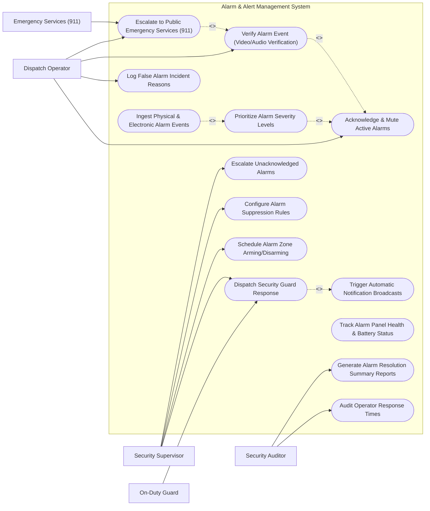

# Use Case Diagram — Alarm & Alert Management System

## Mermaid Code

## Actor Table | Bảng Actor

| # | Actor | Actor Type | Role Description | Related Use Cases |
|---|-------|------------|------------------|-------------------|
| 1 | Dispatch Operator | Primary | Acknowledges active alarms, performs video/audio verification, logs false alarm reasons, and escalates verified threats. | UC04, UC06, UC09, UC10 |
| 2 | On-Duty Guard | Primary | Receives mobile dispatch assignments, navigates to alarm zones, performs physical site inspection, and confirms clearance. | UC03 |
| 3 | Security Supervisor | Primary | Configures alarm priorities, manages zone arming schedules, defines suppression rules, and handles unacknowledged alarm escalations. | UC03, UC07, UC08, UC12 |
| 4 | Security Auditor | Secondary | Audits operator response SLAs, tracks false alarm statistics, and exports compliance reports. | UC13, UC14 |
| 5 | Emergency Services (911) | Supporting / System | Public police and fire dispatch agencies receiving verified emergency alarm escalations. | UC09 |

## Use Case Table | Bảng Use Case

| # | UC ID | Use Case Name | Primary Actor | Secondary Actor | Description | Priority |
|---|-------|---------------|---------------|-----------------|-------------|----------|
| 1 | UC01 | Ingest Physical & Electronic Alarm Events | Dispatch Operator | None | Ingests real-time alarm signals from physical sensors, panic buttons, glassbreak detectors, and fire panels. | High |
| 2 | UC02 | Prioritize Alarm Severity Levels | Dispatch Operator | None | Automatically ranks incoming alarms into priority queues (P1 Fire/Panic, P2 Intrusion, P3 Tamper, P4 Low Battery). | High |
| 3 | UC03 | Dispatch Security Guard Response | Security Supervisor | On-Duty Guard | Dispatches closest mobile patrol guard to alarm zone with GPS coordinates and site details. | High |
| 4 | UC04 | Acknowledge & Mute Active Alarms | Dispatch Operator | None | Allows operators to click and acknowledge active alarm tiles, silencing control room sirens while under review. | High |
| 5 | UC05 | Trigger Automatic Notification Broadcasts | Security Supervisor | None | Sends automated SMS, push notifications, and voice calls to facility managers and on-call guards. | High |
| 6 | UC06 | Verify Alarm Event (Video/Audio Verification) | Dispatch Operator | None | Pulls up live camera feeds or 2-way audio associated with the alarm zone to verify real threats vs false triggers. | High |
| 7 | UC07 | Escalate Unacknowledged Alarms | Security Supervisor | None | Automatically escalates alarms to supervisors if operator fails to acknowledge within SLA timeout (e.g., 60s). | High |
| 8 | UC08 | Configure Alarm Suppression Rules | Security Supervisor | None | Mutes alarm triggers for zones undergoing scheduled maintenance or authorized construction. | Medium |
| 9 | UC09 | Escalate to Public Emergency Services (911) | Dispatch Operator | Emergency Services | Transfers verified fire, armed robbery, or intrusion alarms to public 911 dispatch centers. | High |
| 10 | UC10 | Log False Alarm Incident Reasons | Dispatch Operator | None | Categorizes false alarm causes (User Error, Environmental Weather, Sensor Defect) for municipal fee tracking. | Medium |
| 11 | UC11 | Track Alarm Panel Health & Battery Status | Security Supervisor | None | Monitors hardware panel AC power loss, backup battery voltage, and sensor wire-cut tamper signals. | High |
| 12 | UC12 | Schedule Alarm Zone Arming/Disarming | Security Supervisor | None | Configures automated arming (e.g., 7:00 PM) and disarming (e.g., 6:00 AM) schedules for building zones. | High |
| 13 | UC13 | Generate Alarm Resolution Summary Reports | Security Auditor | None | Compiles statistical reports on alarm volume, peak incident hours, false alarm rates, and zone hotspots. | Medium |
| 14 | UC14 | Audit Operator Response Times | Security Auditor | None | Measures operator time-to-acknowledge and time-to-verify metrics against corporate security SLAs. | Medium |

## Use Case Specification | Đặc tả Use Case

---

### UC01 — Ingest Physical & Electronic Alarm Events

| Field | Detail |
|-------|--------|
| **UC ID** | UC01 |
| **Use Case Name** | Ingest Physical & Electronic Alarm Events |
| **Actor(s)** | Primary: Dispatch Operator   Secondary: None |
| **Description** | Ingests real-time dry-contact, SIA, or Contact ID alarm protocol payloads from physical alarm panels and sensors. |
| **Precondition** | 1. Alarm hardware panels are connected via IP/Cellular dialer to central receiver. |
| **Main Flow** | 1. Hardware alarm panel detects PIR motion sensor trigger in Zone 12 (Warehouse South).   2. Panel formats Contact ID protocol payload (`1130 01 012`) and transmits payload over encrypted IP socket.   3. System receiver ingests payload, decodes account number, zone ID, and alarm event type.   4. System checks zone mapping database, identifying "Zone 12: High-Value Storage Room B".   5. System creates active Alarm Event record, assigning unique Event ID (e.g., `ALM-9941`).   6. System passes event to UC02 Prioritize Alarm Severity Levels. |
| **Alternative Flow** | **AF1** — Cellular Backup Transmission: If primary IP network fails, alarm panel automatically failover transmits payload via LTE cellular link. |
| **Exception Flow** | **EX1** — Unmapped Account ID: If alarm payload contains unknown account ID, system logs "UNMAPPED ALARM PAYLOAD" and alerts duty supervisor. |
| **Postcondition** | Alarm event is ingested, decoded, and passed to priority queue. |
| **Business Rule** | **BR1**: Alarm payload ingestion and zone decoding must execute in less than 100 milliseconds. |

---

### UC02 — Prioritize Alarm Severity Levels

| Field | Detail |
|-------|--------|
| **UC ID** | UC02 |
| **Use Case Name** | Prioritize Alarm Severity Levels |
| **Actor(s)** | Primary: Dispatch Operator   Secondary: None |
| **Description** | Evaluates incoming alarm event types and zone criticality to rank alarms into prioritized dispatch queues. |
| **Precondition** | 1. Alarm event is ingested into system.   2. Priority matrix rules (P1 to P4) are configured. |
| **Main Flow** | 1. System receives decoded alarm event `ALM-9941` (PIR Motion in Vault).   2. System checks priority matrix for event type (Panic/Duress = P1, Fire = P1, Burglary = P2, Tamper = P3, Battery = P4).   3. System checks target zone multiplier (Vault = High Criticality Multiplier).   4. System assigns final rating: "PRIORITY 1 - CRITICAL INTRUSION".   5. System places alarm at top of Dispatch Operator active queue.   6. System plays audible Priority 1 siren sound on control room console and flashes red zone tile on facility map. |
| **Alternative Flow** | **AF1** — Multiple Simultaneous Alarms: System sorts queue dynamically, always placing highest priority life-safety alarms at top of list. |
| **Exception Flow** | **EX1** — Suppressed Zone Check: If zone is currently under authorized maintenance mode, system routes event to "Suppressed Queue" without sounding sirens. |
| **Postcondition** | Alarm is prioritized and displayed at appropriate position in operator console. |
| **Business Rule** | **BR1**: Priority 1 Critical alarms must override all lower-priority notifications on operator screens. |

---

### UC03 — Dispatch Security Guard Response

| Field | Detail |
|-------|--------|
| **UC ID** | UC03 |
| **Use Case Name** | Dispatch Security Guard Response |
| **Actor(s)** | Primary: Security Supervisor   Secondary: On-Duty Guard |
| **Description** | Selects closest available security guard, pushes mobile dispatch assignment with GPS routing, and tracks guard response progress. |
| **Precondition** | 1. Verified alarm event requires physical site inspection.   2. Guards have active mobile dispatch app running. |
| **Main Flow** | 1. Supervisor views verified alarm `ALM-9941` and clicks "Dispatch Guard Response".   2. System queries mobile guard GPS locations and returns list of on-duty guards sorted by proximity.   3. Supervisor selects Guard "Unit 4 - Officer Smith" (0.5 miles away) and clicks "Assign Dispatch".   4. System sends high-priority mobile push alert to Guard Unit 4's smartphone.   5. Guard smartphone vibrates, displays alarm zone map, building entry instructions, and threat details.   6. Guard taps "Accept Dispatch". System updates dispatch ticket status to "EN ROUTE".   7. Upon arrival at site, Guard taps "Arrived at Zone", and system logs arrival timestamp. |
| **Alternative Flow** | **AF1** — Automated Nearest Guard Dispatch: System automatically dispatches closest available guard based on geofence rules. |
| **Exception Flow** | **EX1** — Guard Rejects Dispatch: If guard rejects dispatch, system alerts supervisor and automatically re-routes dispatch to second closest guard. |
| **Postcondition** | Guard response is dispatched, tracked via GPS, and timestamps are recorded. |
| **Business Rule** | **BR1**: On-site guard response dispatch must occur within 2 minutes of alarm verification. |

---

### UC05 — Trigger Automatic Notification Broadcasts

| Field | Detail |
|-------|--------|
| **UC ID** | UC05 |
| **Use Case Name** | Trigger Automatic Notification Broadcasts |
| **Actor(s)** | Primary: Security Supervisor   Secondary: None |
| **Description** | Broadcasts multi-channel emergency notification messages (SMS, Push, Email, Automated Phone Call) to stakeholders during active alarms. |
| **Precondition** | 1. Alarm event triggers notification broadcast rule. |
| **Main Flow** | 1. System detects Priority 1 Fire Alarm event in Building A.   2. System loads pre-configured Mass Notification Template ("Building A Emergency Evacuation Notice").   3. System retrieves contact list for Building A occupants and facility managers.   4. System issues API calls to Mass Notification Gateway (Twilio/Everbridge).   5. Gateway transmits parallel SMS text messages, push notifications, and automated voice calls to 500 recipients.   6. System tracks real-time delivery receipts and recipient response clicks ("I Am Safe" / "Need Assistance").   7. System renders Mass Notification Status Dashboard for Security Supervisor. |
| **Alternative Flow** | **AF1** — On-Call Manager Escalate: System calls On-Call Facility Manager phone; if un-answered in 2 minutes, system calls backup manager phone. |
| **Exception Flow** | **EX1** — SMS Delivery Failure: If SMS gateway fails, system automatically fails over to secondary email/voice broadcast channel. |
| **Postcondition** | Emergency notification is broadcasted across channels and recipient responses are tracked. |
| **Business Rule** | **BR1**: Mass emergency notifications must reach 90% of targeted recipients within 60 seconds of broadcast initiation. |

---

### UC06 — Verify Alarm Event (Video/Audio Verification)

| Field | Detail |
|-------|--------|
| **UC ID** | UC06 |
| **Use Case Name** | Verify Alarm Event (Video/Audio Verification) |
| **Actor(s)** | Primary: Dispatch Operator   Secondary: None |
| **Description** | Integrates live camera feeds and 2-way audio from the target alarm zone to verify actual physical intrusion vs false alarm before 911 dispatch. |
| **Precondition** | 1. Alarm zone is mapped to corresponding CCTV camera IDs. |
| **Main Flow** | 1. Operator receives Priority 2 Intrusion Alarm in "Zone 4 Main Entrance".   2. Operator clicks "Video Verification" button on alarm tile.   3. System automatically retrieves live video feed from Camera `CAM-04` and pre-alarm video clip (10 seconds before alarm).   4. Operator reviews video playback and observes an unauthorized intruder breaking door glass.   5. Operator clicks "VERIFIED REAL INTRUSION".   6. System flags alarm as "VERIFIED THREAT", attach video snapshot, and enables 911 Emergency Escalation button. |
| **Alternative Flow** | **AF1** — False Alarm Verification: Operator reviews video and sees a janitor with valid badge who forgot to disarm zone; operator flags "VERIFIED FALSE ALARM - USER ERROR". |
| **Exception Flow** | **EX1** — Camera Offline in Alarm Zone: System alerts operator "NO VIDEO FEED AVAILABLE - DISPATCH GUARD FOR MANUAL CHECK". |
| **Postcondition** | Alarm event is verified as genuine threat or false alarm based on video/audio evidence. |
| **Business Rule** | **BR1**: Verified video alarms shall receive priority emergency dispatch status from public police departments. |
