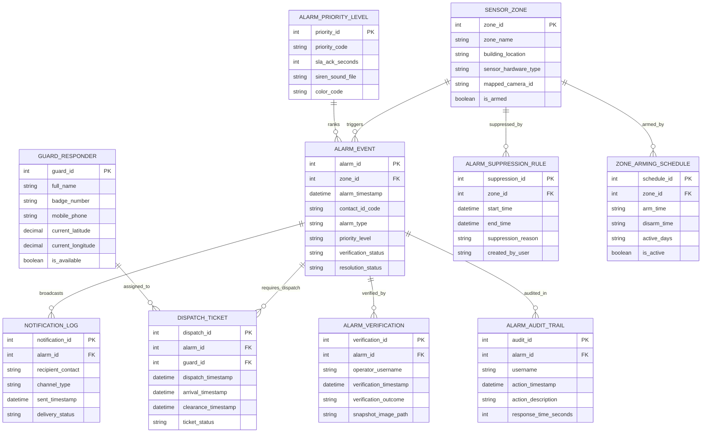

# Conceptual ERD — Alarm & Alert Management System

## Mermaid Code

## Entity Description Table | Bảng mô tả Entity

| # | Entity Name | Vietnamese Name | Description | Key Attributes | Main Relationships |
|---|-------------|-----------------|-------------|----------------|-------------------|
| 1 | ALARM_EVENT | Sự kiện Báo động | Master alarm record capturing contact ID codes, timestamps, priority ratings, and resolution status. | alarm_id, alarm_timestamp, alarm_type, priority_level, resolution_status | Triggered by SENSOR_ZONE; requires DISPATCH_TICKET. |
| 2 | SENSOR_ZONE | Vùng Cảm biến / Khu vực | Stores physical sensor zone definitions, location buildings, sensor types, and camera mapping links. | zone_id, zone_name, building_location, mapped_camera_id, is_armed | Triggers ALARM_EVENT; suppressed by ALARM_SUPPRESSION_RULE. |
| 3 | ALARM_PRIORITY_LEVEL | Cấp độ Ưu tiên Báo động | Defines alarm priority levels (P1-P4), SLA acknowledgment timeouts, siren sound files, and display colors. | priority_id, priority_code, sla_ack_seconds, color_code | Ranks ALARM_EVENT. |
| 4 | DISPATCH_TICKET | Phiếu Phân công Bảo vệ | Tracks guard response dispatches, dispatch timestamps, guard arrival times, and clearance notes. | dispatch_id, dispatch_timestamp, arrival_timestamp, ticket_status | Belongs to ALARM_EVENT and GUARD_RESPONDER. |
| 5 | GUARD_RESPONDER | Nhân viên Bảo vệ Tuần tra | Stores mobile security guard profiles, badge numbers, phone numbers, and live GPS coordinates. | guard_id, full_name, badge_number, current_latitude, is_available | Assigned to DISPATCH_TICKET. |
| 6 | NOTIFICATION_LOG | Nhật ký Thông báo Khan cấp | Logs automated SMS, Push, Email, and Voice notification broadcasts, recipient contacts, and delivery status. | notification_id, recipient_contact, channel_type, delivery_status | Broadcasts from ALARM_EVENT. |
| 7 | ALARM_VERIFICATION | Xác minh Báo động (Audio/Video) | Archives operator video/audio verification outcomes, snapshot image proofs, and timestamps. | verification_id, operator_username, verification_outcome, snapshot_image_path | Belongs to ALARM_EVENT. |
| 8 | ALARM_SUPPRESSION_RULE | Quy tắc Tạm dừng Báo động | Stores temporary alarm mutes for zones undergoing authorized maintenance or construction. | suppression_id, start_time, end_time, suppression_reason | Suppresses SENSOR_ZONE. |
| 9 | ZONE_ARMING_SCHEDULE | Lịch Trình Bật/Tắt Báo động | Configures recurring automated zone arming and disarming schedules (e.g., arm at 7:00 PM weekdays). | schedule_id, arm_time, disarm_time, active_days | Arms SENSOR_ZONE. |
| 10 | ALARM_AUDIT_TRAIL | Nhật ký Kiểm toán Báo động | Captures operator response times, SLA compliance metrics, action descriptions, and audit history. | audit_id, username, action_timestamp, response_time_seconds | Audited in ALARM_EVENT. |

## Relationship Description | Mô tả Quan hệ

| # | From Entity | Cardinality | To Entity | Relationship Label | Business Explanation |
|---|-------------|-------------|-----------|-------------------|----------------------|
| 1 | SENSOR_ZONE | one-to-many | ALARM_EVENT | triggers | A sensor zone can trigger multiple alarm events over time. |
| 2 | ALARM_PRIORITY_LEVEL | one-to-many | ALARM_EVENT | ranks | An alarm priority level ranks multiple alarm events. |
| 3 | ALARM_EVENT | one-to-many | DISPATCH_TICKET | requires_dispatch | An alarm event may require one or more guard response dispatch tickets. |
| 4 | GUARD_RESPONDER | one-to-many | DISPATCH_TICKET | assigned_to | A guard responder is assigned multiple dispatch tickets. |
| 5 | ALARM_EVENT | one-to-many | NOTIFICATION_LOG | broadcasts | An alarm event broadcasts emergency notifications to recipients. |
| 6 | ALARM_EVENT | one-to-many | ALARM_VERIFICATION | verified_by | An alarm event is verified by operators via video/audio snapshots. |
| 7 | SENSOR_ZONE | one-to-many | ALARM_SUPPRESSION_RULE | suppressed_by | A sensor zone can be muted by temporary suppression rules. |
| 8 | SENSOR_ZONE | one-to-many | ZONE_ARMING_SCHEDULE | armed_by | A sensor zone is automatically armed/disarmed by schedules. |
