# Swimlane Diagram — Alarm & Alert Management System

## Mermaid Code

```mermaid
flowchart LR
    Start(["Start Alarm Response Workflow"])

    subgraph Lane1["Physical Alarm Sensor"]
        S1["Detect Motion / Glassbreak Trigger"]
        S2["Transmit Contact ID Protocol Payload"]
    end

    subgraph Lane2["System"]
        C1["Ingest Payload & Match Sensor Zone"]
        C2["Assign Priority Rating (P1-P4)"]
        C3["Display Alarm Tile on Control Console"]
        C4{"Verified Real Threat?"}
        C5["Push Mobile Dispatch Alert & GPS Routing"]
        C6["Log False Alarm & Close Event"]
    end

    subgraph Lane3["Dispatch Operator"]
        O1["Acknowledge Alarm Tile & Mute Siren"]
        O2["Inspect Live Camera Popup & Verification"]
        O3["Confirm Threat & Trigger Guard Dispatch"]
    end

    subgraph Lane4["On-Duty Security Guard"]
        G1["Receive Mobile Dispatch Push Alert"]
        G2["Navigate to Site & Perform Inspection"]
        G3["Tap Clearance Confirmation in App"]
    end

    Finish(["End Alarm Response Process"])

    Start --> S1 --> S2 --> C1 --> C2 --> C3 --> O1 --> O2 --> C4
    C4 -->|"Real Intrusion"| O3 --> C5 --> G1 --> G2 --> G3 --> Finish
    C4 -->|"False Alarm"| C6 --> Finish
```

## Flow Description | Mô tả luồng

| Lane | Actor | Role in Flow |
|------|-------|-------------|
| 1 | Physical Alarm Sensor | Hardware sensor detecting motion/glassbreak and transmitting Contact ID payloads over network socket. |
| 2 | System | Ingests alarm payloads, decodes zone locations, assigns priority ratings (P1-P4), triggers video popups, and sends GPS dispatch alerts to guard smartphones. |
| 3 | Dispatch Operator | Acknowledges active alarm tiles, mutes sirens, conducts video/audio verification, and confirms real threats for guard dispatch. |
| 4 | On-Duty Security Guard | Receives mobile app dispatch alerts, navigates to target zone via GPS, inspects physical site, and taps clearance confirmation. |
