# Action Tree — Alarm & Alert Management System

## Mermaid Code

```mermaid
graph TD
    Root["Alarm & Alert Management System"]

    Root --> M1["Alarm Event Ingestion"]
    Root --> M2["Alarm Verification & Triage"]
    Root --> M3["Dispatch & Guard Routing"]
    Root --> M4["Mass Notification Engine"]
    Root --> M5["Analytics & Performance Audit"]

    M1 --> A1["Decode Contact ID / SIA Payloads"]
    M1 --> A2["Map Hardware Zone to Location"]
    M1 --> A3["Check Cellular Backup Link Status"]
    M1 --> A4["Log Sensor Wire-Cut Tamper"]

    M2 --> B1["Rank P1-P4 Alarm Severity"]
    M2 --> B2["Acknowledge & Mute Siren Tile"]
    M2 --> B3["Pull Live Video Feed Snapshot"]
    M2 --> B4["Log False Alarm Category"]

    M3 --> C1["Query Nearest Guard Mobile GPS"]
    M3 --> C2["Push Mobile App Dispatch Assignment"]
    M3 --> C3["Track Guard En-Route & Arrival"]
    M3 --> C4["Record Site Clearance Confirmation"]

    M4 --> D1["Broadcast Mass Emergency SMS"]
    M4 --> D2["Execute Automated Phone Call Tree"]
    M4 --> D3["Escalate Unacknowledged Operator Alarm"]
    M4 --> D4["Escalate Verified Alarm to 911"]

    M5 --> E1["Audit Operator SLA Response Times"]
    M5 --> E2["Analyze False Alarm Rate Metrics"]
    M5 --> E3["Configure Zone Arming Schedule"]
    M5 --> E4["Set Temporary Zone Suppression"]
```

## Module Description | Mô tả Module

| # | Module | Description | Actions |
|---|--------|-------------|---------|
| 1 | Alarm Event Ingestion | Decodes Contact ID / SIA protocols, maps physical sensor zones, monitors cellular backup links, and logs tamper alerts. | Decode Contact ID / SIA Payloads, Map Hardware Zone to Location, Check Cellular Backup Link Status, Log Sensor Wire-Cut Tamper |
| 2 | Alarm Verification & Triage | Ranks P1-P4 alarm queues, allows operators to acknowledge/mute sirens, displays video snapshots, and logs false alarm reasons. | Rank P1-P4 Alarm Severity, Acknowledge & Mute Siren Tile, Pull Live Video Feed Snapshot, Log False Alarm Category |
| 3 | Dispatch & Guard Routing | Mobile GPS proximity queries, guard smartphone app dispatches, en-route tracking, and site clearance confirmations. | Query Nearest Guard Mobile GPS, Push Mobile App Dispatch Assignment, Track Guard En-Route & Arrival, Record Site Clearance Confirmation |
| 4 | Mass Notification Engine | Mass emergency SMS/Voice broadcasts, supervisor escalation triggers, and verified 911 public emergency service dispatches. | Broadcast Mass Emergency SMS, Execute Automated Phone Call Tree, Escalate Unacknowledged Operator Alarm, Escalate Verified Alarm to 911 |
| 5 | Analytics & Performance Audit | Operator response time SLA auditing, false alarm rate analytics, automated zone arming schedules, and zone suppression rules. | Audit Operator SLA Response Times, Analyze False Alarm Rate Metrics, Configure Zone Arming Schedule, Set Temporary Zone Suppression |
