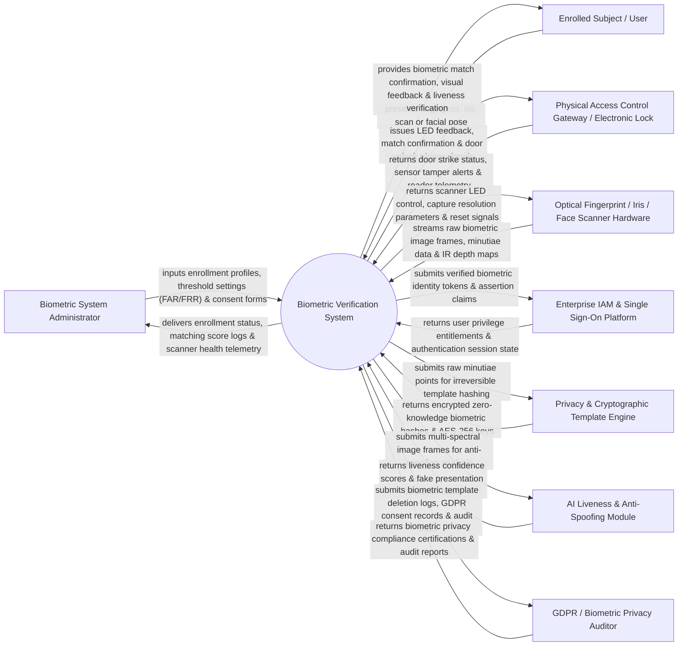

# Context Diagram — Biometric Verification System

## Mermaid Code

## Actor & Interaction Table | Bảng Actor & Tương tác

| # | Actor | Actor Type | Data Sent TO System | Data Received FROM System | Notes |
|---|-------|------------|---------------------|---------------------------|-------|
| 1 | Biometric System Administrator | Primary | Enrollment profiles, threshold settings (FAR/FRR), user consent forms, scanner configurations. | Enrollment status, matching score logs, scanner health telemetry, FAR/FRR metrics. | Administrator overseeing biometric enrollment, sensor calibration, and privacy policy parameters. |
| 2 | Enrolled Subject / User | Primary | Fingerprint, iris scan, 3D facial geometry, liveness pose interaction. | Biometric match confirmation, visual green/red feedback, liveness verification status. | Individual presenting biometric traits for 1:1 verification or 1:N identification. |
| 3 | Physical Access Control Gateway | Supporting | Door strike status, sensor tamper alerts, reader connection telemetry. | LED feedback commands, match confirmation, electronic door strike unlock trigger signals. | Physical security door controller receiving biometric match trigger signals to unlock doors. |
| 4 | Optical Fingerprint / Iris / Face Scanner Hardware | Supporting | Raw biometric image frames, minutiae point vectors, IR depth maps, thermal readings. | Scanner LED control, capture resolution parameters, sensor calibration signals. | Specialized biometric scanner hardware (Suprema, HID Lumidigm, Iris ID) capturing traits. |
| 5 | Enterprise IAM & Single Sign-On Platform | Supporting | User privilege entitlements, authentication session state, role definitions. | Verified biometric identity tokens, SAML/OIDC assertion claims, biometric MFA tokens. | Identity provider receiving biometric authentication claims for multi-factor login. |
| 6 | Privacy & Cryptographic Template Engine | Supporting | Encrypted zero-knowledge biometric hashes, AES-256 keys, template salt values. | Raw minutiae points for irreversible template hashing and secure encryption. | Cryptographic engine ensuring biometric templates cannot be reverse-engineered into raw images. |
| 7 | AI Liveness & Anti-Spoofing Module | Supporting | Liveness confidence scores, fake presentation detection alerts, 3D depth verification. | Multi-spectral image frames, infrared video frames, micro-expression data. | AI module detecting spoofing attempts (printed photos, 3D silicone masks, gel fingerprints). |
| 8 | GDPR / Biometric Privacy Auditor | Supporting / Regulatory | Biometric privacy compliance audit mandates, consent inspection inquiries. | Biometric template deletion logs, GDPR consent records, audit trails, encryption proofs. | Regulatory auditor ensuring compliance with BIPA, GDPR Article 9, and biometric privacy laws. |

## System Boundary Description | Mô tả Phạm vi Hệ thống

The **Biometric Verification System** is an enterprise multi-modal biometric enrollment, 1:1 verification, 1:N identification, AI liveness detection (anti-spoofing), and template encryption platform.

**Inside System Scope:**
- Multi-modal biometric trait processing (Fingerprint minutiae, Iris patterns, 3D Facial geometry).
- 1:1 Authentication Verification (matching user presentation against claimed ID template).
- 1:N Identification Search (matching user presentation against database of N templates).
- AI-driven liveness detection and presentation attack detection (PAD) preventing spoofing attempts.
- Cryptographic template hashing (ANSI/INCITS standards) and GDPR consent-based template deletion.

**Outside System Scope:**
- Direct physical manufacture of optical prism sensors or IR cameras (handled by Hardware Manufacturers).
- Direct physical security guard response to un-verified intruders (handled by Guard Patrol System).
- Direct issuance of physical passport documents (handled by Government Passport Agencies).
