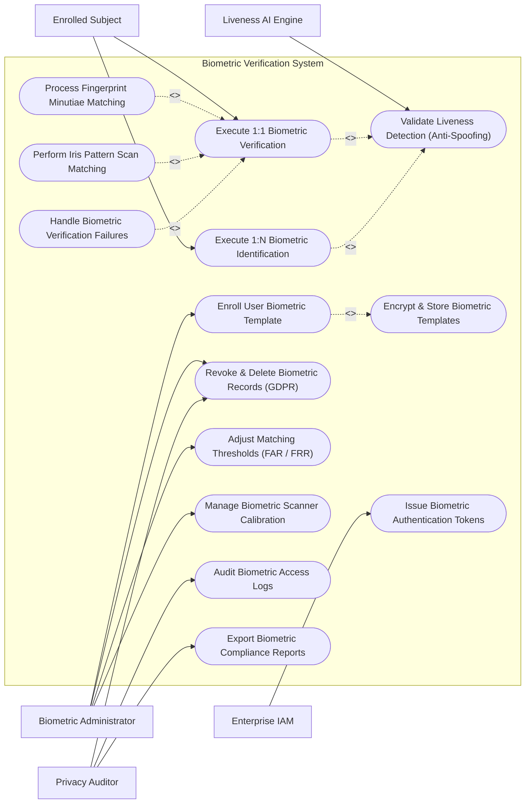

# Use Case Diagram — Biometric Verification System

## Mermaid Code

## Actor Table | Bảng Actor

| # | Actor | Actor Type | Role Description | Related Use Cases |
|---|-------|------------|------------------|-------------------|
| 1 | Biometric Administrator | Primary | Enrolls user templates, manages matching thresholds (FAR/FRR), calibrates scanners, and processes GDPR template deletions. | UC01, UC08, UC09, UC11 |
| 2 | Enrolled Subject | Primary | Presents biometric traits at scanners for 1:1 verification or 1:N identification. | UC02, UC03 |
| 3 | Privacy Auditor | Secondary | Inspects biometric data encryption, template deletion logs, GDPR Article 9 consent records, and audit trails. | UC08, UC12, UC14 |
| 4 | Liveness AI Engine | Supporting / System | Computer vision module analyzing multi-spectral imagery to detect presentation spoofing attacks. | UC06 |
| 5 | Enterprise IAM | Supporting / System | Central identity system receiving biometric verification tokens for multi-factor login. | UC13 |

## Use Case Table | Bảng Use Case

| # | UC ID | Use Case Name | Primary Actor | Secondary Actor | Description | Priority |
|---|-------|---------------|---------------|-----------------|-------------|----------|
| 1 | UC01 | Enroll User Biometric Template | Biometric Admin | Enrolled Subject | Captures multi-modal biometric traits, extracts minutiae points, and generates an encrypted biometric template. | High |
| 2 | UC02 | Execute 1:1 Biometric Verification | Enrolled Subject | Liveness Engine | Compares live biometric trait against user specific claimed template to verify identity claim. | High |
| 3 | UC03 | Execute 1:N Biometric Identification | Enrolled Subject | Liveness Engine | Compares live biometric trait against entire database of templates to identify an unknown subject. | High |
| 4 | UC04 | Process Fingerprint Minutiae Matching | Enrolled Subject | None | Extracts ridge endings and bifurcations (ISO/IEC 19794-2) and calculates match probability score. | High |
| 5 | UC05 | Perform Iris Pattern Scan Matching | Enrolled Subject | None | Analyzes infrared iris texture patterns (Daugman algorithm) for high-accuracy match scoring. | High |
| 6 | UC06 | Validate Liveness Detection (Anti-Spoofing) | Liveness Engine | Enrolled Subject | Analyzes skin reflectance, IR depth, micro-expressions, or blood pulse to reject fake photos or silicone masks. | High |
| 7 | UC07 | Encrypt & Store Biometric Templates | Biometric Admin | Privacy Engine | Applies irreversible hashing and AES-256 encryption to stored biometric templates to prevent template theft. | High |
| 8 | UC08 | Revoke & Delete Biometric Records (GDPR) | Biometric Admin | Privacy Auditor | Permanently purges user biometric templates upon consent revocation or employee termination (GDPR Right to Erasure). | High |
| 9 | UC09 | Adjust Matching Thresholds (FAR / FRR) | Biometric Admin | None | Configures False Acceptance Rate (FAR) and False Rejection Rate (FRR) thresholds based on security level requirements. | Medium |
| 10 | UC10 | Handle Biometric Verification Failures | Enrolled Subject | Biometric Admin | Triggers secondary authentication fallback (PIN/Smartcard) when biometric matching falls below threshold. | Medium |
| 11 | UC11 | Manage Biometric Scanner Calibration | Biometric Admin | Scanner Hardware | Monitors optical lens cleanliness, illumination intensity, and sensor calibration status. | Low |
| 12 | UC12 | Audit Biometric Access Logs | Privacy Auditor | None | Logs all verification attempts, match scores, timestamp records, and administrator edits without storing raw biometric images. | Medium |
| 13 | UC13 | Issue Biometric Authentication Tokens | Enterprise IAM | Enrolled Subject | Issues cryptographically signed assertion token upon successful biometric verification for SSO access. | High |
| 14 | UC14 | Export Biometric Compliance Reports | Privacy Auditor | Biometric Admin | Generates privacy compliance reports detailing template count, encryption standards, and consent records. | Medium |

## Use Case Specification | Đặc tả Use Case

---

### UC01 — Enroll User Biometric Template

| Field | Detail |
|-------|--------|
| **UC ID** | UC01 |
| **Use Case Name** | Enroll User Biometric Template |
| **Actor(s)** | Primary: Biometric Administrator   Secondary: Enrolled Subject |
| **Description** | Captures high-quality biometric sample (fingerprint/iris/face), extracts mathematical minutiae features, obtains user consent, and stores an encrypted template. |
| **Precondition** | 1. Enrolled subject identity is verified using official government ID.   2. Biometric scanner is calibrated and online. |
| **Main Flow** | 1. Administrator creates enrollment session for target subject.   2. System displays Biometric Privacy & GDPR Consent Form on touch tablet.   3. Subject signs digital consent form agreeing to biometric template processing.   4. Administrator prompts subject to place finger on optical scanner 3 consecutive times.   5. System captures 500 DPI image frames, checks image quality score (NFIQ 2 > 70), and extracts minutiae vector points.   6. System converts minutiae points into mathematical template hash (ANSI 378 / ISO 19794).   7. System encrypts template using AES-256, binds template to User ID, and discards raw optical image.   8. System saves encrypted template in secure biometric database. |
| **Alternative Flow** | **AF1** — Multi-Modal Enrollment: System captures fingerprint AND iris scan for dual-factor high-security enrollment. |
| **Exception Flow** | **EX1** — Poor Sample Quality: System detects low NFIQ score (e.g., dry or worn fingerprint), prompts administrator to clean sensor lens or try another finger. |
| **Postcondition** | Encrypted biometric template is created and bound to user identity record. |
| **Business Rule** | **BR1**: Raw biometric images shall be permanently deleted from system memory immediately following minutiae template extraction. |

---

### UC02 — Execute 1:1 Biometric Verification

| Field | Detail |
|-------|--------|
| **UC ID** | UC02 |
| **Use Case Name** | Execute 1:1 Biometric Verification |
| **Actor(s)** | Primary: Enrolled Subject   Secondary: Liveness AI Engine |
| **Description** | Verifies a user's claimed identity by comparing their live presented biometric sample against their specific pre-stored enrollment template (1:1 Match). |
| **Precondition** | 1. User claims identity (e.g., enters Employee ID or taps smartcard badge).   2. User pre-stored biometric template exists in database. |
| **Main Flow** | 1. User enters Employee ID `10942` at biometric reader.   2. System retrieves encrypted template for ID `10942`.   3. User presents finger/face to biometric scanner.   4. System executes UC06 Validate Liveness Detection to confirm live human presentation.   5. System extracts live minutiae vector from presented sample.   6. System computes Match Probability Score (0 to 1000) comparing live sample against template `10942`.   7. System checks score against FAR threshold (e.g., Match Score 850 >= Required Threshold 700).   8. System confirms match, displays "VERIFICATION SUCCESSFUL", and issues door unlock or SSO token. |
| **Alternative Flow** | **AF1** — Smartcard On-Card Matching (MoC): Live minutiae is matched directly inside smartcard chip memory without sending template across network. |
| **Exception Flow** | **EX1** — Match Score Below Threshold: System records match score 450 (below 700 threshold), displays "VERIFICATION FAILED", and prompts for retry or PIN fallback. |
| **Postcondition** | 1:1 identity verification outcome is logged and access decision is executed. |
| **Business Rule** | **BR1**: 1:1 verification matching processing time must execute within 500 milliseconds. |

---

### UC03 — Execute 1:N Biometric Identification

| Field | Detail |
|-------|--------|
| **UC ID** | UC03 |
| **Use Case Name** | Execute 1:N Biometric Identification |
| **Actor(s)** | Primary: Enrolled Subject   Secondary: Liveness AI Engine |
| **Description** | Identifies an unknown subject by searching their live presented biometric sample against a database of N enrolled templates (1:N Search). |
| **Precondition** | 1. Subject does not present a claimed ID or badge.   2. Enrolled template database is indexed for fast vector search. |
| **Main Flow** | 1. Subject approaches facial recognition camera or places finger on reader without tapping card.   2. System executes UC06 Validate Liveness Detection.   3. System extracts live biometric feature vector.   4. System executes 1:N vector search against 50,000 enrolled database templates using GPU acceleration.   5. System finds candidate match `ID: 8841` with highest match score (e.g., 960).   6. System confirms candidate score exceeds 1:N identification threshold (e.g., 850).   7. System identifies subject as "John Doe (ID 8841)" and logs successful identification event. |
| **Alternative Flow** | **AF1** — Multi-Candidate Selection: If two templates return close top scores, system prompts administrator to review secondary verification. |
| **Exception Flow** | **EX1** — Unidentified Subject: If no candidate template meets threshold, system logs "NO MATCH FOUND - UNIDENTIFIED SUBJECT" and triggers security alert. |
| **Postcondition** | Subject identity is resolved from 1:N database search and logged. |
| **Business Rule** | **BR1**: 1:N identification search across 50,000 templates must complete in less than 1.5 seconds. |

---

### UC06 — Validate Liveness Detection (Anti-Spoofing)

| Field | Detail |
|-------|--------|
| **UC ID** | UC06 |
| **Use Case Name** | Validate Liveness Detection (Anti-Spoofing) |
| **Actor(s)** | Primary: Liveness AI Engine   Secondary: Enrolled Subject |
| **Description** | Evaluates multi-spectral optical, infrared, or 3D depth sensor data to detect fake biometric presentation attacks (spoofing). |
| **Precondition** | 1. Biometric scanner is equipped with liveness sensors (IR camera, thermal sensor, or multi-spectral LED). |
| **Main Flow** | 1. Subject presents trait (face or finger) to sensor.   2. Liveness AI Engine ingests multi-spectral light absorption, IR reflection, and 3D depth topography data.   3. Engine analyzes liveness markers:     a. Facial: Micro-blink, 3D nose depth, skin pulse blood flow (rPPG).     b. Fingerprint: Moisture distribution, sub-dermal ridge pattern, capacitance.   4. Engine calculates Liveness Score (0.0 to 1.0).   5. If Liveness Score exceeds 0.85, engine returns "LIVENESS VERIFIED - REAL HUMAN".   6. System proceeds to biometric template matching. |
| **Alternative Flow** | **AF1** — Interactive Liveness Challenge: System prompts user to perform a random motion (e.g., "Blink twice and turn head right") to verify live interaction. |
| **Exception Flow** | **EX1** — Presentation Attack Detected (Spoof): Engine detects flat 2D printed photo or silicone mask, returns "SPOOF DETECTED", blocks transaction, and triggers alert. |
| **Postcondition** | Presentation sample is validated as authentic live human tissue or rejected as a spoof. |
| **Business Rule** | **BR1**: Presentation Attack Detection (PAD) must comply with ISO/IEC 30107-3 anti-spoofing evaluation standards. |

---

### UC07 — Encrypt & Store Biometric Templates

| Field | Detail |
|-------|--------|
| **UC ID** | UC07 |
| **Use Case Name** | Encrypt & Store Biometric Templates |
| **Actor(s)** | Primary: Biometric Admin   Secondary: Privacy Engine |
| **Description** | Converts feature minutiae vectors into zero-knowledge, irreversible mathematical templates and encrypts them using AES-256 GCM. |
| **Precondition** | 1. Feature minutiae extraction is complete. |
| **Main Flow** | 1. System receives raw minutiae point vector from enrollment session.   2. Privacy Engine applies non-invertible mathematical transform (Cancellable Biometrics / Bio-Hashing) using a unique per-user salt.   3. Engine verifies that the resulting template format cannot be reverse-engineered to reconstruct the original fingerprint image.   4. System encrypts the transformed template using AES-256 GCM with HSM-managed keys.   5. System writes encrypted template payload to database.   6. System logs template encryption timestamp and key ID in audit trail. |
| **Alternative Flow** | **AF1** — Cancel & Re-Key Template: If a template is compromised, system revokes old salt key, applies new salt, and generates a fresh non-matching template version. |
| **Exception Flow** | **EX1** — HSM Key Access Failure: System detects HSM key management failure, blocks template storage, and alerts administrator. |
| **Postcondition** | Irreversible, AES-256 encrypted biometric template is stored securely. |
| **Business Rule** | **BR1**: Reconstructing an optical biometric image from a stored template format shall be mathematically impossible. |
